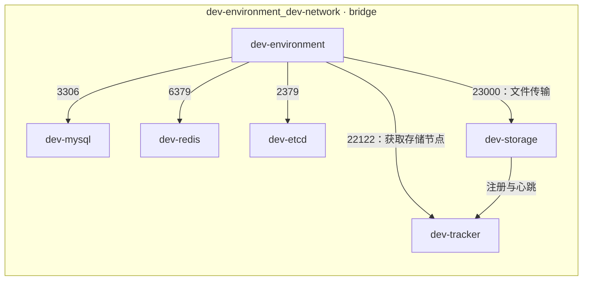

# chat2data-cpp

A C++ microservices project for AI-powered Excel and database querying using natural language, with Docker-based development and deployment.

## 1. 安装环境

### 1. 环境定位

本项目使用 Docker Compose 管理 C++ 开发环境及依赖的中间件，统一编译环境、服务访问地址和端口映射。

业务代码由 `chat2data-cpp` 仓库维护，在开发容器内完成编译、调试和运行。基础开发组合包含六个容器：

- C++ 开发容器；
- MySQL；
- Redis；
- ETCD；
- FastDFS Tracker；
- FastDFS Storage。

环境还提供 RabbitMQ、Elasticsearch 和 Kibana，可按实际开发需求启动。属于**开发环境与基础设施脚手架**。它为项目开发提供基础条件，业务模块、接口和数据库结构由项目自行实现。

### 2. 容器构成与端口

| Compose 服务名        | 容器名称                  | 职责                         | Ubuntu 端口 → 容器端口                      |
| --------------------- | ------------------------- | ---------------------------- | -------------------------------------------- |
| `dev-environment`   | `dev-env-service`       | C++ 编译、调试及业务进程运行 | `2222 → 22`；`9000–9009 → 9000–9009` |
| `dev-mysql`         | `mysql-service`         | 关系型数据存储               | `3308 → 3306`                             |
| `dev-redis`         | `redis-service`         | 缓存、会话等临时数据管理     | `6380 → 6379`                             |
| `dev-etcd`          | `etcd-service`          | 服务注册与发现               | `2379 → 2379`；`2380 → 2380`           |
| `dev-tracker`       | `fdfs-tracker-service`  | FastDFS 存储节点管理与定位   | `22122 → 22122`                           |
| `dev-storage`       | `fdfs-storage-service`  | FastDFS 文件存储             | `23000 → 23000`                           |
| `dev-rabbitmq`      | `rabbitmq-service`      | 消息队列；管理界面           | `5672 → 5672`；`15672 → 15672`         |
| `dev-elasticsearch` | `elasticsearch-service` | 搜索与索引；节点通信         | `9200 → 9200`；`9300 → 9300`           |
| `dev-kibana`        | `kibana-service`        | Elasticsearch 可视化管理     | `5601 → 5601`                             |

补充说明：

- Ubuntu 的 SSH 端口 `22` 属于虚拟机自身，不是 Docker 端口映射。
- `2222` 映射到开发容器的 SSH 服务，其登录配置与 Ubuntu SSH 独立。
- `9000–9009` 是开发容器中的预留业务端口。端口映射不会自动启动业务程序，具体用途由项目后续规划。
- ETCD 的 `2379` 用于客户端访问，`2380` 用于节点间通信；单节点开发主要使用 `2379`。

Compose 命令使用**服务名**，例如 `dev-mysql`；`docker exec` 使用**容器名称**，例如 `mysql-service`。

### 3. 网络

所有容器连接到同一个 Docker 网络：

```text
Compose 网络标识：dev-network
实际网络名称：dev-environment_dev-network
网络驱动：bridge
```

同一网络中的容器通过服务名和容器内部端口通信，避免依赖可能变化的容器 IP。[Docker Compose 网络说明](https://docs.docker.com/compose/how-tos/networking/)

基础开发组合的通信关系如下：



### 4. 目录

环境仓库的主要目录如下：

```text
bite-dev-environment/
├── docker-compose.yml
├── dockerfile
├── dev-environment/
│   └── workspace/
│       └── chat2data-cpp/       # 自主开发的项目仓库
├── mysql/
│   ├── my.cnf
│   └── sql.d/                   # 可选的首次初始化 SQL
├── redis/
│   └── redis.conf
├── fastdfs/
├── rabbitmq/
├── elasticsearch/
└── kibana/
```

主要挂载关系：

| 宿主机路径，相对于环境仓库      | 容器内路径                      | 用途                 |
| ------------------------------- | ------------------------------- | -------------------- |
| `./dev-environment/workspace` | `/home/dev/workspace`         | 源码及构建文件共享   |
| `./mysql/my.cnf`              | `/etc/my.cnf`                 | MySQL 配置           |
| `./mysql/sql.d`               | `/docker-entrypoint-initdb.d` | MySQL 首次初始化脚本 |
| `./redis/redis.conf`          | `/usr/local/etc/redis.conf`   | Redis 配置           |
| `/etc/localtime`              | `/etc/localtime`，只读        | 时间配置同步         |

源码采用绑定挂载。修改容器中的项目文件，会直接修改宿主机上的对应文件；构建产生的文件也会保存在映射目录中。[Docker 绑定挂载说明](https://docs.docker.com/engine/storage/bind-mounts/)

MySQL 不要求预先存在项目建表 SQL。没有业务 SQL 时，可以先启动 MySQL，再随着开发进度创建数据库和表。

`sql.d` 中的初始化脚本仅在首次初始化空数据库数据目录时执行。数据库已经初始化后，新加入的脚本应手动导入或通过迁移工具执行。[MySQL 初始化说明](https://hub.docker.com/_/mysql#initializing-a-fresh-instance)

**源码和配置文件的挂载，不等于中间件数据持久化。**当前 Compose 未显式声明 MySQL、Redis、ETCD、FastDFS 的持久化数据卷。镜像可能自带匿名卷，但正式保存业务数据前，应明确配置数据卷及备份方式。

### 5. 使用方法

以下 Compose 命令均在 Ubuntu 的环境仓库目录中执行：

```bash
# 将路径替换为实际环境仓库位置
cd /path/to/bite-dev-environment

# 检查配置语法；正常时没有输出
docker compose -f docker-compose.yml config --quiet
```

#### 5.1 启动完整开发环境

```bash
# 准备 SQL 挂载目录，可以暂时为空
mkdir -p mysql/sql.d

# 创建并在后台启动全部 9 个环境容器，自动拉取缺失的镜像
docker compose -f docker-compose.yml up -d

# 查看全部容器，包括启动失败或已停止的容器
docker compose -f docker-compose.yml ps -a
```

完整启动时，`up -d` 后不指定服务名。成功后应看到 `dev-env-service`、`mysql-service`、`redis-service`、`etcd-service`、`fdfs-tracker-service`、`fdfs-storage-service`、`rabbitmq-service`、`elasticsearch-service` 和 `kibana-service` 共 9 个容器。首次启动需要下载多个镜像；容器已经运行时，部分服务还需要等待初始化或健康检查完成。[Docker Compose 启动说明](https://docs.docker.com/reference/cli/docker/compose/up/)

如果执行 `up -d dev-environment`，只会启动开发容器及其声明的依赖。当前开发容器没有声明其他服务为依赖，因此不会自动启动其余 8 个容器。

这份 Compose 管理的是开发环境及中间件。业务网关（例如 `gateway-service`）、AI 等业务服务需要由项目另行编译和启动，不包含在上述 9 个环境容器中。

进入开发容器及项目目录：

```bash
docker exec -it --user dev --workdir /home/dev/workspace/chat2data-cpp dev-env-service bash
```

在容器内检查开发工具：

```bash
pwd
g++ --version
cmake --version
protoc --version
```

输入 `exit` 返回 Ubuntu 终端。退出终端不会停止容器。

#### 5.2 启动基础中间件

在 Ubuntu 的环境仓库目录中执行：

```bash
# 准备 SQL 挂载目录，可以暂时为空
mkdir -p mysql/sql.d

docker compose -f docker-compose.yml up -d dev-mysql dev-redis dev-etcd dev-tracker dev-storage
```

需要扩展中间件时再启动：

```bash
docker compose -f docker-compose.yml up -d dev-rabbitmq dev-elasticsearch dev-kibana
```

#### 5.3 查看状态与日志

```bash
docker compose -f docker-compose.yml ps

docker compose -f docker-compose.yml logs --tail 100 dev-mysql

docker compose -f docker-compose.yml logs -f --tail 100 dev-environment
```

跟踪日志时，按 `Ctrl+C` 结束查看，不会停止后台容器。

#### 5.4 验证中间件连接

MySQL：

```bash
docker exec -it mysql-service mysql -uroot -p
```

Redis：

```bash
docker exec -it redis-service redis-cli --askpass ping
```

ETCD：

```bash
docker exec etcd-service etcdctl --endpoints=http://127.0.0.1:2379 endpoint health
```

数据库密码通过交互输入，不写入 README 或命令参数。

#### 5.5 停止、恢复与重启

```bash
# 停止开发容器
docker compose -f docker-compose.yml stop dev-environment

# 恢复已创建的开发容器
docker compose -f docker-compose.yml start dev-environment

# 重启指定中间件
docker compose -f docker-compose.yml restart dev-mysql
```

修改 Compose 配置后，应重新执行对应服务的 `up -d`。单纯执行 `restart` 不会应用新增的环境变量等配置变更。[Docker 重启命令说明](https://docs.docker.com/reference/cli/docker/compose/restart/)
