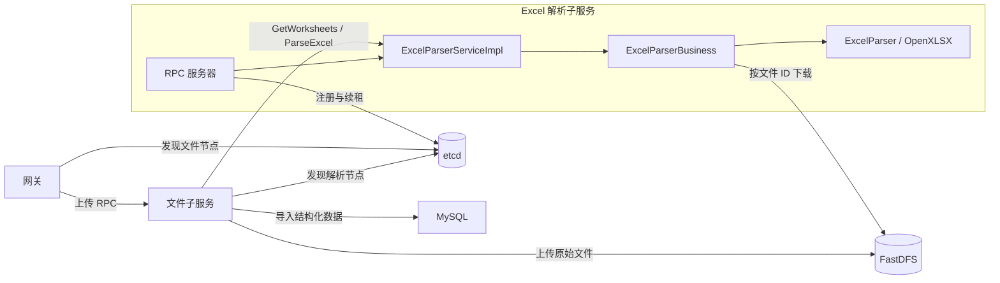

# Excel 解析子服务设计

## 1. 结构设计

Excel 解析子服务由文件子服务通过 brpc 调用，提供工作表名称查询和结构化数据解析。文件子服务负责原文件存储，并将解析结果交给存储服务入库。浏览器通过网关发起上传。 [网关子服务](网关子服务.md)

| 组件                                                | 职责                                                           |
| --------------------------------------------------- | -------------------------------------------------------------- |
| `ExcelParserServerBuilder`、`ExcelParserServer` | 组装 FastDFS 客户端、业务对象和 RPC 服务，管理监听与 etcd 注册 |
| `ExcelParserServiceImpl`                          | 校验 RPC 请求，把业务结果转换为协议响应                        |
| `ExcelParserBusiness`                             | 按 FastDFS 文件 ID 下载工作簿、管理临时文件并组织解析结果      |
| `ExcelParser`                                     | 使用 OpenXLSX 打开工作簿、读取单元格并组织工作表响应           |
| `excelColumn.cpp`                                 | 规范化列名，识别文本和数字格式，按列汇总样本类型               |



### 1.1 上传与解析链路

解析请求使用 FastDFS 文件 ID，因此文件子服务先在 FastDFS 保存原文件。两个解析 RPC 各自读取该 ID 对应的工作簿，同一次上传的两个请求可以由不同解析节点处理。


文件子服务负责将**导入映射、完成时间及就绪状态一起提交**。工作表映射的存储和读取顺序见 [文件子服务设计](文件子服务.md#34-文件查询预览与下载)。

## 2. 接口设计

协议定义在 [excelParseService.proto](../proto/excelParseService.proto)，使用项目统一的包名 `chat2Data` 和[接口设计](接口设计.md#23-excel解析子服务)中的服务名 `ExcelParserService`。启用 C++ 通用服务接口以供 brpc 生成服务端基类和调用端存根。

两条 RPC 都接收非空的 `request_id` 和 `fdfs_file_id`。文件 ID 使用 FastDFS 返回的完整标识。响应原样返回请求 ID，`error_code = 0` 表示业务成功，此时 `error_msg` 为空。调用方同时检查 brpc 传输状态和业务错误码。

| RPC 方法          | 请求字段                                                   | 成功结果                                            |
| ----------------- | ---------------------------------------------------------- | --------------------------------------------------- |
| `GetWorksheets` | `request_id`、`fdfs_file_id`                           | `worksheets` 为按工作簿顺序排列的工作表名称       |
| `ParseExcel`    | `request_id`、`fdfs_file_id` 和待解析的 `worksheets` | `worksheets` 为按请求顺序排列的 `WorksheetData` |

- `GetWorksheets` 返回可解析的工作表名称，工作簿没有工作表时返回业务错误。
- 调用方解析整个工作簿时，把该列表交给 `ParseExcel`。
- 解析请求至少包含一个非空名称，按工作表原始名称精确匹配。任一请求项解析失败时返回业务错误，结果列表为空。

| 结构              | 字段和语义                                                                                                                  |
| ----------------- | --------------------------------------------------------------------------------------------------------------------------- |
| `WorksheetData` | `name` 是工作表原名。 `columns` 和 `rows` 按原顺序返回。 `total_rows` 包含首行表头，`total_cols` 为解析范围的列数 |
| `ColumnInfo`    | `name` 是整理后的列名，`type` 是 `TEXT`、`BIGINT`、`DOUBLE`、`BOOLEAN` 或 `DATE`                              |
| `RowData`       | `cells` 保留列顺序和空单元格。每行单元格数量等于 `total_cols`                                                           |
| `CellData`      | `value` 是单元格的文本表示，`type` 是 `Empty`、`Integer`、`Float`、`Boolean`、`String` 或 `Error`           |

### 2.1 错误返回

| 错误码                               | 含义                                                                   |
| ------------------------------------ | ---------------------------------------------------------------------- |
| `EXCEL_INVALID_INPUT`（400）       | 请求 ID、FastDFS 文件 ID 或工作表参数无效                              |
| `EXCEL_DOWNLOAD_FAILED`（401）     | FastDFS 下载失败                                                       |
| `EXCEL_WORKBOOK_INVALID`（402）    | 工作簿打不开、格式无效或没有工作表                                     |
| `EXCEL_WORKSHEET_NOT_FOUND`（403） | 指定工作表名称不存在                                                   |
| `EXCEL_EMPTY_WORKSHEET`（404）     | 指定工作表没有可解析的结构                                             |
| `EXCEL_PARSE_FAILED`（405）        | 解析失败，例如数字或共享字符串索引无效，或表格范围超出初步响应大小限制 |

启动配置、etcd 探测、监听和注册错误使用 406 至 409。RPC 层使用 `brpc::ClosureGuard` 完成响应，BreezeLog 记录方法、请求 ID、工作表数量或错误码。 [公共错误码](../common/errorHandler.hpp)

## 3. 业务流程

### 3.1 `.xlsx` 文件结构

`.xlsx` 是一个 ZIP 包，内部 XML 按 Office Open XML 的 SpreadsheetML 规则保存工作簿。制表人看到的工作表顺序来自工作簿清单，单元格坐标、实际值和显示格式存放在不同位置。 [SpreadsheetML 文档结构](https://learn.microsoft.com/en-us/office/open-xml/spreadsheet/structure-of-a-spreadsheetml-document)

| 常见路径                       | 数据及作用                                                 |
| ------------------------------ | ---------------------------------------------------------- |
| `[Content_Types].xml`        | 声明 ZIP 包中各部分的类型                                  |
| `xl/workbook.xml`            | 保存工作表名称、顺序和关系 ID                              |
| `xl/_rels/workbook.xml.rels` | 将工作表的关系 ID 指向工作表 XML                           |
| `xl/worksheets/sheet1.xml`   | `sheetData` 保存行和单元格，`mergeCells` 保存合并范围  |
| `xl/sharedStrings.xml`       | 可选字符串表，单元格可以按从零起算的索引引用文本           |
| `xl/styles.xml`              | 保存样式及数字格式，日期、时间、百分比和货币的显示会用到它 |

项目的「销售记录」样本中，第二行含有以下两个节点。 [示例工作簿](../tests/svc_excelParserService/fixtures/multipleWorksheets.xlsx)

```xml
<c r="A2" t="s"><v>5</v></c>
<c r="D2" t="b"><v>1</v></c>
```

- `r` 表示坐标。工作表可省略空节点，行和单元格也可以省略各自的坐标属性。解析时用显式坐标定位稀疏数据，并按顺序补全省略的坐标。 [单元格结构](https://learn.microsoft.com/en-us/dotnet/api/documentformat.openxml.spreadsheet.cell)
- `t` 表示数据类型。A2 的 `t="s"` 将 `5` 解释成共享字符串索引，读到「键盘」。D2 的 `t="b"` 将 `1` 解释成布尔真。内联字符串存于 `<is>`，带富文本格式时文字可分布在多个 `<r><t>` 中。 [共享字符串](https://learn.microsoft.com/en-us/office/open-xml/spreadsheet/working-with-the-shared-string-table) · [单元格类型](https://learn.microsoft.com/en-us/dotnet/api/documentformat.openxml.spreadsheet.cellvalues)
- `s` 表示样式索引。比如数值 `0.15` 结合百分比格式会显示成 `15%`。日期序列也利用数字格式来显示，换算日历日期时还要考虑工作簿的 1900 或 1904 日期系统。 [自定义数字格式](https://support.microsoft.com/en-us/excel/review-guidelines-for-customizing-a-number-format) · [Excel 日期系统](https://support.microsoft.com/en-us/excel/date-systems-in-excel)
- `<f>` 保存公式，`<v>` 可保存上一次计算的结果。解析服务读取现有缓存，缺失缓存的公式单元格按 `Empty` 返回。 [公式缓存](https://learn.microsoft.com/en-us/office/open-xml/spreadsheet/working-with-formulas)

### 3.2 下载和打开工作簿

业务层复用 `Breezefdfs::FDFSClient::download_to_file`。每次 RPC 创建自己的临时文件，将同一请求涉及的工作表从该副本读取。用资源作用域管理文件和工作簿，保证并发请求使用不同路径，并在成功、下载失败或解析异常时清理临时文件。


OpenXLSX 负责打开 ZIP 工作簿、解析工作表关系、读取样式和共享字符串。调用 `worksheetNames()` 可取得工作表名称。解析指定工作表时，服务通过 OpenXLSX 的 XML 节点访问已存储的单元格，以便区分显式空单元格、公式缺失缓存和内联富文本。 [Excel 解析器](../svc_excelParseService/excelParser.cpp)

### 3.3 工作表结构与数据


1. **确定范围**。第一遍遍历工作表 XML。保留显式记录的空格子，跳过只有显示样式的格子。合并区域以左上角格保存内容，右下角参与计算表格范围。工作表完全无结构时返回 404 业务错误。只有表头时，`total_rows` 为 1，数据行列表为空。
2. **回填数据**。每个数据行预留 `total_cols` 个单元格，初始类型为 `Empty`。第二遍将第一行用作表头，第二行起按原始坐标写入数据，保留中间空行和空字段。布尔值写成 `1` 或 `0`，整数用十进制表示，浮点数保持可往返转换的精度。普通文本保留空白和前导零，内联富文本按原顺序拼接，错误值保留例如 `#DIV/0!` 的文本。
3. **整理列名**。空表头用 `column_<列号>`，列号从 1 开始。数字开头加 `column_`。保留 ASCII 字母、数字、下划线、美元符号和允许的 BMP 汉字，其余字符替换为下划线。按 UTF‑8 字符边界截至 64 个字符，再按不区分 ASCII 大小写的规则追加后缀，后缀计入长度。
4. **推断列类型**。读数据时统计第 2 至第 101 行，超出采样范围的数据仍完整回传。空单元格、错误值、空白文本和不区分大小写的 `N/A` 跳过统计。文本依次尝试有限数值、布尔值、日期，纯数字编号的前导零保留。日期文本校验闰年、天数和时分秒。数值样式通过索引取得内置格式 ID 或自定义格式代码，据此识别日期和时间，单元格保留日期序列原文。百分比、货币和科学计数法以数值处理。
5. **组装响应**。每列采用票数最高的类型，无有效样本或票数并列时用 `TEXT`。通过校验的日期文本列可使用 `DATE`，日期时间列及含日期序列的日期列使用 `TEXT`。工作表原名、列名、列提示和单元格类型分别保存。到达 brpc 消息限制时，调用方还需检查传输状态。

以编号列为例，文本 `00123` 作为文本样本参与推断，响应同时保留其 `String` 类型和原值。对于文本 `123`，列推断会统计为浮点样本，单元格响应仍为 `String`。 [列名与采样实现](../svc_excelParseService/excelColumn.cpp)

## 4. 程序主流程

1. 入口解析 gflags，配置 BreezeLog，安装 `SIGINT` 和 `SIGTERM` 处理函数。 [服务入口](../svc_excelParseService/main.cpp)
2. 构建器校验配置并探测 etcd，初始化 FastDFS，再创建业务对象和 RPC 服务。
3. brpc 监听成功后，通过 BreezeKit 的 `SvcProvider` 注册。默认以 `/excelService/节点标识` 为键，值为调用方可访问的 RPC 地址，租约持续续期。
4. 主线程收到退出信号后先停止续租，再停止监听并等待在途 RPC，最后释放实现对象和进程内 FastDFS 客户端。 [服务器实现](../svc_excelParseService/excelParserServer.cpp) · [通知子服务](通知子服务.md)

## 5. 配置、编译和运行

### 5.1 启动参数

| 参数                                                   | 默认值                                      | 说明                                         |
| ------------------------------------------------------ | ------------------------------------------- | -------------------------------------------- |
| `--excel_port`                                       | `9003`                                    | brpc 监听端口                                |
| `--excel_service`                                    | `excelService`                            | etcd 注册名                                  |
| `--excel_address`                                    | 空值时使用 `dev-env-service:<excel_port>` | 注册给调用方的 RPC 地址                      |
| `--registry_address`                                 | `http://dev-etcd:2379`                    | etcd 注册端点                                |
| `--fdfs_trackers`                                    | `dev-tracker:22122`                       | FastDFS Tracker 地址列表，多个地址用逗号分隔 |
| `--fdfs_connect_timeout`、`--fdfs_network_timeout` | 各 `30` 秒                                | FastDFS 连接和网络读写超时                   |
| `--log_level`                                        | `info`                                    | BreezeLog 日志级别                           |

### 5.2 编译与启动

在开发容器的项目目录构建。服务使用 C++17、工作区的 OpenXLSX 和 BreezeKit，并链接 `excel_parse_service_proto`。启动前确认 etcd 和 FastDFS 可从开发容器访问。 [服务 CMake](../svc_excelParseService/CMakeLists.txt)

```bash
cmake -S . -B build -DBUILD_TESTING=ON
cmake --build build --target excel_parse_service
./build/svc_excelParseService/excel_parse_service
```

## 6. 测试

- 工作簿测试覆盖多表顺序、稀疏坐标、合并单元格、显式空值、表头规范、类型采样及公式缓存。格式样本覆盖内联富文本、ISO 日期、日期序列、货币、百分比、累计时间和科学计数法。 [解析测试](../tests/svc_excelParserService/excelParser_test.cpp)
- RPC 测试启动回环 brpc 服务，请求经过真实业务和解析层。测试下载入口提供可重复的样本和失败场景，覆盖工作表列表、指定工作表、整次失败清空结果及临时文件清理。 [RPC 测试](../tests/svc_excelParserService/excelParserServiceImpl_test.cpp)

```bash
cmake --build build --target excel_parser_test
ctest --test-dir build -R '^excel_parser_test$' --output-on-failure
```
