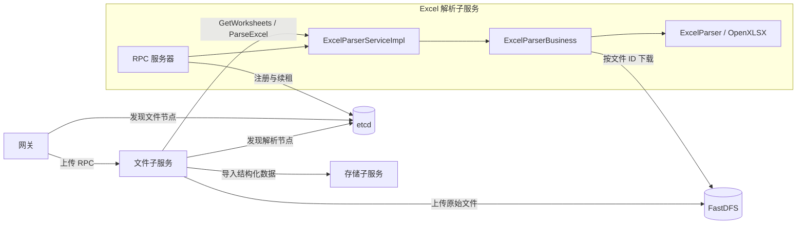
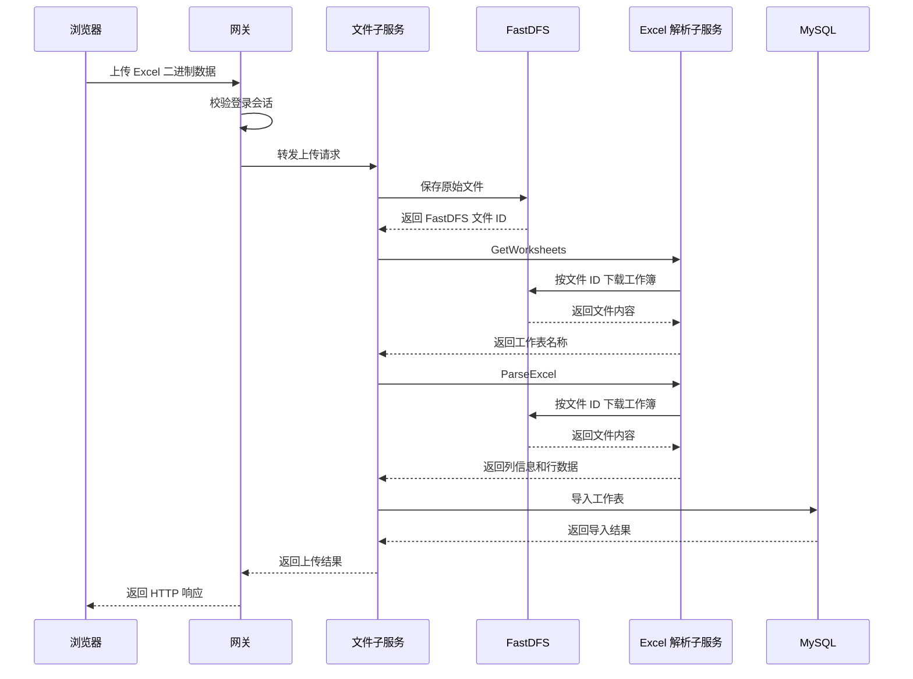
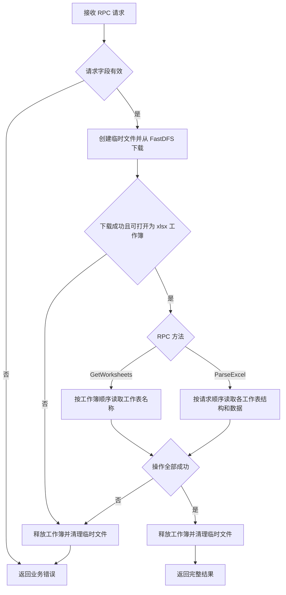
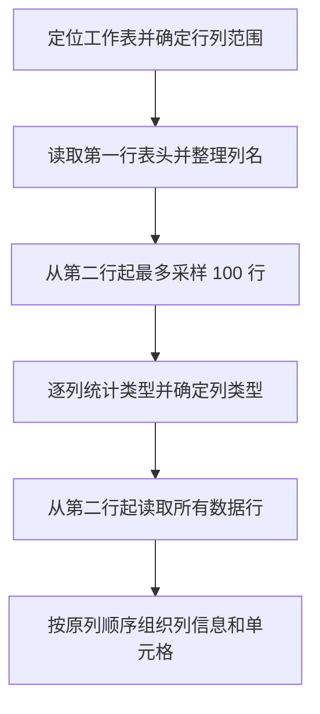
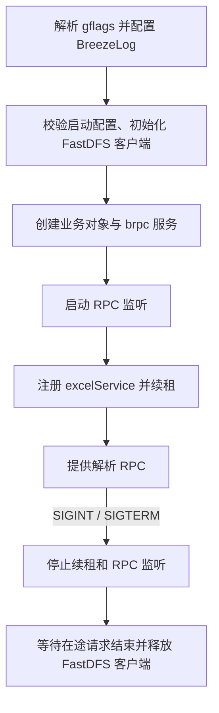

# Excel 解析子服务设计

## 1. 结构设计

Excel 解析子服务由文件子服务通过 brpc 调用，提供工作表名称查询和结构化数据解析。文件子服务负责原文件存储，并将解析结果交给存储子服务入库。浏览器通过[网关](../../docs/网关子服务.md)发起上传。

| 组件                                                | 职责                                                           |
| --------------------------------------------------- | -------------------------------------------------------------- |
| `ExcelParserServerBuilder`、`ExcelParserServer` | 组装 FastDFS 客户端、业务对象和 RPC 服务，管理监听与 etcd 注册 |
| `ExcelParserServiceImpl`                          | 校验 RPC 请求，把业务结果转换为协议响应                        |
| `ExcelParserBusiness`                             | 按 FastDFS 文件 ID 下载工作簿、管理临时文件并组织解析结果      |
| `ExcelParser`                                     | 使用 OpenXLSX 读取工作表、表头、列类型和单元格数据             |

### 1.1 上传与解析链路

解析请求使用 FastDFS 文件 ID，因此文件子服务先在 FastDFS 保存原文件。两个解析 RPC 各自读取该 ID 对应的工作簿，同一次上传的两个请求可以由不同解析节点处理。

## 2. 接口设计

协议定义在 [excelParseService.proto](../../proto/excelParseService.proto)，沿用附件的包名 `chat2Data.excelParseService` 和现有[接口设计](../../docs/接口设计.md#23-excel解析子服务)中的服务名 `ExcelParserService`。启用 C++ 通用服务接口以供 brpc 生成服务端基类和调用端存根。

两条 RPC 都接收非空的 `request_id` 和 `fdfs_file_id`。文件 ID 使用 FastDFS 返回的完整标识。响应原样返回请求 ID，`error_code = 0` 表示业务成功，此时 `error_msg` 为空。调用方同时检查 brpc 传输状态和业务错误码。

| RPC 方法          | 请求字段                                                   | 成功结果                                            |
| ----------------- | ---------------------------------------------------------- | --------------------------------------------------- |
| `GetWorksheets` | `request_id`、`fdfs_file_id`                           | `worksheets` 为按工作簿顺序排列的工作表名称       |
| `ParseExcel`    | `request_id`、`fdfs_file_id` 和待解析的 `worksheets` | `worksheets` 为按请求顺序排列的 `WorksheetData` |

`GetWorksheets` 返回可解析的工作表名称，工作簿没有工作表时返回业务错误。调用方解析整个工作簿时，把该列表交给 `ParseExcel`。解析请求至少包含一个非空名称，按工作表原始名称精确匹配。任一请求项解析失败时返回业务错误，结果列表为空。

| 结构              | 字段和语义                                                                                                                  |
| ----------------- | --------------------------------------------------------------------------------------------------------------------------- |
| `WorksheetData` | `name` 是工作表原名。 `columns` 和 `rows` 按原顺序返回。 `total_rows` 包含首行表头，`total_cols` 为解析范围的列数 |
| `ColumnInfo`    | `name` 是整理后的列名，`type` 是 `TEXT`、`BIGINT`、`DOUBLE`、`BOOLEAN` 或 `DATE`                              |
| `RowData`       | `cells` 保留列顺序和空单元格。每行单元格数量等于 `total_cols`                                                           |
| `CellData`      | `value` 是单元格的文本表示，`type` 是 `Empty`、`Integer`、`Float`、`Boolean`、`String` 或 `Error`           |

## 3. 业务流程

### 3.1 下载和解析

业务层复用 `Breezefdfs::FDFSClient::download_to_file`。每次 RPC 创建自己的临时文件，将同一请求涉及的工作表从该副本读取。用资源作用域管理文件和工作簿，保证并发请求使用不同路径，并在成功、下载失败或解析异常时清理临时文件。

现有 [chat2excel 解析器](../../../chat2excel/src/ExeclParser.cc)可供参考。它使用 OpenXLSX 读取工作表，保留空单元格位置，处理数值精度和公式缓存值，并为原应用输出 CSV。Excel 解析 RPC 按协议返回列、行和单元格结构。

### 3.2 工作表结构与数据

- **表头**。第一行为表头。空列名使用 `column_<列号>`，列号从 1 开始。保留有效的非 ASCII UTF-8 字符及 ASCII 字母、数字、下划线和美元符号，其他 ASCII 字符替换为下划线。数字开头加 `col_`，整理后重复的列名按列序追加后缀，使同一张表的列名可区分。
- **列类型**。从第二行起最多采样 100 行。跳过空值及 `N/A`、`n/a`，根据单元格原始类型统计，必要时识别字符串中的数值、布尔和日期。按出现次数最多的类型给出列提示，样本为空或票数并列时使用 `TEXT`。数字字符串与布尔文本均可被识别时优先识别为数字，保留有前导零的标识文本。日期识别需校验实际日历值。
- **单元格**。空单元格返回空文本，布尔值表示为 `1` 或 `0`，整数和浮点数保留可还原的精度。普通字符串和 Excel 错误文本保留原内容。公式读取工作簿中的缓存结果，Excel 的数字日期序列保留原始数值。列类型只描述采样结果，数据行保留各单元格自身的类型和值。
- **行列范围**。读取工作表范围内的所有数据行，保留中间空行及空字段。只有表头的工作表返回有效列信息和空数据行列表，`total_rows` 为 1。工作表缺失或完全没有可解析的结构时报告错误。

### 3.3 RPC 响应与错误

接口层使用 brpc 的闭包管理方式完成一次响应。格式错误、FastDFS 下载失败、文件内容无效、工作表缺失和解析异常分别按项目约定返回业务错误。实现时使用 `ErrorCode` 的 Excel 解析预留范围 `400～499`，错误描述由 `error2String` 统一提供。BreezeLog 记录 RPC 方法、请求 ID 和处理结果，单元格值仅用于返回解析数据。

两个接口均使用普通请求响应 RPC。文件导入只消费错误码为零的完整解析结果。达到 brpc 消息大小限制时按传输失败处理。

## 4. 程序主流程与配置

构建和退出流程参考现有[通知服务](../../docs/通知子服务.md)。使用 BreezeKit 的 `SvcProvider` 注册到 etcd，注册发生在监听成功之后。调用方用服务注册名发现节点，注册值使用调用方可访问的地址。信号处理只设置退出标志，主线程回收资源。

| 配置                   | 规划默认值                     | 说明                                 |
| ---------------------- | ------------------------------ | ------------------------------------ |
| RPC 监听端口           | `9003`                       | 延续附件端口，并对应开发容器端口映射 |
| 服务注册名             | `excelService`               | 与项目错误码所属服务名称一致         |
| 服务注册地址           | `dev-env-service:<监听端口>` | 开发容器内可达的默认地址             |
| etcd 注册地址          | `http://dev-etcd:2379`       | 服务注册端点                         |
| FastDFS Tracker        | `dev-tracker:22122`          | 下载工作簿的 Tracker，允许配置多个   |
| FastDFS 连接和网络超时 | 各 `30` 秒                   | 沿用 BreezeFDFS 的默认值             |
| 日志级别               | `info`                       | 沿用 BreezeLog 配置                  |

## 5. 后续实现与验证范围

- 服务实现放在 `svc_excelParseService`，使用 `chat2data` 命名空间和 C++17。按项目现有命名组织解析器、业务层、RPC 接口、服务器和入口，使用 `.hpp` 与 `.cpp`。
- 依赖复用工作区内的 OpenXLSX 和 BreezeKit，包括 BreezeFDFS、BreezeEtcd、BreezeLog。协议链接 `excel_parse_service_proto`，由根 CMake 经 [proto/CMakeLists.txt](../../proto/CMakeLists.txt) 生成。服务可执行目标在实现阶段接入。
- 单元测试先用本地 `.xlsx` 样本验证工作表顺序、行列范围、表头整理、列类型和单元格转换。RPC 测试覆盖无效文件 ID、下载失败、工作表缺失、解析错误和临时文件清理。文件子服务接入后再验证上传、解析和入库链路。
