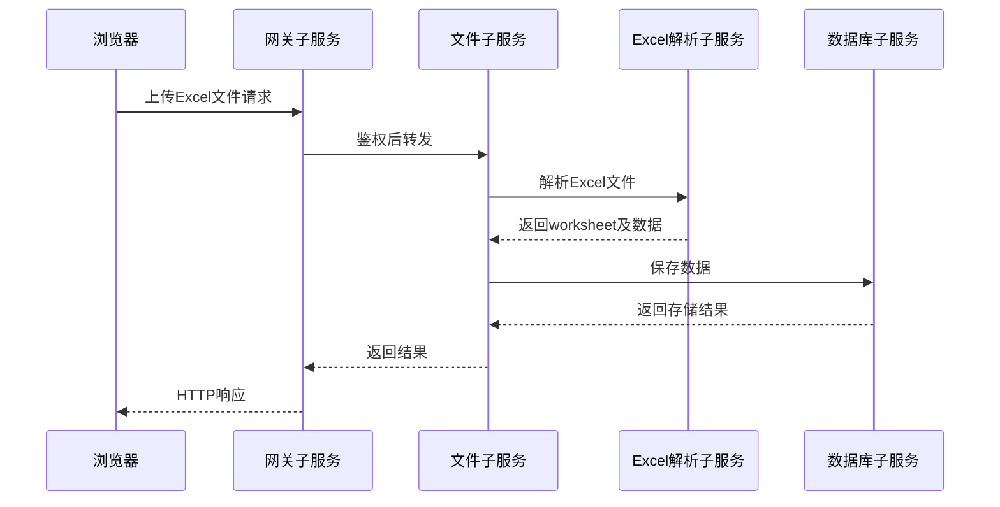

# 接口设计

## 1. API接口定义

本项目中网关是通过HTTP协议和浏览器通信的，API接口定义主要是约定好网关能提供的服务的接口约定，API接口基本遵循RESTFul风格。

### 1.1 RESTFull API

RESTful（Representational State Transfer，表述性状态转移）是一种基于 HTTP 协议设计网络 API 的架构风格，由 Roy Fielding 在 2000 年的博士论文中提出。它不是标准、协议或技术，而是一组设计原则和约束，用于构建可伸缩、可维护、松耦合、跨平台的 Web 服务。

REST的核心思想是把一切看作“资源”（Resource），通过标准 HTTP 方法对资源进行操作，用 URI 定位资源，用 HTTP 状态码表达结果。

- 资源（Resource）：任何可以被命名的东西，如用户、订单、文章、文件等。
- URI（统一资源标识符）：唯一标识一个资源的地址，如 /users/123 。
- 表述（Representation）：资源在某一时刻的状态，通常以 JSON 或 XML 格式返回。
- 状态转移（State Transfer）：客户端通过 HTTP 动作（GET/POST/PUT/DELETE）改变资源状态。

**使用标准HTTP方法表达操作语义**

| HTTP 方法 | 语义                                 | 幂等性           | 安全性 | 典型用途           |
| --------- | ------------------------------------ | ---------------- | ------ | ------------------ |
| GET       | 获取资源                             | 是               | 是     | 查询列表、详情     |
| POST      | 创建资源 / 执行非幂等操作            | 否               | 否     | 新增用户、上传文件 |
| PUT       | 全量更新资源（或创建指定 ID 的资源） | 是               | 否     | 替换整个用户信息   |
| PATCH     | 部分更新资源                         | 否(通常视为幂等) | 否     | 修改用户邮箱       |
| DELETE    | 删除资源                             | 是               | 否     | 删除用户           |

幂等性：多次执行同一请求，结果与一次执行相同。

安全性：不会改变服务器状态（只有 GET 是安全的）。

**使用合理的HTTP状态码表达结果**

| 状态码                    | 含义           | 场景                            |
| ------------------------- | -------------- | ------------------------------- |
| 200 OK                    | 成功           | GET/PUT/PATCH 成功              |
| 201 Created               | 创建成功       | POST 成功，响应中带 Location 头 |
| 204 No Content            | 成功但无返回体 | DELETE 成功                     |
| 400 Bad Request           | 客户端参数错误 | 缺少必填字段、格式错误          |
| 401 Unauthorized          | 未认证         | Token 缺失或无效                |
| 403 Forbidden             | 无权限         | 用户无权访问该资源              |
| 404 Not Found             | 资源不存在     | 请求的 /users/999 不存在        |
| 409 Conflict              | 冲突           | 创建时 ID 已存在                |
| 500 Internal Server Error | 服务器内部错误 | 未捕获异常                      |

总之，RESTFul的核心精髓是：

- 资源是什么？用名词 URI 表示
- 要做什么？用 HTTP 方法表达
- 结果如何？用 HTTP 状态码说明
- 数据长什么样？用 JSON 清晰描述

示例：

请求URL：`GET /api/file/list`

请求参数：

```json
{
    "requestId": "string",
    "sessionId": "string"
}
```

响应状态码：成功返回200

响应参数：

```json
{
    "requestId": "req_123456",
    "errorCode": 0,
    "errorMsg": "",
    "result": {
        "fileList": [
            {
                "fileId": "file_001",
                "fileName": "员工薪资.xlsx",
                "fileSize": 102400,
                "uploadTime": 1706428800
            },
            {
                "fileId": "file_002",
                "fileName": "学生信息.xlsx",
                "fileSize": 204800,
                "uploadTime": 1706515200
            }
        ]
    }
}
```

我们定义的接口有些可能不是严格遵循RestFul风格，具体以接口定义为准。

**公共约定：** 除注册、登录、昵称与邮箱校验、获取验证码及健康检测外，请求均需携带登录 `sessionId`。`sessionId` 表示登录凭证，`chatSessionId` 表示 ModelBridge 聊天会话，两者不能混用。涉及 ModelBridge 的时间字段使用 Unix 毫秒；其他时间字段需在实现时统一约定单位。

### 1.2 用户子服务

#### 1.2.1 检测昵称是否唯一

请求URL：`POST /api/user/valid/nickname`

**请求参数：**

| 字段名称      | 字段类型 | 字段说明 |
| ------------- | -------- | -------- |
| `requestId` | string   | 请求ID   |
| `nickname`  | string   | 用户昵称 |

**示例：**

```json
{
    "requestId": "string",
    "nickname": "string"
}
```

**返回响应：** `200 OK`

| 字段名称      | 字段类型 | 字段说明       |
| ------------- | -------- | -------------- |
| `requestId` | string   | 请求ID         |
| `errorCode` | integer  | 错误码；0-成功 |
| `errorMsg`  | string   | 错误信息       |

**示例：**

```json
{
  "requestId": "string",
  "errorCode": 0,
  "errorMsg": ""
}
```

#### 1.2.2 检测邮箱是否唯一

请求URL：`POST /api/user/valid/email`

**请求参数：**

| 字段名称      | 字段类型 | 字段说明 |
| ------------- | -------- | -------- |
| `requestId` | string   | 请求ID   |
| `email`     | string   | 用户邮箱 |

**示例：**

```json
{
    "requestId": "string",
    "email": "string"
}
```

**返回响应：** `200 OK`

| 字段名称      | 字段类型 | 字段说明       |
| ------------- | -------- | -------------- |
| `requestId` | string   | 请求ID         |
| `errorCode` | integer  | 错误码；0-成功 |
| `errorMsg`  | string   | 错误信息       |

**示例：**

```json
{
  "requestId": "string",
  "errorCode": 0,
  "errorMsg": ""
}
```

#### 1.2.3 用户注册

请求URL：`POST /api/user/register`

**请求参数：**

| 字段名称      | 字段类型 | 字段说明 |
| ------------- | -------- | -------- |
| `requestId` | string   | 请求ID   |
| `nickname`  | string   | 用户昵称 |
| `password`  | string   | 用户密码 |
| `email`     | string   | 用户邮箱 |

**示例：**

```json
{
    "requestId" : "string",
    "nickname" : "string",
    "password" : "string",
    "email" : "string"
}
```

**返回响应：** `200 OK`

| 字段名称      | 字段类型 | 字段说明       |
| ------------- | -------- | -------------- |
| `requestId` | string   | 请求ID         |
| `errorCode` | integer  | 错误码；0-成功 |
| `errorMsg`  | string   | 错误信息       |

**示例：**

```json
{
  "requestId": "string",
  "errorCode": 0,
  "errorMsg": ""
}
```

#### 1.2.4 会话登录

请求URL：`POST /api/user/session/login`

**请求参数：**

| 字段名称      | 字段类型 | 字段说明 |
| ------------- | -------- | -------- |
| `requestId` | string   | 请求ID   |
| `sessionId` | string   | 会话ID   |

**示例：**

```json
{
    "requestId": "string",
    "sessionId": "string"
}
```

**返回响应：** `200 OK`

| 字段名称      | 字段类型 | 字段说明       |
| ------------- | -------- | -------------- |
| `requestId` | string   | 请求ID         |
| `errorCode` | integer  | 错误码；0-成功 |
| `errorMsg`  | string   | 错误信息       |

**示例：**

```json
{
  "requestId": "string",
  "errorCode": 0,
  "errorMsg": ""
}
```

#### 1.2.5 密码登录

请求URL：`POST /api/user/passwd/login`

**请求参数：**

| 字段名称      | 字段类型 | 字段说明 |
| ------------- | -------- | -------- |
| `requestId` | string   | 请求ID   |
| `nickname`  | string   | 用户昵称 |
| `password`  | string   | 用户密码 |

**示例：**

```json
{
    "requestId": "string",
    "nickname": "string" ,
    "password" : "string"
}
```

**返回响应：** `200 OK`

| 字段名称      | 字段类型 | 字段说明       |
| ------------- | -------- | -------------- |
| `errorCode` | integer  | 错误码；0-成功 |
| `requestId` | string   | 请求ID         |
| `errorMsg`  | string   | 错误信息       |
| `result`    | object   | 响应结果       |
| `sessionId` | string   | 会话Id         |

**示例：**

```json
{
  "requestId": "string",
  "errorCode": 0,
  "errorMsg": "",
  "result":{
    "sessionId": "string"
  }
}
```

#### 1.2.6 获取验证码

请求URL：`POST /api/user/code`

**请求参数：**

| 字段名称      | 字段类型 | 字段说明 |
| ------------- | -------- | -------- |
| `requestId` | string   | 请求ID   |
| `email`     | string   | 用户邮箱 |

**示例：**

```json
{
    "requestId": "string",
    "email": "string"
}
```

**返回响应：** `200 OK`

| 字段名称      | 字段类型 | 字段说明       |
| ------------- | -------- | -------------- |
| `requestId` | string   | 请求ID         |
| `errorCode` | integer  | 错误码；0-成功 |
| `errorMsg`  | string   | 错误信息       |
| `result`    | object   | 响应结果       |
| `codeId`    | string   | 验证码id       |

**示例：**

```json
{
  "requestId": "string",
  "errorCode": 0,
  "errorMsg": "",
  "result":{
    "codeId": "string"
  }
}
```

在服务端，每个验证码对应一个codeId，验证码发送到用户邮箱，5分钟后过期，codeId返回给前端。将来用户使用验证码登录时，需要提供验证码和codeId，后端检测完全匹配后才能登录成功。

#### 1.2.7 验证码登录

请求URL：`POST /api/user/vcode/login`

**请求参数：**

| 字段名称       | 字段类型 | 字段说明 |
| -------------- | -------- | -------- |
| `requestId`  | string   | 请求ID   |
| `email`      | string   | 用户邮箱 |
| `verifyCode` | string   | 验证码   |
| `codeId`     | string   | 验证码Id |

**示例：**

```json
{
    "requestId": "string",
    "email": "string",
    "verifyCode": "string",
    "codeId": "string"
}
```

**返回响应：** `200 OK`

| 字段名称      | 字段类型 | 字段说明       |
| ------------- | -------- | -------------- |
| `requestId` | string   | 请求ID         |
| `errorCode` | integer  | 错误码；0-成功 |
| `errorMsg`  | string   | 错误信息       |
| `result`    | object   | 响应结果       |
| `sessionId` | string   | 会话Id         |

**示例：**

```json
{
  "requestId": "string",
  "errorCode": 0,
  "errorMsg": "",
  "result": {
    "sessionId": "string"
  }
}
```

#### 1.2.8 退出登录

请求URL：`POST /api/user/logout`

**请求参数：**

| 字段名称      | 字段类型 | 字段说明 |
| ------------- | -------- | -------- |
| `requestId` | string   | 请求ID   |
| `sessionId` | string   | 会话Id   |

**示例：**

```json
{
    "requestId": "string",
    "sessionId": "string"
}
```

**返回响应：** `200 OK`

| 字段名称      | 字段类型 | 字段说明       |
| ------------- | -------- | -------------- |
| `requestId` | string   | 请求ID         |
| `errorCode` | integer  | 错误码；0-成功 |
| `errorMsg`  | string   | 错误信息       |

**示例：**

```json
{
  "requestId": "string",
  "errorCode": 0,
  "errorMsg": ""
}
```

#### 1.2.9 获取用户信息

请求URL：`GET /api/user/info`

**请求参数：**

| 字段名称      | 字段类型 | 字段说明 |
| ------------- | -------- | -------- |
| `requestId` | string   | 请求ID   |
| `sessionId` | string   | 会话Id   |

**示例：**

```http
GET /api/user/info?requestId=req_123&sessionId=session_456
```

**返回响应：** `200 OK`

| 字段名称      | 字段类型 | 字段说明       |
| ------------- | -------- | -------------- |
| `requestId` | string   | 请求ID         |
| `errorCode` | integer  | 错误码；0-成功 |
| `errorMsg`  | string   | 错误信息       |
| `result`    | object   | 响应结果       |
| `userInfo`  | object   | 用户信息       |
| `userId`    | string   | 用户Id         |
| `nickname`  | string   | 用户昵称       |
| `email`     | string   | 用户邮箱       |

**示例：**

```json
{
  "requestId": "string",
  "errorCode": 0,
  "errorMsg": "",
  "result":{
    "userInfo":{
      "userId": "string",
      "nickname": "string",
      "email": "string"
    }
  }
}
```

### 1.3 文件子服务

#### 1.3.1 上传文件信息

请求URL：`POST /api/file/upload/info`

**请求参数：**

| 字段名称      | 字段类型 | 字段说明   |
| ------------- | -------- | ---------- |
| `requestId` | string   | 请求ID     |
| `sessionId` | string   | 登录会话ID |
| `fileInfo`  | object   | 文件信息   |
| `fileName`  | string   | 文件名称   |
| `fileSize`  | integer  | 文件大小   |
| `fileExt`   | string   | 文件扩展名 |

**示例：**

```json
{
    "requestId": "string",
    "sessionId": "string",
    "fileInfo": {
      "fileName": "string",
      "fileSize": 0,
      "fileExt": "string"
    }
}
```

**返回响应：** `200 OK`

| 字段名称      | 字段类型 | 字段说明       |
| ------------- | -------- | -------------- |
| `requestId` | string   | 请求ID         |
| `errorCode` | integer  | 错误码；0-成功 |
| `errorMsg`  | string   | 错误信息       |
| `result`    | object   | 响应结果       |
| `fileId`    | string   | 文件Id         |

**示例：**

```json
{
  "requestId": "string",
  "errorCode": 0,
  "errorMsg": "",
  "result": {
    "fileId": "string"
  }
}
```

#### 1.3.2 获取文件信息

请求URL：`GET /api/file/info`

**请求参数：**

| 字段名称      | 字段类型 | 字段说明   |
| ------------- | -------- | ---------- |
| `requestId` | string   | 请求ID     |
| `sessionId` | string   | 登录会话ID |
| `fileId`    | string   | 文件ID     |

**示例：**

```http
GET /api/file/info?requestId=req_123&sessionId=session_456&fileId=file_789
```

**返回响应：** `200 OK`

| 字段名称       | 字段类型 | 字段说明       |
| -------------- | -------- | -------------- |
| `requestId`  | string   | 请求ID         |
| `errorCode`  | integer  | 错误码；0-成功 |
| `errorMsg`   | string   | 错误信息       |
| `result`     | object   | 响应结果       |
| `fileId`     | string   | 文件Id         |
| `fileName`   | string   | 文件名称       |
| `fileSize`   | integer  | 文件大小       |
| `uploadTime` | integer  | 上传时间       |
| `fileExt`    | string   | 文件后缀       |

**示例：**

```json
{
  "requestId": "string",
  "errorCode": 0,
  "errorMsg": "",
  "result": {
    "fileId": "string",
    "fileName": "string",
    "fileSize": 0,
    "uploadTime": 0,
    "fileExt": "string"
  }
}
```

#### 1.3.3 上传文件数据

请求URL：`POST /api/file/upload`

Content-Type: `application/octet-stream`

**请求参数(URL Query)：**

| 字段名称      | 字段类型 | 字段说明 |
| ------------- | -------- | -------- |
| `requestId` | string   | 请求ID   |
| `sessionId` | string   | 会话Id   |
| `fileId`    | string   | 文件Id   |

**示例：**

```http
POST /api/file/upload?requestId=req_123&sessionId=session_456&fileId=file_789
```

请求体：文件二进制数据

**返回响应：** `200 OK`

| 字段名称      | 字段类型 | 字段说明       |
| ------------- | -------- | -------------- |
| `requestId` | string   | 请求ID         |
| `errorCode` | integer  | 错误码；0-成功 |
| `errorMsg`  | string   | 错误信息       |
| `result`    | object   | 响应结果       |
| `fileId`    | string   | 文件Id         |

**示例：**

```json
{
  "requestId": "string",
  "errorCode": 0,
  "errorMsg": "",
  "result": {
    "fileId": "file_abc123"
  }
}
```

#### 1.3.4 下载文件

请求URL：`GET /api/file/download`

**请求参数(URL Query)：**

| 字段名称      | 字段类型 | 字段说明   |
| ------------- | -------- | ---------- |
| `requestId` | string   | 请求ID     |
| `sessionId` | string   | 登录会话ID |
| `fileId`    | string   | 文件ID     |

**示例：**

```http
GET /api/file/download?requestId=req_123&sessionId=session_456&fileId=file_789
```

**返回响应：** `200 OK`

**示例：**

```http
Content-Type: application/octet-stream
Content-Disposition: attachment; filename="文件名"
```

响应体：文件二进制流

#### 1.3.5 删除文件

请求URL：`DELETE /api/file/{fileId}`

**请求参数：**

| 字段名称      | 字段类型 | 字段说明 |
| ------------- | -------- | -------- |
| `requestId` | string   | 请求ID   |
| `sessionId` | string   | 会话Id   |
| `fileId`    | string   | 文件Id   |

**示例：**

```http
DELETE /api/file/{fileId}?requestId=req_123&sessionId=session_456
```

**返回响应：** `200 OK`

| 字段名称      | 字段类型 | 字段说明       |
| ------------- | -------- | -------------- |
| `errorCode` | integer  | 错误码；0-成功 |
| `requestId` | string   | 请求ID         |
| `errorMsg`  | string   | 错误信息       |

**示例：**

```json
{
  "requestId": "string",
  "errorCode": 0,
  "errorMsg": ""
}
```

#### 1.3.6 预览Excel文件

请求URL：`POST /api/file/preview`

**请求参数：**

| 字段名称      | 字段类型 | 字段说明                                   |
| ------------- | -------- | ------------------------------------------ |
| `requestId` | string   | 请求ID                                     |
| `sessionId` | string   | 会话Id                                     |
| `fileId`    | string   | 文件Id                                     |
| `sheetName` | string   | 可选，指定工作表；不传时返回各工作表第一页 |
| `page`      | integer  | 可选，页号，从1开始，默认1                 |
| `pageSize`  | integer  | 可选，每页行数，默认50                     |

**示例：**

```json
{
    "requestId": "string",
    "sessionId": "string",
    "fileId": "string",
    "sheetName": "员工",
    "page": 1,
    "pageSize": 50
}
```

**返回响应：** `200 OK`

| 字段名称        | 字段类型 | 字段说明       |
| --------------- | -------- | -------------- |
| `requestId`   | string   | 请求ID         |
| `errorCode`   | integer  | 错误码；0-成功 |
| `errorMsg`    | string   | 错误信息       |
| `result`      | object   | 响应结果       |
| `fileId`      | string   | 文件ID         |
| `fileName`    | string   | 文件名称       |
| `fileSize`    | integer  | 文件大小       |
| `fileExt`     | string   | 文件后缀       |
| `excelData`   | object   | excel数据      |
| `sheets`      | array    | worksheet      |
| `name`        | string   | worksheet名称  |
| `totalRows`   | integer  | 总行数         |
| `colCount`    | integer  | 总列数         |
| `currentPage` | integer  | 当前页号       |
| `totalPages`  | integer  | 总页数         |
| `pageSize`    | integer  | 每页行数       |
| `columns`     | array    | 列名列表       |
| `data`        | array    | 具体行数据     |

**示例：**

```json
{
  "requestId": "string",
  "errorCode": 0,
  "errorMsg": "",
  "result": {
    "fileId": "file_abc123",
    "fileName": "员工薪资.xlsx",
    "fileSize": 102400,
    "fileExt": "xlsx",
    "excelData": {
      "sheets": [
        {
          "name": "员工",
          "totalRows": 1,
          "colCount": 2,
          "currentPage": 1,
          "totalPages": 1,
          "pageSize": 50,
          "columns": ["姓名", "电话"],
          "data": [
              ["曹玉凤", "15112345678"]
          ]
        }
      ]
    }
  }
}
```

#### 1.3.7 获取文件列表

请求URL：`POST /api/file/list`

**请求参数：**

| 字段名称      | 字段类型 | 字段说明 |
| ------------- | -------- | -------- |
| `requestId` | string   | 请求ID   |
| `sessionId` | string   | 会话Id   |

**示例：**

```json
{
    "requestId": "string",
    "sessionId": "string"
}
```

**返回响应：** `200 OK`

| 字段名称       | 字段类型      | 字段说明       |
| -------------- | ------------- | -------------- |
| `errorMsg`   | string        | 错误信息       |
| `errorCode`  | integer       | 错误码；0-成功 |
| `requestId`  | string        | 请求ID         |
| `result`     | object        | 响应结果       |
| `fileList`   | array[object] | 文件列表       |
| `fileId`     | string        | 文件Id         |
| `fileName`   | string        | 文件名称       |
| `fileSize`   | integer       | 文件大小       |
| `uploadTime` | integer       | 文件上传时间   |

**示例：**

```json
{
  "requestId": "string",
  "errorCode": 0,
  "errorMsg": "",
  "result": {
    "fileList": [
      {
        "fileId": "string",
        "fileName": "string",
        "fileSize": 0,
        "uploadTime": 0
      }
    ]
  }
}
```

#### 1.3.8 关联文件和聊天会话

**同一文件可以关联多个聊天会话；一个聊天会话最多关联一个文件。**关联前校验文件和聊天会话均属于当前用户，替换关联时更新业务会话记录。

请求URL：`POST /api/file/chat/map`

**请求参数：**

| 字段名称          | 字段类型 | 字段说明   |
| ----------------- | -------- | ---------- |
| `requestId`     | string   | 请求ID     |
| `sessionId`     | string   | 会话ID     |
| `fileId`        | string   | 文件ID     |
| `chatSessionId` | string   | 聊天会话ID |

**示例：**

```json
{
    "requestId": "string",
    "sessionId": "string",
    "fileId": "string",
    "chatSessionId": "string"
}
```

**返回响应：** `200 OK`

| 字段名称      | 字段类型 | 字段说明       |
| ------------- | -------- | -------------- |
| `requestId` | string   | 请求ID         |
| `errorCode` | integer  | 错误码；0-成功 |
| `errorMsg`  | string   | 错误信息       |

**示例：**

```json
{
  "requestId": "string",
  "errorCode": 0,
  "errorMsg": ""
}
```

#### 1.3.9 上传SQLite文件

请求URL：`POST /api/file/sqlite/upload`

Content-Type: `application/octet-stream`

**请求参数(URL Query)：**

| 字段名称      | 字段类型 | 字段说明 |
| ------------- | -------- | -------- |
| `requestId` | string   | 请求ID   |
| `sessionId` | string   | 会话Id   |
| `filename`  | string   | 文件名称 |

**示例：**

```http
POST /api/file/sqlite/upload?requestId=req_123&sessionId=session_456&filename=example.db
```

请求体：SQLite文件二进制数据

**返回响应：** `200 OK`

| 字段名称      | 字段类型 | 字段说明       |
| ------------- | -------- | -------------- |
| `requestId` | string   | 请求ID         |
| `errorCode` | integer  | 错误码；0-成功 |
| `errorMsg`  | string   | 错误信息       |
| `result`    | object   | 响应结果       |
| `fileId`    | string   | 文件Id         |

**示例：**

```json
{
  "requestId": "string",
  "errorCode": 0,
  "errorMsg": "",
  "result": {
    "fileId": "string"
  }
}
```

### 1.4 数据库子服务

#### 1.4.1 建立数据库连接

请求URL：`POST /api/db/connect`

**请求参数：**

| 字段名称      | 字段类型 | 字段说明   |
| ------------- | -------- | ---------- |
| `requestId` | string   | 请求ID     |
| `sessionId` | string   | 会话ID     |
| `database`  | object   | 数据库信息 |
| `type`      | string   | 数据库类型 |
| `MySQL`     | object   | MySQL配置  |
| `host`      | string   | 主机地址   |
| `port`      | integer  | 端口号     |
| `name`      | string   | 数据库名称 |
| `username`  | string   | 用户名称   |
| `password`  | string   | 用户密码   |
| `charset`   | string   | 字符集     |
| `SQLite`    | object   | SQLite配置 |
| `fileId`    | string   | 文件ID     |
| `readonly`  | boolean  | 是否只读   |

**示例：**

```json
{
  "requestId": "string",
  "sessionId": "string",
  "database": {
    "type": "MySQL",
    "MySQL": {
      "host": "string",
      "port": 3306,
      "name": "string",
      "username": "string",
      "password": "string",
      "charset": "utf8mb4"
    },
    "SQLite": {
      "fileId": "string",
      "readonly": false
    }
  }
}
```

**返回响应：** `200 OK`

| 字段名称         | 字段类型 | 字段说明       |
| ---------------- | -------- | -------------- |
| `requestId`    | string   | 请求ID         |
| `errorCode`    | integer  | 错误码；0-成功 |
| `errorMsg`     | string   | 错误信息       |
| `result`       | object   | 响应结果       |
| `connectionId` | string   | 数据库连接ID   |

**示例：**

```json
{
  "requestId": "string",
  "errorCode": 0,
  "errorMsg": "",
  "result": {
    "connectionId": "string"
  }
}
```

**注意：**

- 程序启动时，会建立一个默认MySQL连接，连接ID为"**excel_default**"，专门处理智能Excel场景
- 智能DB场景，需要用户自己提交数据库信息建立数据库连接
- 智能DB场景，目前仅支持MySQL 和 SQLite
- `type` 为 `MySQL` 时仅需 `MySQL` 配置，为 `SQLite` 时仅需 `SQLite` 配置

#### 1.4.2 获取数据库中表列表

请求URL：`GET /api/db/tables`

**请求参数：**

| 字段名称         | 字段类型 | 字段说明     |
| ---------------- | -------- | ------------ |
| `requestId`    | string   | 请求ID       |
| `sessionId`    | string   | 会话ID       |
| `connectionId` | string   | 数据库连接ID |

**示例：**

```http
GET /api/db/tables?requestId=req_123&sessionId=session_456&connectionId=conn_789
```

**返回响应：** `200 OK`

| 字段名称      | 字段类型      | 字段说明       |
| ------------- | ------------- | -------------- |
| `requestId` | string        | 请求ID         |
| `errorCode` | integer       | 错误码；0-成功 |
| `errorMsg`  | string        | 错误信息       |
| `result`    | object        | 响应结果       |
| `tableList` | array[string] | 表名列表       |

**示例：**

```json
{
  "requestId": "string",
  "errorCode": 0,
  "errorMsg": "",
  "result": {"tableList": ["users", "orders"]}
}
```

#### 1.4.3 断开数据库连接

请求URL：`POST /api/db/disconnect`

**请求参数：**

| 字段名称         | 字段类型 | 字段说明     |
| ---------------- | -------- | ------------ |
| `requestId`    | string   | 请求ID       |
| `sessionId`    | string   | 会话ID       |
| `connectionId` | string   | 数据库连接ID |

**示例：**

```json
{
    "requestId": "string",
    "sessionId": "string",
    "connectionId": "string"
}
```

**返回响应：** `200 OK`

| 字段名称      | 字段类型 | 字段说明       |
| ------------- | -------- | -------------- |
| `requestId` | string   | 请求ID         |
| `errorCode` | integer  | 错误码；0-成功 |
| `errorMsg`  | string   | 错误信息       |

**示例：**

```json
{
  "requestId": "string",
  "errorCode": 0,
  "errorMsg": ""
}
```

#### 1.4.4 获取表数据

请求URL：`POST /api/db/table/data`

**请求参数：**

| 字段名称          | 字段类型 | 字段说明         |
| ----------------- | -------- | ---------------- |
| `requestId`     | string   | 请求ID           |
| `sessionId`     | string   | 会话ID           |
| `connectionId`  | string   | 数据库连接ID     |
| `tableName`     | string   | 数据库表名       |
| `forceOriginal` | boolean  | 是否获取原表数据 |

**示例：**

```json
{
    "requestId": "string",
    "sessionId": "string",
    "connectionId": "string",
    "tableName": "string",
    "forceOriginal": false
}
```

**返回响应：** `200 OK`

| 字段名称        | 字段类型      | 字段说明       |
| --------------- | ------------- | -------------- |
| `requestId`   | string        | 请求ID         |
| `errorCode`   | integer       | 错误码；0-成功 |
| `errorMsg`    | string        | 错误信息       |
| `result`      | object        | 响应结果       |
| `tableSchema` | object        | 表结构信息     |
| `columnInfo`  | array[object] | 列信息         |
| `name`        | string        | 列名           |
| `type`        | string        | 列类型         |
| `tableData`   | object        | 表数据         |
| `rows`        | array[object] | 所有行数据     |
| `cells`       | array[string] | 单行数据       |

**示例：**

```json
{
  "requestId": "req_123456",
  "errorCode": 0,
  "errorMsg": "",
  "result": {
    "tableSchema": {
      "columnInfo": [
        {
          "name": "id",
          "type": "INT"
        }
      ]
    },
    "tableData": {
      "rows": [
        {
          "cells": ["1"]
        }
      ]
    }
  }
}
```

#### 1.4.5 获取指定连接的临时表列表

请求URL：`POST /api/db/connection/status`

**请求参数：**

| 字段名称        | 字段类型 | 字段说明     |
| --------------- | -------- | ------------ |
| `requestId`   | string   | 请求ID       |
| `sessionId`   | string   | 会话ID       |
| `connectionId` | string   | 数据库连接ID |

**示例：**

```json
{
    "requestId": "string",
    "sessionId": "string",
    "connectionId": "string"
}
```

**返回响应：** `200 OK`

| 字段名称             | 字段类型      | 字段说明       |
| -------------------- | ------------- | -------------- |
| `requestId`        | string        | 请求ID         |
| `errorCode`        | integer       | 错误码；0-成功 |
| `errorMsg`         | string        | 错误信息       |
| `tempTables`       | array[string] | 被修改过的表名 |
| `hasModifications` | boolean       | 是否有表被修改 |

**示例：**

```json
{
  "requestId": "string",
  "errorCode": 0,
  "errorMsg": "",
  "tempTables":[
    "users", "orders"
  ],
  "hasModifications": true
}
```

为了安全性考虑，对于修改类SQL，后端统一创建被修改表备份，所有修改操作都是在临时表上修改
的，前端为了展示修改结果，需要区分是从原表还是临时表中获取数据。
tempTables保存被修改的表名，hasModifications字段被前段用来控制是否显示有修改状态。

### 1.5 AI服务

#### 1.5.1 获取支持的模型列表

请求URL：`POST /api/ai/models`

**请求参数：**

| 字段名称      | 字段类型 | 字段说明 |
| ------------- | -------- | -------- |
| `requestId` | string   | 请求ID   |
| `sessionId` | string   | 会话Id   |

**示例：**

```json
{
    "requestId": "string",
    "sessionId": "string"
}
```

**返回响应：** `200 OK`

| 字段名称          | 字段类型      | 字段说明       |
| ----------------- | ------------- | -------------- |
| `requestId`     | string        | 请求ID         |
| `errorCode`     | integer       | 错误码；0-成功 |
| `errorMsg`      | string        | 错误信息       |
| `result`        | object        | 响应结果       |
| `modelList`     | array[object] | 模型列表       |
| `modelConfigId` | string        | 模型连接配置ID |
| `modelName`     | string        | 模型名称       |
| `modelDesc`     | string        | 模型描述       |

**示例：**

```json
{
  "requestId": "string",
  "errorCode": 0,
  "errorMsg": "",
  "result": {
    "modelList": [
      {
        "modelConfigId": "string",
        "modelName": "string",
        "modelDesc": "string"
      }
    ]
  }
}
```

**模型列表由 Chat2Data 服务端维护的可用模型配置提供；ModelBridge 提供单个已配置模型的信息**

#### 1.5.2 创建新会话

请求URL：`POST /api/ai/session/create`

**请求参数：**

| 字段名称          | 字段类型 | 字段说明                    |
| ----------------- | -------- | --------------------------- |
| `requestId`     | string   | 请求ID                      |
| `sessionId`     | string   | 会话Id                      |
| `modelConfigId` | string   | 模型连接配置ID              |
| `title`         | string   | 可选会话标题                |
| `sessionType`   | string   | 会话类型，区分Excel和DB场景 |

**示例：**

```json
{
    "requestId": "string",
    "sessionId": "string",
    "modelConfigId": "string",
    "title": "string",
    "sessionType": "excel"
}
```

**返回响应：** `200 OK`

| 字段名称          | 字段类型 | 字段说明       |
| ----------------- | -------- | -------------- |
| `requestId`     | string   | 请求ID         |
| `errorCode`     | integer  | 错误码；0-成功 |
| `errorMsg`      | string   | 错误信息       |
| `result`        | object   | 响应结果       |
| `chatSessionId` | string   | 聊天会话Id     |
| `modelConfigId` | string   | 模型连接配置ID |
| `modelName`     | string   | 模型名称       |

**示例：**

```json
{
  "requestId": "string",
  "errorCode": 0,
  "errorMsg": "",
  "result": {
    "chatSessionId": "string",
    "modelConfigId": "string",
    "modelName": "string"
  }
}
```

**注意：**

- 会话ID：用来区分当前登录用户
- 聊天会话ID：用来区分和模型聊天时不同会话
- 会话标题：可选；未填写时，在收到首条用户消息后用其前20字更新标题。
- 服务端根据登录会话确定 userId，校验模型配置可用后调用 ModelBridge `createSession(userId, modelConfigId, title)`；模型名称从配置获取。

#### 1.5.3 获取会话列表

请求URL：`POST /api/ai/chatSessionLists`

**请求参数：**

| 字段名称      | 字段类型 | 字段说明   |
| ------------- | -------- | ---------- |
| `requestId` | string   | 请求ID     |
| `sessionId` | string   | 登录会话Id |

**示例：**

```json
{
    "requestId": "string",
    "sessionId": "string"
}
```

**返回响应：** `200 OK`

| 字段名称                    | 字段类型      | 字段说明               |
| --------------------------- | ------------- | ---------------------- |
| `requestId`               | string        | 请求ID                 |
| `errorCode`               | integer       | 错误码；0-成功         |
| `errorMsg`                | string        | 错误信息               |
| `result`                  | object        | 响应结果               |
| `chatSessionLists`        | array[object] | 聊天会话列表           |
| `chatSessionId`           | string        | 聊天会话Id             |
| `modelName`               | string        | 模型名称               |
| `title`                   | string        | 会话标题               |
| `createdAt`               | integer       | 会话创建时间，Unix毫秒 |
| `updatedAt`               | integer       | 会话更新时间，Unix毫秒 |
| `messageCount`            | integer       | 消息总数               |
| `firstUserMessageContent` | string        | 首条消息               |

**示例：**

```json
{
  "requestId": "string",
  "errorCode": 0,
  "errorMsg": "",
  "result": {
    "chatSessionLists": [
      {
        "chatSessionId": "string",
        "modelName": "string",
        "title": "string",
        "createdAt": 0,
        "updatedAt": 0,
        "messageCount": 0,
        "firstUserMessageContent": "string"
      }
    ]
  }
}
```

ModelBridge 的 `getSessions(userId)` 返回不含消息的会话概要。

#### 1.5.4 获取会话历史消息

请求URL：`POST /api/ai/history`

**请求参数：**

| 字段名称          | 字段类型 | 字段说明   |
| ----------------- | -------- | ---------- |
| `requestId`     | string   | 请求ID     |
| `sessionId`     | string   | 会话Id     |
| `chatSessionId` | string   | 聊天会话Id |

**示例：**

```json
{
    "requestId": "string",
    "sessionId": "string",
    "chatSessionId": "string"
}
```

**返回响应：** `200 OK`

| 字段名称             | 字段类型      | 字段说明                    |
| -------------------- | ------------- | --------------------------- |
| `requestId`        | string        | 请求ID                      |
| `errorCode`        | integer       | 错误码；0-成功              |
| `errorMsg`         | string        | 错误信息                    |
| `result`           | object        | 响应结果                    |
| `messageList`      | array[object] | 消息列表                    |
| `id`               | string        | 消息Id                      |
| `role`             | string        | 消息角色                    |
| `content`          | string        | 消息内容                    |
| `timestamp`        | integer       | 创建时间，Unix毫秒          |
| `fileId`           | string        | 文件Id                      |
| `sessionType`      | string        | 会话类型，区分Excel和DB场景 |
| `dbConnectionInfo` | string        | 数据库连接信息              |

**示例：**

```json
{
  "requestId": "string",
  "errorCode": 0,
  "errorMsg": "",
  "result": {
    "messageList": [
      {
        "id": "string",
        "role": "string",
        "content": "string",
        "timestamp": 0
      }
    ],
    "fileId":"string",
    "sessionType": "string",
    "dbConnectionInfo": "string"
  }
}
```

读取前校验会话归属。ModelBridge 返回的历史包括 System 和 Tool 消息；接口向客户端展示的消息需要业务层按角色过滤，完整消息链及工具协议字段仍保留在 ModelBridge 中用于后续调用。

#### 1.5.5 删除会话

请求URL：`POST /api/ai/delete`

**请求参数：**

| 字段名称          | 字段类型 | 字段说明   |
| ----------------- | -------- | ---------- |
| `chatSessionId` | string   | 聊天会话ID |
| `sessionId`     | string   | 会话ID     |
| `requestId`     | string   | 请求ID     |

**示例：**

```json
{
    "requestId": "string",
    "sessionId": "string",
    "chatSessionId": "string"
}
```

**返回响应：** `200 OK`

| 字段名称      | 字段类型 | 字段说明       |
| ------------- | -------- | -------------- |
| `requestId` | string   | 请求ID         |
| `errorCode` | integer  | 错误码；0-成功 |
| `errorMsg`  | string   | 错误信息       |

**示例：**

```json
{
  "requestId": "string",
  "errorCode": 0,
  "errorMsg": ""
}
```

#### 1.5.6 发送消息(流式响应)

`fileId`、`connectionId`、`databaseName`、`tableName` 根据聊天场景可选；有文件或数据库上下文时须校验与会话所属用户及场景一致。未关联数据时按普通聊天处理。

请求URL：`POST /api/ai/sendStreamMessage`

**请求参数：**

| 字段名称          | 字段类型 | 字段说明     |
| ----------------- | -------- | ------------ |
| `requestId`     | string   | 请求ID       |
| `sessionId`     | string   | 会话ID       |
| `chatSessionId` | string   | 聊天会话ID   |
| `message`       | string   | 消息内容     |
| `fileId`        | string   | 文件ID       |
| `connectionId`  | string   | 数据库连接ID |
| `databaseName`  | string   | 数据库名称   |
| `tableName`     | string   | 数据库表     |

**示例：**

```json
{
    "requestId": "string",
    "sessionId": "string",
    "chatSessionId": "string",
    "message": "string",
    "fileId": "string",
    "connectionId": "string",
    "databaseName": "string",
    "tableName": "string"
}
```

**返回响应：** `200 OK`

响应头：`Content-Type: text/event-stream; charset=utf-8`。网关将 ModelBridge 的文本增量转换为 SSE；成功完成时发送 `[DONE]`。失败时发送包含非零 `errorCode` 的事件并结束流。

```text
data: {"content": "消息片段", "errorCode": 0, "errorMsg": ""}

data: {"content": "更多消息", "errorCode": 0, "errorMsg": ""}

data: [DONE]
```

**响应字段说明**

- content: 消息片段（字符串）
- errorCode: 错误码（0 表示成功）
- errorMsg: 错误信息

调用前校验聊天会话、文件和数据库连接的归属；未传文件或连接时按普通聊天处理。ModelBridge 的 `sendMessageStream` 是阻塞调用，增量回调在调用线程执行；完成回调发生在本轮消息保存之后。失败时未完成回复不保存，但已经完成的工具步骤可能保留。

### 1.6 健康监测

定期检测服务器是否正常运行。

请求URL：`GET /health`

请求参数：无

返回响应：`200 OK`

| 字段名称      | 字段类型 | 字段说明 |
| ------------- | -------- | -------- |
| `status`    | string   | 健康状态 |
| `service`   | string   | 服务名称 |
| `timestamp` | integer  | 时间戳   |

```json
{
  "status": "healthy",
  "service": "GatewayService",
  "timestamp": 1706428800
}
```

## 2. RPC接口定义

网关主要负责接收客户端的HTTP请求，鉴权之后会通过RPC接口转发给能提供该服务的子服务处理。
各个子服务之间也可能会相互调用，比如浏览器发送一个上传Excel文件的请求，后端响应流程如下

- a. 网关子服务先收到上传文件请求，鉴权之后将该请求交给文件子服务
- b. 文件子服务创建文件信息，保存文件到本地，然后将文件交给Excel解析子服务
- c. Excel解析子服务：解析出Excel文件的worksheet 以及 worksheet中数据，返回给文件子服务
- d. 文件子服务收到Excel子服务的解析结果后，将结果交给数据库子服务
- e. 数据库子服务收到Excel文件的数据，会将Excel文件内容存储到数据库，最后返回到文件子服务
- f. 文件子服务收到数据库子服务响应后，返回给网关
- g. 网关子服务收到文件子服务的响应之后，组织HTTP响应，将结果返回给浏览器

因此，在后端各个子服务之间，还需要定义子服务之间的RPC接口。除网关外，每个子服务实际就是一个RPC服务器。以下为服务方法清单，消息字段、错误码和超时等仍需在 `.proto` 中定义，并非已经实现的协议。普通调用使用 cpp-service-kit 的 brpc 和 protobuf 通道；流式通道须单独实现。



### 2.1 用户子服务

```protobuf
service UserService {
    // 检测昵称是否唯一
    rpc ValidNickname(ValidNicknameRequest) returns (ValidNicknameResponse);
    // 检测邮箱是否唯一
    rpc ValidEmail(ValidEmailRequest) returns (ValidEmailResponse);
    // 用户注册
    rpc UserRegister(UserRegisterRequest) returns (UserRegisterResponse);
    // 会话登录
    rpc SessionLogin(SessionLoginRequest) returns (SessionLoginResponse);
    // 密码登录
    rpc PasswdLogin(PasswdLoginRequest) returns (PasswdLoginResponse);
    // 获取验证码
    rpc GetCode(GetCodeRequest) returns (GetCodeResponse);
    // 邮箱验证码登录
    rpc VcodeLogin(VcodeLoginRequest) returns (VcodeLoginResponse);
    // 退出登录
    rpc Logout(LogoutRequest) returns (LogoutResponse);
    // 获取用户信息
    rpc GetUserInfo(GetUserInfoRequest) returns (GetUserInfoResponse);
    // 检查会话是否有效
    rpc IsSessionValid(IsSessionValidRequest) returns (IsSessionValidResponse);
}
```

### 2.2 文件子服务

```protobuf
service FileService {
  // 上传文件信息
  rpc UploadFileInfo(UploadFileInfoRequest) returns (UploadFileInfoResponse);
  // 获取文件信息
  rpc GetFileInfo(GetFileInfoRequest) returns (GetFileInfoResponse);
  // 上传文件
  rpc UploadFile(UploadFileRequest) returns (UploadFileResponse);
  // 下载文件
  rpc DownloadFile(DownloadFileRequest) returns (DownloadFileResponse);
  // 删除文件
  rpc DeleteFile(DeleteFileRequest) returns (DeleteFileResponse);
  // 预览Excel文件
  rpc PreviewExcel(PreviewExcelRequest) returns (PreviewExcelResponse);
  // 获取文件列表
  rpc GetFileList(GetFileListRequest) returns (GetFileListResponse);
  // 关联文件和会话
  rpc HandleFileChatSessionMap(HandleFileChatSessionMapRequest)  returns (HandleFileChatSessionMapResponse);
  // 上传SQLite文件
  rpc UploadSQLiteFile(UploadSQLiteFileRequest) returns  (UploadSQLiteFileResponse);
  // 获取SQLite文件信息
  rpc GetSQLiteFile(GetSQLiteFileRequest) returns (GetSQLiteFileResponse);
  // 获取Worksheet的数据库表名列表
  rpc GetWorksheetDBTables(GetWorksheetDBTablesRequest)  returns (GetWorksheetDBTablesResponse);
}
```

### 2.3 Excel解析子服务

```protobuf
service ExcelParserService {
  // 获取工作表列表
  rpc GetWorksheets(GetWorksheetsRequest) returns (GetWorksheetsResponse);
  // 解析 Excel 文件，返回结构化数据
  rpc ParseExcel(ParseExcelRequest) returns (ParseExcelResponse);
}
```

### 2.4 AI子服务

```protobuf
service AIService {
    // 获取支持模型
    rpc GetModels(GetModelsRequest) returns (GetModelsResponse);
    // 创建新会话
    rpc CreateSession(CreateChatSessionRequest) returns  (CreateChatSessionResponse);
    // 获取会话列表
    rpc GetSessions(GetSessionsRequest) returns (GetSessionsResponse);
    // 获取指定会话的历史消息
    rpc GetSessionHistory(GetSessionHistoryRequest) returns  (GetSessionHistoryResponse);
    // 删除会话
    rpc DeleteSession(DeleteSessionRequest) returns (DeleteSessionResponse);
    // 更新会话文件关联
    rpc UpdateSessionFile(UpdateSessionFileRequest) returns  (UpdateSessionFileResponse);
    // 建立消息流；流的数据传输使用 brpc Streaming RPC
    rpc SendMessage(SendMessageRequest) returns (SendMessageResponse);
}
```

`returns (stream ...)` 是 gRPC 流式声明，这里通过普通 RPC 协商并建立 brpc Streaming RPC，逐帧传递增量、完成和错误；网关转为 SSE。流建立失败、断连及背压需要在实现中处理。

### 2.5 邮件通知子服务

```protobuf
service NotifyService {
  // 发送验证码邮件
  rpc SendVerifyCode(SendVerifyCodeRequest) returns (SendVerifyCodeResponse);
  // 发送富文本邮件
  rpc SendEmail(SendEmailRequest) returns (SendEmailResponse);
}
```

### 2.6 存储子服务

```protobuf
service DatabaseService {
  // 连接数据库
  rpc ConnectDatabase(ConnectDatabaseRequest) returns  (ConnectDatabaseResponse);
  // 断开数据库连接
  rpc DisconnectDatabase(DisconnectDatabaseRequest) returns  (DisconnectDatabaseResponse);
  // 获取数据库表列表
  rpc ListTables(ListTablesRequest) returns (ListTablesResponse);
  // 获取表数据
  rpc GetTableData(GetTableDataRequest) returns (GetTableDataResponse);
  // 通用 SQL 执行
  rpc ExecuteSQL(ExecuteSQLRequest) returns (ExecuteSQLResponse);
  // 获取连接临时表
  rpc GetConnTempTables(GetConnTempTablesRequest) returns  (GetConnTempTablesResponse);
  // 获取表结构
  rpc GetTableStruct(GetTableStructRequest) returns (GetTableStructResponse);
  // 获取采样数据
  rpc GetSampleData(GetSampleDataRequest) returns (GetSampleDataResponse);
  // 导入Excel数据
  rpc ImportExcelData(ImportExcelDataRequest) returns  (ImportExcelDataResponse);
  // 删除Excel表
  rpc DropTableExcel(DropTableExcelRequest) returns (DropTableExcelResponse);
  // 删除用户所有连接
  rpc DeleteUserAllConn(DeleteUserAllConnRequest) returns  (DeleteUserAllConnResponse);
}
```
