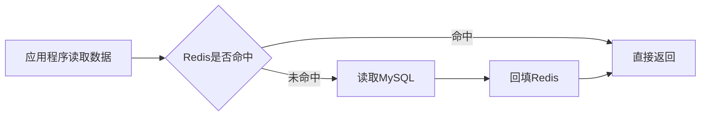

# 数据库设计

## 1. 数据库表设计

### 1.1 用户服务

#### 1.1.1 用户信息表

描述用户相关信息：用户Id、昵称、密码、邮箱、状态。

| 字段     | 类型            | 约束 | 备注               |
| -------- | --------------- | ---- | ------------------ |
| ID       | BIGINT UNSIGNED | PK   | 主键               |
| 用户Id   | VARCHAR(32)     | UNI  |                    |
| 用户昵称 | VARCHAR(32)     | UNI  |                    |
| 用户邮箱 | VARCHAR(255)    | UNI  |                    |
| 用户密码 | TEXT            |      | 存储带盐的密码哈希 |
| 用户状态 | INT             |      |                    |

注意：

- 用户Id、用户昵称、用户邮箱必须唯一
- 用户状态目前两种：登录状态、离线状态
- 出于安全性考虑，数据库中仅存储带盐的密码哈希，不保存明文或可逆加密密码

用户信息表涉及到的相关操作：

- 检测用户昵称是否唯一
- 检测用户邮箱是否唯一
- 通过用户Id获取用户信息
- 通过用户昵称获取用户信息(密码登录)
- 通过用户邮箱获取用户信息(邮箱登录)
- 持久化用户信息

#### 1.1.2 会话表

HTTP本身不保存请求之间的状态，每次请求相互独立，登录后需要一种方式让后续请求“认得”用户，通常做法是服务端生成 sessionId 返回给客户端，客户端每次请求带上 sessionId，服务端根据 sessionId 查出对应的用户信息。

| 字段     | 类型            | 约束 | 备注                         |
| -------- | --------------- | ---- | ---------------------------- |
| ID       | BIGINT UNSIGNED | PK   |                              |
| 会话ID   | VARCHAR(32)     | UNI  |                              |
| 用户ID   | VARCHAR(32)     |      |                              |
| 过期时间 | BIGINT UNSIGNED |      | Unix毫秒，到期后不可用于认证 |

注意：用户可能同时在：手机App登录、电脑Web登录、平板登录，每个登录产生一个独立的 sessionId ，所以 userId 在表中会出现多次。

会话表涉及到的相关操作：

- 创建会话
- 获取指定会话
- 删除指定会话

### 1.2 文件服务

#### 1.2.1 文件信息表

保存Excel 和 SQLite文件的元信息。

| 字段      | 类型            | 约束 | 备注                              |
| --------- | --------------- | ---- | --------------------------------- |
| ID        | BIGINT UNSIGNED | PRI  |                                   |
| 文件ID    | VARCHAR(32)     | UNI  |                                   |
| 文件名称  | VARCHAR(64)     |      |                                   |
| 文件后缀  | VARCHAR(8)      |      |                                   |
| 文件大小  | BIGINT UNSIGNED |      |                                   |
| 上传时间  | BIGINT UNSIGNED |      |                                   |
| fastDFSID | VARCHAR(255)    |      | 可以为空，保存完整FastDFS文件标识 |
| 用户ID    | VARCHAR(32)     |      |                                   |

文件信息表涉及到的相关操作：

- 保存文件元数据
- 通过文件Id加载文件元数据
- 通过文件Id删除文件元数据
- 更新文件元数据
- 获取用户上传文件列表

#### 1.2.2 worksheet信息表

Excel文件解析之后，每个worksheet数据会存储到数据库，因此需要维护worksheet和其在数据库中实际表名的映射关系。

| 字段        | 类型            | 约束 | 备注                          |
| ----------- | --------------- | ---- | ----------------------------- |
| ID          | BIGINT UNSIGNED | PRI  |                               |
| 文件ID      | VARCHAR(32)     | FK   | 同一个文件可以包含多个工作表  |
| worksheet名 | VARCHAR(32)     |      |                               |
| 数据库表名  | VARCHAR(64)     |      | 每个worksheet对应一张数据库表 |

worksheet信息表涉及相关操作：

- 保存worksheet记录
- 通过fileId获取worksheet列表
- 通过fileId删除worksheet记录，并使对应缓存失效

注意：worksheet映射表中的元素会在Excel文件删除后自动删除，**在创建数据库表时，需要将文件信息表的文件Id作为worksheet映射表的外键，并建立级联删除关系**。

### 1.3 AI服务

本项目使用 `libSource/ModelBridge` 实现模型交互**。AI 服务将 `DataManager` 注入 `SessionManager` 后，ModelBridge 才会将会话及消息持久化到 SQLite**；未注入时仅保存在内存。聊天消息不在 MySQL 中重复存储，通过 ModelBridge 接口读取。默认数据库路径为进程工作目录下的 `DBFiles/modelbridge.db`，部署时应配置持久化路径并保证重启后仍可访问。

**以下两张表由 ModelBridge 的 `SDK/schema.sql` 管理。**

#### 1.3.1 聊天会话表

`sessions` 表保存会话元数据，按用户查询会话概要；时间使用 Unix 毫秒。

| 字段          | 类型    | 约束       | 备注                           |
| ------------- | ------- | ---------- | ------------------------------ |
| sessionId     | TEXT    | PK、非空   | 聊天会话ID                     |
| userId        | TEXT    | 非空       | 所属用户ID                     |
| modelConfigId | TEXT    | 非空       | 最近添加消息所用模型连接ID     |
| title         | TEXT    | 非空       | 会话标题，可为空字符串         |
| createdAt     | INTEGER | 非空       | 创建时间，Unix毫秒             |
| updatedAt     | INTEGER | 非空       | 最近活动时间，Unix毫秒         |
| generation    | INTEGER | 非空、非负 | 清空消息时递增，防止旧请求写回 |

ModelBridge会话管理涉及操作：

- 创建会话
- 获取指定会话消息
- 删除指定会话
- 获取会话列表

#### 1.3.2 消息表

`messages` 表保存完整消息链，包括系统消息和工具调用信息。主键为 `(sessionId, messageId)`，`(sessionId, position)` 唯一；会话删除时级联删除消息。

| 字段                            | 类型    | 约束         | 备注                          |
| ------------------------------- | ------- | ------------ | ----------------------------- |
| sessionId                       | TEXT    | PK、FK、非空 | 所属会话                      |
| messageId                       | TEXT    | PK、非空     | 消息ID                        |
| position                        | INTEGER | 非空         | 会话内排序，可为负数          |
| role                            | INTEGER | 非空，0～3   | System、User、Assistant、Tool |
| content                         | TEXT    | 非空         | 消息内容，可为空字符串        |
| createdAt                       | INTEGER | 非空         | 创建时间，Unix毫秒            |
| toolCallId、toolName、toolCalls | TEXT    | 非空         | 工具调用及结果信息            |
| reasoningContent、protocolData  | TEXT    | 非空         | 推理内容及协议原始数据        |
| modelConfigId、modelName        | TEXT    | 非空         | 消息使用的模型配置及名称快照  |
| reasoningEffort                 | TEXT    | 可空         | 推理级别                      |
| thinkingEnabled                 | INTEGER | 可空，0或1   | 思考开关                      |

#### 1.3.3 聊天会话表

ModelBridge 按用户保存会话，但不管理文件、数据库连接等业务关联。Chat2Data 需要维护业务会话表，并通过与 ModelBridge 相同的聊天会话ID关联；用户身份由登录会话确定，按会话ID操作前仍须校验归属。ModelBridge 的会话ID带前缀且长度不固定，业务表使用 `VARCHAR(128)` 保存完整ID。

| 字段             | 类型            | 约束 | 备注                     |
| ---------------- | --------------- | ---- | ------------------------ |
| ID               | BIGINT UNSIGNED | PK   |                          |
| 聊天会话ID       | VARCHAR(128)    | UNI  | ModelBridge生成的完整ID  |
| 用户ID           | VARCHAR(32)     |      |                          |
| 聊天会话标题     | TEXT            |      | 允许为空                 |
| 会话创建时间     | BIGINT UNSIGNED |      |                          |
| 会话最后活跃时间 | BIGINT UNSIGNED |      |                          |
| 消息个数         | INT             |      |                          |
| 模型名称         | TEXT            |      |                          |
| 文件ID           | VARCHAR(32)     |      | 允许为空                 |
| 会话类型         | VARCHAR(20)     |      |                          |
| 数据库连接信息   | TEXT            |      | 允许为空，不保存明文密码 |

聊天会话表涉及到的操作如下：

- 新建聊天会话信息
- 通过聊天会话id获取聊天会话信息
- 通过聊天会话Id删除指定聊天会话信息
- 更新聊天会话信息
- 通过用户Id获取聊天会话信息列表

同一文件可以关联多个聊天会话，每个聊天会话最多关联一个文件，因此以业务聊天会话表的文件ID为关联依据，文件信息表不再保存单个聊天会话ID。删除文件时，按业务**要求查找并删除所有关联会话及其 ModelBridge 消息**，再清理文件及 Worksheet 数据

标题、时间、模型名称及消息数量属于业务侧展示数据：会话标题及时间以 ModelBridge 为准或在业务表中同步维护；模型名称由模型配置或消息快照取得；消息数量和首条用户消息需业务侧根据消息计算或维护，`getSessions(userId)` 返回的是不含消息的概要。创建、更新和删除跨存储失败时需补偿，避免两侧记录不一致。

## 2. 缓存设计

### 2.1 Cache-Aside模式

Chat2Data项目中产生的用户信息、会话信息、文件信息、聊天会话等信息，已经通过上述表存入到MySQL中。由于MySQL中的数据实际是存入在磁盘上的，每次获取数据时如果都直接从数据库获取，无疑会降低系统的响应速度，并且增加了数据库的压力。

因此对于项目中需要高频使用的数据将其缓存到redis中，主要缓存以下数据：

- 用户信息
- 会话信息
- 邮箱校验码
- 文件元信息
- 聊天会话信息

主要使用Cache-Aside(旁路缓存)策略：

- 写：只写数据库(必要时再更新/删除缓存)
- 读：先查缓存，未命中时在查询数据库并回填缓存

在本项目中，数据变更先写数据库，成功后使对应缓存失效；读取时按需回填并设置 TTL。缓存失效失败不能只记录日志后继续使用旧缓存，需要重试或采取其他措施避免返回过期数据。

### 2.2 缓存策略

#### 2.2.1 用户信息缓存策略

写用户：先写数据库，写入成功之后再删除缓存。

读用户：先查redis，命中后直接返回，未命中则查数据库，查到后写入redis。

TTL：用户信息设置3600s过期时间，避免长时间缓存导致数据陈旧，也能减少频繁回源导致数据库压力

#### 2.2.2 会话缓存策略

创建会话：先写数据库，后删除redis；读取回填时设置不超过会话剩余有效期的TTL。

验证会话：先读redis，未命中查数据库；仅有效会话可回填，TTL不超过数据库中记录的剩余有效期。

**删除会话(延迟双删)：先删redis，再删数据库，休眠500ms后再删缓存**

延迟双删只能降低并发回填旧值的概率，不能保证强一致；删除或退出登录后验证会话时，还需确保不会因旧缓存而继续认证，并对缓存失效失败进行重试或降级处理。

**TTL：会话有效期为3天；会话表应保存过期时间，数据库和缓存均检查有效期，避免缓存过期后从数据库恢复已过期会话。**

#### 2.2.3 验证码缓存策略

仅reids，不落地数据库，带5分钟过期时间 和 单次消费保证。

#### 2.2.4 文件元数据缓存策略

读取文件元数据：先从redis获取，命中时返回，未命中则查询数据库，查到后写入redis。

保存文件元数据：先写数据库，后删除redis；读取回填时设置3天TTL。

更新文件元数据：先更新数据库，后删除redis。

删除文件元数据(延迟双删)：先删redis，再删数据库，休眠500ms后再删缓存

#### 2.2.5 聊天会话缓存策略

新建聊天会话：先写数据库，再删redis；读取回填时设置3天TTL。

获取聊天会话列表：**一次性获取当前用户所有会话列表，理论应该先查缓存，但缓存中一般保存的是一些高频访问数据，用户所有会话信息不一定在缓存，此处直接到数据库查询了。**

更新聊天会话：先更新数据库，后删除redis。

删除聊天会话(延迟双删)：先删redis，再删数据库，休眠500ms后再删缓存

#### 2.2.6 Worksheet映射信息缓存策略

Excel预览和数据分析都需要查询文件对应的Worksheet及数据库表名。将映射信息缓存到redis，可以减少重复查询。

缓存内容：文件ID、Worksheet名称及对应的数据库表名。

读取映射：先校验当前用户对文件的访问权限，再查询缓存；缓存未命中时查询数据库并回填。

更新映射：文件重新解析或删除后，使对应缓存失效。回填时可先设置1小时TTL，后续根据访问情况调整。

#### 2.2.7 模型列表缓存策略

用户进入页面或新建会话时需要获取模型列表。模型配置变化较少时，可以缓存用于展示的模型列表，减少重复加载。

缓存内容：模型配置ID、模型名称及模型描述。用户拥有不同模型配置时，按用户区分缓存。

读取模型列表：先查缓存；缓存未命中时读取服务端模型配置并回填。模型配置变更后使对应缓存失效。

TTL：可先设置10分钟，后续根据模型配置更新频率调整。创建会话时仍需校验模型配置是否可用。

#### 2.2.8 数据库连接信息缓存策略

智能DB页面需要展示用户建立的数据库连接。连接管理功能实现后，可以缓存用于展示的连接信息，减少重复查询。

缓存内容：连接ID、所属用户ID、数据库类型及连接状态。连接状态应由实际持有连接的服务确认。

读取连接信息：先校验用户身份，再按用户查询缓存；缓存未命中时向连接管理服务查询并回填。

TTL：可先设置1分钟，且缓存有效期应短于连接有效期。连接断开、过期或所属服务重启后，使对应缓存失效。
