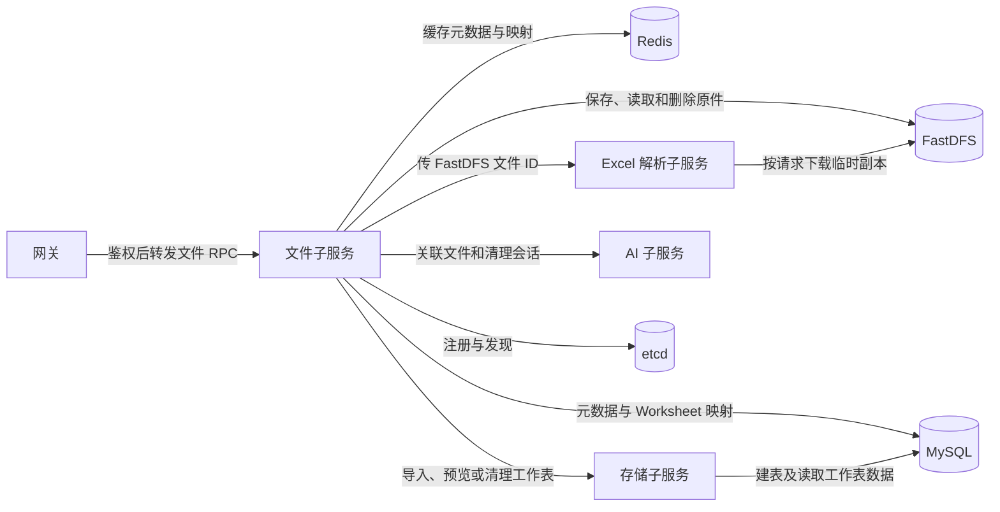
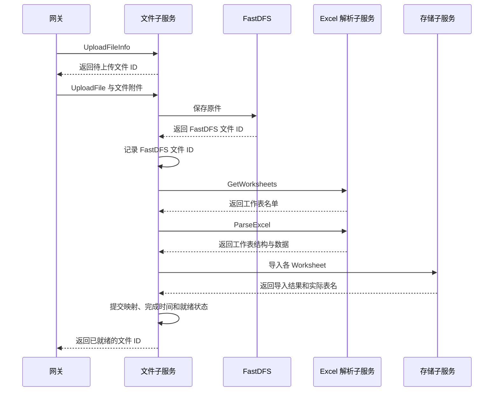

# 文件子服务设计

## 1. 结构设计

文件子服务接收网关转发的文件管理请求，保存原始文件和元数据，并协调 Excel 解析、工作表导入及聊天会话关联。存储子服务和 AI 子服务也可以查询相应的文件信息。 [项目设计](项目设计.md#234-详细流程图) · [网关子服务](网关子服务.md)

| 组件 | 职责 |
| --- | --- |
| `FileServiceImpl` | 读取 Protobuf 参数和 brpc 附件，返回业务响应 |
| `FileBusiness` | 校验文件归属，组织上传、解析、导入、预览和删除 |
| 文件及 Worksheet 数据访问层 | 通过 MySQL 保存元数据与表映射，通过 Redis 缓存按文件 ID 的查询 |
| `FileServer`、`FileServerBuilder` | 管理监听、etcd 注册及下游服务发现 |



## 2. 接口设计

协议包为 `chat2Data`，完整服务名为 `chat2Data.FileService`。请求带 `request_id`、`session_id` 和 `user_id`。网关通过用户服务的 `IsSessionValid` 获取可信 `user_id`，内部调用方传递已鉴权的用户身份。文件服务按用户校验目标文件归属。响应原样回传 `request_id`，`error_code = 0` 表示业务成功，此时 `error_msg` 为空。调用方先判断 brpc 传输状态，再检查业务错误码。 [文件协议](../proto/fileService.proto) · [用户协议](../proto/userService.proto)

| RPC 方法 | HTTP 入口或内部调用方 | 公共字段以外的请求参数 | 成功结果 |
| --- | --- | --- | --- |
| `UploadFileInfo` | `POST /api/file/upload/info` | `file_info`，包含名称、字节数和后缀 | 业务文件 ID |
| `GetFileInfo` | `GET /api/file/info` | `file_id` | 文件元数据 |
| `UploadFile` | `POST /api/file/upload` | `file_id`、请求附件 | 已上传并完成导入的文件 ID |
| `DownloadFile` | `GET /api/file/download` | `file_id` | 文件名、原始文件字节作为响应附件 |
| `DeleteFile` | `DELETE /api/file/{fileId}` | `file_id` | 公共响应字段，成功表示相关资源已清理 |
| `PreviewExcel` | `POST /api/file/preview` | `file_id`，可选的 `sheet_name`、`page_number`、`page_size` | 文件信息、列名和分页数据 |
| `GetFileList` | `POST /api/file/list` | 用户身份来自公共字段 | 当前用户的已就绪文件列表 |
| `HandleFileChatSessionMap` | `POST /api/file/chat/map` | `file_id`、`chat_session_id` | 公共响应字段 |
| `UploadSQLiteFile` | `POST /api/file/sqlite/upload` | `filename`、请求附件 | 已上传的文件 ID |
| `GetSQLiteFile` | 存储子服务 | `file_id` | SQLite 原件的完整 FastDFS 文件 ID |
| `GetWorksheetDBTables` | AI 子服务 | `file_id` | 已导入 Worksheet 对应的实际表名列表 |

- 浏览器使用业务 `fileId` 管理文件。远端定位符 `fdfs_file_id` 用于子服务间读取原件。
- 上传时网关把 HTTP 二进制请求体放入 `request_attachment()`。下载成功时把 `response_attachment()` 作为 HTTP 响应体，并用 RPC 返回的 `file_name` 设置下载文件名。上传和下载均使用 Protobuf 传递元数据与业务状态。 [bRPC 附件机制](https://brpc.apache.org/docs/server/basics/#attachment)
- 网关把 HTTP 的 `page` 映射为 `page_number`，把每行的 `cells` 映射为预览 JSON 的二维数组 `data`。文件大小、Unix 毫秒时间戳和分页计数按 HTTP 契约输出为 JSON 数字。 [HTTP 接口设计](接口设计.md#13-文件子服务) · [前端文件接口](../wwwroot/src/api/files.ts)
- 业务错误使用公共错误码预留的 `200～299`，实现时细分参数无效、文件不可用、存储或解析失败、下游调用失败等情况。 [公共错误定义](../common/errorHandler.hpp)

## 3. 数据与业务流程

### 3.1 数据存储

FastDFS 保存 Excel 和 SQLite 文件原件。MySQL 文件信息表保存文件 ID、名称、后缀、字节数、用户 ID、上传时间和完整 FastDFS 文件 ID。初次登记时用现有上传时间字段记录登记时刻，文件就绪时更新为完成时刻。对外返回已就绪文件的 `upload_time`，单位为 Unix 毫秒。Excel 数据由存储子服务按 Worksheet 写入 MySQL，文件服务保存文件 ID、Worksheet 原名和实际表名的映射。聊天会话关联以 AI 服务维护的业务会话表为准，同一文件可以被多个会话引用。 [数据库设计](数据库设计.md#12-文件服务) · [聊天会话关联](数据库设计.md#133-聊天会话表)

文件信息表新增一个状态字段，区分待上传、上传中、已就绪和删除中。上传或删除时按当前状态原子更新，同一文件的修改操作串行执行。列表与文件读取只接受已就绪记录。

待上传记录从首次登记起保留 24 小时，复用的时间字段在重试时保持登记时刻。失败后在原期限内清理完成即可重试，沿用 `file_id`。到期后只回收已处于待上传状态的记录。上传中和删除中的记录保留到清理结束。

失败后的清理复用文件状态、已记录的 FastDFS 文件 ID 和按文件定位的表。Excel 上传失败后，确认旧操作已经结束并清理完成，再清空 FastDFS 文件 ID 并恢复待上传。删除失败时保留删除中的文件记录，调用方可用原文件 ID 重试。

现有建表脚本包含用户与会话表。实现文件数据访问层时按相同的 ODB 组织方式补齐文件信息表和 Worksheet 映射表，文件 ID 使用唯一索引，Worksheet 映射通过文件 ID 建立外键。 [建表脚本](../data/sql/create_tables.sql) · [数据构建配置](../data/CMakeLists.txt)

| Redis 键 | 用途 | 回填有效期 |
| --- | --- | --- |
| `file:{fileId}` | 文件元数据 | 3 天 |
| `worksheet:{fileId}` | Worksheet 与实际数据表的映射 | 1 小时 |

两个键使用 Hash 的 `data` 字段保存 JSON，复用项目的 `Utils::ReadCache` 和 `Utils::WriteCache`。MySQL 文件状态和归属是文件可读性的依据，确认已就绪且归属正确后使用缓存，未命中则回填。删除时沿用用户子服务的延迟双删顺序，先清除文件及映射缓存，再在 MySQL 事务中删除文件记录及映射，等待 500 毫秒后再次清除缓存，成功后提交事务。第二次清除失败时回滚，保留删除中记录便于重试。按用户列出文件时从 MySQL 查询。 [现有双删实现](../svc_userService/sessionManager.cpp) · [缓存策略](数据库设计.md#22-缓存策略)

### 3.2 Excel 上传、解析与导入



1. `UploadFileInfo` 校验用户、文件名、后缀和申报大小，保存待上传元数据并返回 `file_id`。Excel 后缀规范化为 `xlsx`，大小上限按前端现有值 `10 × 1024 × 1024` 字节执行。
2. `UploadFile` 按 `file_id` 校验用户归属和上传状态，确认附件非空、实际字节数与申报值一致且在上限内。文件子服务把原件保存至 FastDFS，取得完整文件 ID。
3. 文件子服务向 `excelService` 调用 `GetWorksheets` 获取工作表原名，再发送 `ParseExcel`。解析节点在每次 RPC 内下载、读取并清理临时副本。
4. 把按原顺序排列的 `WorksheetData` 交给存储子服务建表并取得实际表名。文件子服务核对返回映射，在一次 MySQL 事务内按工作簿顺序逐条写入映射，并提交就绪状态和完成时间。
5. 第二步失败时用原 `file_id` 清理已创建的表和已记录的 FastDFS 对象。原件 ID 已保存后才可能开始导入，因此只在该 ID 存在时请求存储子服务清理。旧操作仍在执行时，重试请求报告文件处理中。已就绪文件再次调用 `UploadFile` 时报告已上传，调用方可用 `GetFileInfo` 确认结果。

文件服务复用现有 Excel 协议，导入和清理按第 3.6 节交接。FastDFS 上传取得完整 ID 后立即记录，再发起解析。FastDFS 分配 ID 的方式决定了服务在收到或记录 ID 之前中断时，清理进度可能缺少可定位的远端对象，该情况归入存储巡检。 [上传需求](需求文档.md) · [前端大小限制](../wwwroot/src/lib/constants.ts) · [Excel 解析服务](Excel解析服务.md#11-上传与解析链路) · [Excel 协议](../proto/excelParseService.proto)

### 3.3 SQLite 上传与获取

`UploadSQLiteFile` 一次接收文件名和附件。接受 `.db` 单文件快照，大小上限与 Excel 相同，为 10 MiB。写入 FastDFS 前检查 SQLite 的文件头。文件服务先登记上传中记录，再保存 FastDFS 原件，记录远端 ID 并提交已就绪状态。失败时先清理可定位的原件，清理完成后再删除未就绪记录。每次新的上传请求分配一个文件 ID，上传结果可从已就绪文件列表核对。 [SQLite 文件格式](https://www.sqlite.org/fileformat.html#the_database_header) · [SQLite 上传接口](接口设计.md#139-上传sqlite文件)

存储子服务建立 SQLite 连接时，通过 `GetSQLiteFile` 获取 FastDFS ID，下载连接所用副本，并检查数据库能否正常打开。副本随对应连接释放。需要合并 WAL 中未落入主文件的变更时，上传方先导出完整快照。

### 3.4 文件查询、预览与下载

- `GetFileInfo` 返回已就绪文件的元数据。`GetFileList` 按上传时间倒序返回已就绪文件，上传时间相同时按文件 ID 升序。
- `PreviewExcel` 以 Worksheet 原名精确定位，`sheet_name` 为空时按工作簿顺序返回各表第一页。指定工作表时页码从 1 开始，0 取默认值 1。页容量允许 1 至 100，0 取默认值 50。负数、超限页容量、页码超过指定表末页及未知表名返回对应业务错误。
- 同一文件的 Worksheet 映射按现有自增主键 `id` 升序读取。写入时在同一事务内按工作簿顺序分配主键，缓存保存同一顺序的列表，因此无需单独的工作表序号。
- 分页结果的 `total_rows` 只计数据行。`total_pages = max(1, ceil(total_rows / page_size))`，仅表头时返回空的第一页。列使用导入顺序，行使用 Excel 的原始行序。每行的字符串数等于 `col_count`，SQL `NULL` 映射为空字符串。
- 预览响应还受 brpc 消息上限限制。结果超限时报告错误，调用方可指定工作表或降低页容量。
- `DownloadFile` 根据文件元数据中的完整 FastDFS 文件 ID 取得原始文件，由网关将附件内容返回浏览器。

### 3.5 文件关联与删除

文件服务确认 Excel 文件已就绪且属于当前用户，再调用 AI 服务更新指定聊天会话的文件关联。同一文件的关联操作与删除操作串行。AI 服务校验聊天会话归属并保存关联，保留一个文件对应多个会话的关系。AI 服务通过 `GetWorksheetDBTables` 获取分析所需的实际表名。 [会话接口](接口设计.md#24-ai子服务) · [关联关系设计](数据库设计.md#133-聊天会话表)

1. 校验归属，将已就绪文件标记为删除中，重试时沿用删除中状态。清理期间暂停文件读取及新的会话关联。
2. Excel 文件先交由 AI 子服务删除关联会话及 ModelBridge 消息，再由存储子服务清理物理表。SQLite 文件向存储子服务确认是否有正在建立或已建立的连接。有连接时恢复已就绪并提示先断开。查询失败则保留删除中状态，等待重试。
3. 删除 FastDFS 原件，再按第 3.1 节的延迟双删流程提交 MySQL 文件元数据及 Worksheet 映射清理。FastDFS 明确返回原件不存在时，视为该对象已清理。连接或存储错误保留重试。实现删除调用时需取得 SDK 的具体错误结果，BreezeFDFS 当前只返回成功或失败。
4. **全部相关资源清理完成后才返回成功。** 部分失败时保留删除中记录，同一文件 ID 可重试。下游确认资源已移除时继续下一步。文件记录已删除后再次调用，按文件不可用处理。

### 3.6 下游调用契约

下表约定实现文件服务所需的下游调用，协议定义随对应子服务落地。下游根据 `user_id` 和业务 `file_id` 核对资源归属，RPC 公共字段沿用请求 ID、业务错误码和错误描述。

| 调用 | 业务输入 | 成功结果与重试约定 |
| --- | --- | --- |
| 存储 `ImportExcelData` | `user_id`、`file_id`、`fdfs_file_id`、按工作簿顺序排列的 `WorksheetData` | 按输入顺序返回 `worksheet_name` 与实际 `table_name` |
| 存储 `PreviewImportedWorksheet` | `user_id`、`file_id`、`table_name`、页号、页容量 | 返回用户列名、数据行数、页号和一页文本数据 |
| 存储 `DropTableExcel` | `user_id`、`file_id`、当前 `fdfs_file_id` | 按该文件清理物理表，目标已清理时成功 |
| 存储 `HasSQLiteFileConnections` | `user_id`、`file_id` | 按存储子服务的连接记录查询正在建立或已建立的连接。存储子服务在调用 `GetSQLiteFile` 前登记连接状态，连接失败时清理登记 |
| AI `UpdateSessionFile` | `user_id`、`chat_session_id`、`file_id` | 更新当前用户的会话关联，重复关联同一文件返回成功 |
| AI `DeleteFileChatSessions` | `user_id`、`file_id` | 逐个删除关联会话及 ModelBridge 消息，保留待清理的会话标识以便重试，直至全部关联资源已移除 |

存储子服务按文件串行处理导入和清理。导入前核对上传状态和当前 FastDFS 文件 ID，清理也核对对应 ID，避免旧请求操作新上传的文件。物理表名使用 `excel_<文件记录主键>_<工作表在请求中的位置>`，位置从 1 开始。存储子服务按完整的文件表名前缀定位该文件的物理表，包括已建表但尚未保存映射的情况。导入成功后才返回映射。 [MySQL 隐式提交](https://dev.mysql.com/doc/refman/8.0/en/implicit-commit.html)

导入时为每行写入唯一的 Worksheet 数据行号，由存储子服务使用 MySQL 8.0 的不可见列保存。内部列名从 `_chat2data_row_no` 起选，与用户列冲突时递增后缀。预览按该列升序，使数据行重复时也能按原始行序分页。返回结构、样本和预览时使用用户列。按单元格类型写入空值，原生 `Empty` 入库为 SQL `NULL`。推断类型无法容纳实际值时，整列按文本保存以保留数据。 [MySQL 不可见列](https://dev.mysql.com/doc/refman/8.0/en/invisible-columns.html)

## 4. 程序主流程

1. `main.cpp` 读取 gflags、设置 BreezeLog 日志级别并安装退出信号处理函数。
2. 构建器校验配置并检查注册中心，创建 MySQL、Redis、FastDFS 客户端和业务对象。
3. brpc 启动监听，发现 `excelService`、`dbService` 和 `aiService`。文件服务以 `/fileService/节点标识` 为键向 etcd 注册可访问的 RPC 地址。
4. 主线程收到退出信号后停止续租和监听，等待在途 RPC，再释放依赖客户端与资源。

## 5. 配置、编译和运行

### 5.1 启动参数规划

| 参数 | 建议默认值 | 说明 |
| --- | --- | --- |
| `--file_port` | `9004` | brpc 监听端口，对应开发容器已有映射 |
| `--file_service`、`--file_address` | `fileService`、`dev-env-service:<file_port>` | etcd 注册名及节点地址，与网关发现配置一致 |
| `--registry_address` | `http://dev-etcd:2379` | etcd 端点 |
| `--excel_service`、`--db_service`、`--ai_service` | `excelService`、`dbService`、`aiService` | 下游发现名称 |
| `--fdfs_trackers` | `dev-tracker:22122` | FastDFS Tracker |
| `--mysql_host`、`--mysql_port`、`--mysql_database` | `dev-mysql`、`3306`、`chat2data` | MySQL 连接配置，账号按部署环境提供 |
| `--redis_host`、`--redis_port`、`--redis_db` | `dev-redis`、`6379`、`0` | Redis 连接配置 |
| `--log_level` | `info` | BreezeLog 日志级别 |

服务名和地址按当前网关及 Excel 服务的配置规划。 [网关入口](../svc_gatewayService/main.cpp) · [Excel 服务入口](../svc_excelParseService/main.cpp)

### 5.2 编译

开发容器中的项目根目录提供 `file_service_proto` 目标，生成 C++ 协议类并编译静态库。 [协议构建配置](../proto/CMakeLists.txt)

```bash
cmake -S . -B build
cmake --build build --target file_service_proto
```

## 6. 测试计划

- 协议阶段编译 `file_service_proto`，并用 `protoc` 检查统一包名下各协议的符号。
- 实现阶段优先验证 Excel 两步上传、重试复用文件 ID、列表与预览、下载原件、SQLite 一次上传及查询、多个会话引用同一文件和删除后的数据清理。错误场景集中在业务中常见的无权限访问、下载或导入失败、删除中途依赖失败。
