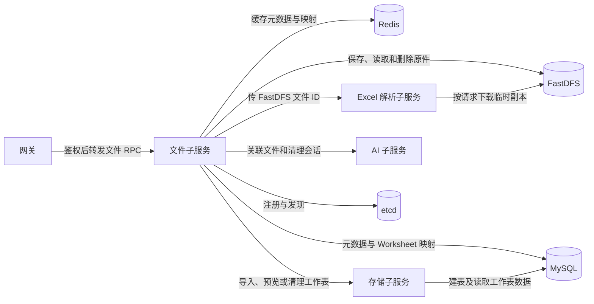
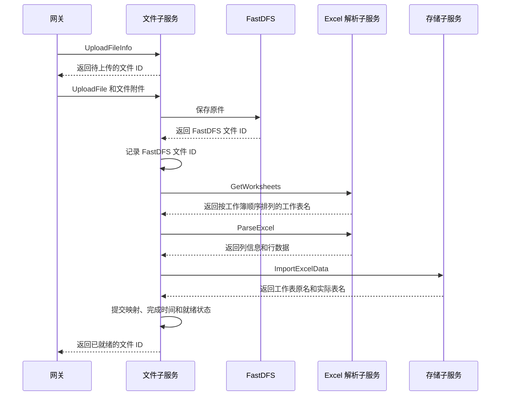
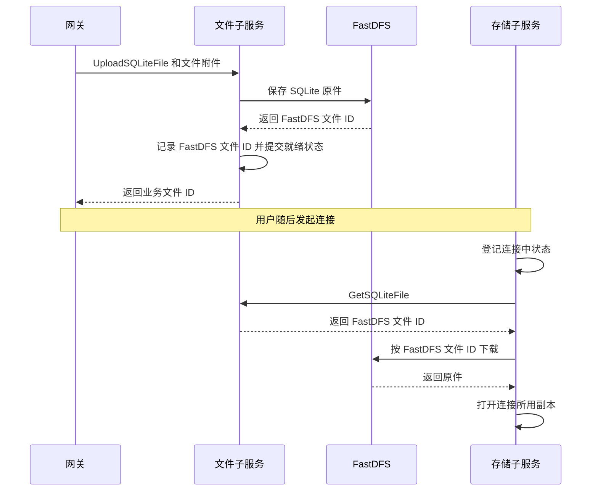
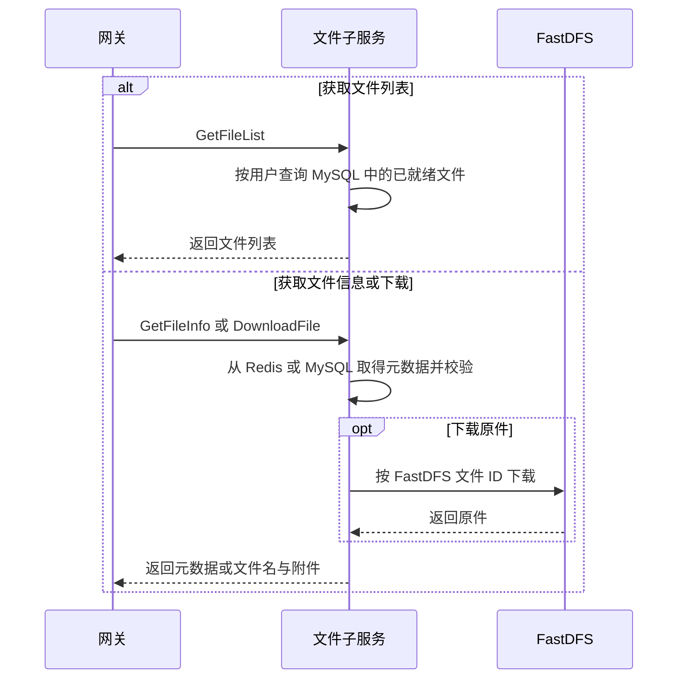
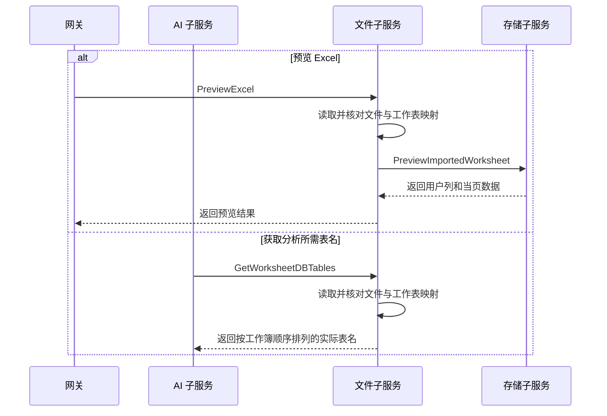
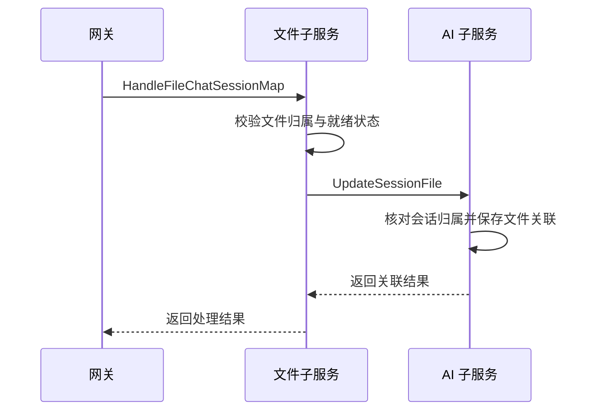
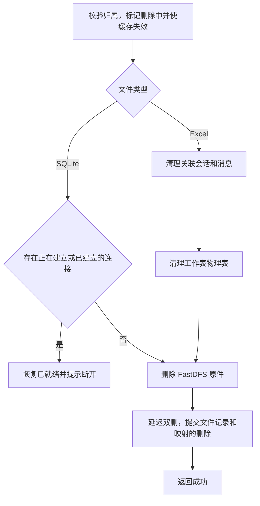

# 文件子服务设计

## 1. 结构设计

文件子服务接收网关转发的文件管理请求，保存原始文件和元数据，并协调 Excel 解析、工作表导入及聊天会话关联。存储子服务和 AI 子服务也可以查询相应的文件信息。 [项目设计](项目设计.md#234-详细流程图) · [网关子服务](网关子服务.md)

| 组件                                  | 职责                                                           |
| ------------------------------------- | -------------------------------------------------------------- |
| `FileServiceImpl`                   | 读取 Protobuf 参数和 brpc 附件，返回业务响应                   |
| `FileBusiness`                      | 校验文件归属，组织上传、解析、导入、预览和删除                 |
| 文件及 Worksheet 数据访问层           | 通过 MySQL 保存元数据与表映射，通过 Redis 缓存按文件 ID 的查询 |
| `FileServer`、`FileServerBuilder` | 管理监听、etcd 注册及下游服务发现                              |



## 2. 接口设计

协议包为 `chat2Data`，完整服务名为 `chat2Data.FileService`。请求带 `request_id`、`session_id` 和 `user_id`。网关通过用户服务的 `IsSessionValid` 获取可信 `user_id`，内部调用方传递已鉴权的用户身份。文件服务按用户校验目标文件归属。响应原样回传 `request_id`，`error_code = 0` 表示业务成功，此时 `error_msg` 为空。调用方先判断 brpc 传输状态，再检查业务错误码。 [文件协议](../proto/fileService.proto) · [用户协议](../proto/userService.proto)

| RPC 方法                     | HTTP 入口或内部调用方            | 公共字段以外的请求参数                                             | 成功结果                             |
| ---------------------------- | -------------------------------- | ------------------------------------------------------------------ | ------------------------------------ |
| `UploadFileInfo`           | `POST /api/file/upload/info`   | `file_info`，包含名称、字节数和后缀                              | 业务文件 ID                          |
| `GetFileInfo`              | `GET /api/file/info`           | `file_id`                                                        | 文件元数据                           |
| `UploadFile`               | `POST /api/file/upload`        | `file_id`、请求附件                                              | 已上传并完成导入的文件 ID            |
| `DownloadFile`             | `GET /api/file/download`       | `file_id`                                                        | 文件名、原始文件字节作为响应附件     |
| `DeleteFile`               | `DELETE /api/file/{fileId}`    | `file_id`                                                        | 公共响应字段，成功表示相关资源已清理 |
| `PreviewExcel`             | `POST /api/file/preview`       | `file_id`，可选的 `sheet_name`、`page_number`、`page_size` | 文件信息、列名和分页数据             |
| `GetFileList`              | `POST /api/file/list`          | 用户身份来自公共字段                                               | 当前用户的已就绪文件列表             |
| `HandleFileChatSessionMap` | `POST /api/file/chat/map`      | `file_id`、`chat_session_id`                                   | 公共响应字段                         |
| `UploadSQLiteFile`         | `POST /api/file/sqlite/upload` | `filename`、请求附件                                             | 已上传的文件 ID                      |
| `GetSQLiteFile`            | 存储子服务                       | `file_id`                                                        | SQLite 原件的完整 FastDFS 文件 ID    |
| `GetWorksheetDBTables`     | AI 子服务                        | `file_id`                                                        | 已导入 Worksheet 对应的实际表名列表  |

- 浏览器使用业务 `fileId` 管理文件。远端定位符 `fdfs_file_id` 用于子服务间读取原件。
- 上传时网关把 HTTP 二进制请求体放入 `request_attachment()`。下载成功时把 `response_attachment()` 作为 HTTP 响应体，并用 RPC 返回的 `file_name` 设置下载文件名。上传和下载均使用 Protobuf 传递元数据与业务状态。（避免直接作为proto字段重复拷贝，消耗CPU资源） [bRPC 附件机制](https://brpc.apache.org/docs/server/basics/#attachment)
- 网关把 HTTP 的 `page` 映射为 `page_number`，把每行的 `cells` 映射为预览 JSON 的二维数组 `data`。文件大小、Unix 毫秒时间戳和分页计数按 HTTP 契约输出为 JSON 数字。 [HTTP 接口设计](接口设计.md#13-文件子服务) · [前端文件接口](../wwwroot/src/api/files.ts)
- 业务错误使用公共错误码预留的 `200～299`，实现时细分参数无效、文件不可用、存储或解析失败、下游调用失败等情况。 [公共错误定义](../common/errorHandler.hpp)

## 3. 数据与业务流程

### 3.1 数据存储

FastDFS 保存 Excel 和 SQLite 原件。MySQL 的文件信息表记录文件元数据、所属用户、状态和完整的 FastDFS 文件 ID。登记时在上传时间字段写入登记时刻，文件就绪时更新为完成时刻，对外返回的 `upload_time` 为 Unix 毫秒。

Excel 数据由存储子服务按工作表写入 MySQL。文件子服务保存工作表原名与实际表名的映射，会话与文件的关联由 AI 子服务维护。文件信息表的文件 ID 唯一，工作表映射通过该字段建立级联删除外键。实现时参考用户子服务的 ODB 映射和建表方式。 [数据库设计](数据库设计.md#12-文件服务) · [建表脚本](../data/sql/create_file_tables.sql)

| Redis 键               | 用途                   | 回填有效期 |
| ---------------------- | ---------------------- | ---------- |
| `file:{fileId}`      | 文件元数据             | 3 天       |
| `worksheet:{fileId}` | 工作表与实际表名的映射 | 1 小时     |

两个键均使用 Hash 的 `data` 字段保存 JSON。元数据缓存携带 `userId` 和 `status`，工作表映射按工作簿顺序保存。具体字段和失效规则见 [数据库设计的缓存策略](数据库设计.md#224-文件元数据缓存策略)。

### 3.2 上传并导入 Excel

**业务流程**

1. 浏览器先提交文件信息。网关鉴权后调用 `UploadFileInfo`，文件子服务校验元数据，登记待上传记录并返回业务文件 ID。
2. 浏览器接着用该 ID 上传原件。文件子服务在 `UploadFile` 中校验归属、上传状态和附件大小，将记录置为上传中，再保存原件并记录 FastDFS 文件 ID。
3. 文件子服务先调用 Excel 解析子服务的 `GetWorksheets` 取得工作表名单，再把名单按原顺序交给 `ParseExcel`，取得各工作表的列信息和行数据。
4. 接着调用存储子服务的 `ImportExcelData` 建表入库，取得工作表原名和实际表名。最后核对返回的映射，在同一个 MySQL 事务中按工作簿顺序逐条保存映射，更新完成时间和已就绪状态。事务提交后返回文件 ID。



**实现注意事项**

- 统一使用 `xlsx` 后缀，申报大小与附件大小一致，附件大小范围为 1 字节至 10 MiB。两个解析 RPC 各自按 FastDFS ID 下载工作簿，解析结束后清理各自的临时副本。 [前端大小限制](../wwwroot/src/lib/constants.ts) · [Excel 解析服务](Excel解析服务.md#11-上传与解析链路)
- 待上传记录从首次登记起**保留 24 小时**。第二步失败时，先确认旧操作结束，再按已记录的 FastDFS ID 清理该次导入的表和原件。清理完成后清空 FastDFS ID、恢复待上传，并在原期限内沿用原文件 ID 和登记时间。到期回收待上传记录，上传中的记录保留到资源清理完成。
- 旧操作仍在执行时返回文件处理中。已就绪文件再次提交时返回已上传，可通过 `GetFileInfo` 确认结果。FastDFS 返回完整 ID 后立即保存，供后续失败清理定位原件。
- `ImportExcelData` 接收用户 ID、业务文件 ID、FastDFS 文件 ID 和按工作簿排序的 `WorksheetData`，导入完成后按输入顺序返回映射。存储子服务按文件串行处理导入与清理，核对归属、上传状态和当前 FastDFS ID。 [MySQL 隐式提交](https://dev.mysql.com/doc/refman/8.0/en/implicit-commit.html)

### 3.3 上传 SQLite 并获取连接所需文件

**业务流程**

1. 浏览器选中 `.db` 文件并上传。网关鉴权后调用 `UploadSQLiteFile`，文件子服务校验文件名、附件大小及数据库文件头，然后分配文件 ID 并登记上传中记录。
2. 接着将原件保存到 FastDFS，记录完整的 FastDFS 文件 ID，再提交完成时间和已就绪状态。最后将业务文件 ID 返回给浏览器。
3. 用户随后发起连接。存储子服务登记连接中状态，再调用 `GetSQLiteFile`。文件子服务校验类型、归属和就绪状态后返回 FastDFS 文件 ID，由存储子服务下载副本并打开数据库。



**实现注意事项**

- 上传内容为最大 10 MiB 的 SQLite 单文件快照，存储子服务负责检查副本能否打开，并在连接释放时清理副本。 [SQLite 文件格式](https://www.sqlite.org/fileformat.html#the_database_header)
- 每次新上传分配一个文件 ID，已提交的结果可从文件列表核对。上传失败时先清理可定位的原件，再删除该条未就绪记录。连接失败时由存储子服务撤销连接登记。 [业务分析](业务分析.md#153-sqlite-数据库连接)

### 3.4 查询、下载和预览文件

#### 3.4.1 获取文件信息、列出文件和下载原件

**业务流程**

1. 网关先校验登录会话，再把可信用户 ID 随请求交给文件子服务。
2. 查看文件列表时，`GetFileList` 从 **MySQL** 查询当前用户的已就绪文件。获取指定文件时，`GetFileInfo` 先读 Redis，按缓存中的归属和状态校验，通过后返回元数据。缓存缺失时查询 MySQL，校验通过后回填。
3. 下载时，`DownloadFile` 复用指定文件的校验流程，再按 FastDFS ID 下载对应原件。最后在 RPC 响应中返回原文件名，由网关将响应附件作为下载内容发送给浏览器。



**实现注意事项**

- Redis 未命中时，在 MySQL 文件行锁内查询并回填已就绪记录。缓存命中且校验通过时直接使用缓存。文件列表按上传时间倒序，同一时间按文件 ID 升序。
- 下载成功后通过 `response_attachment()` 传输原件字节，RPC 消息中的 `file_name` 用于设置下载文件名。（注意这里避免使用proto字段进行文件二进制流的传输） [业务分析](业务分析.md#16-我的文件页面)

#### 3.4.2 预览 Excel 和获取实际表名

**业务流程**

1. 网关调用 `PreviewExcel` 后，文件子服务先读取文件元数据和工作表映射，校验该文件属于当前用户、类型为 Excel 且已就绪。
2. 接着根据工作表原名定位实际表。请求指定工作表时读取指定页，请求留空时按工作簿顺序读取各表的第一页。文件子服务把用户 ID、文件 ID、实际表名、页码和页容量交给存储子服务的 `PreviewImportedWorksheet`。
3. 最后将存储子服务返回的列名、数据行和分页信息与文件元数据一起返回给网关。AI 子服务通过 `GetWorksheetDBTables` 使用同一套校验和映射读取，取得按工作簿顺序排列的实际表名。



**实现注意事项**

- 一次从 Redis 批量读取元数据和映射，命中后用元数据校验归属、类型及状态。缓存缺失时，在同一 MySQL 事务内锁定文件行、核对权限并按需回填。映射按文件 ID 查询并用自增主键升序排序，工作表原名按原始字符串精确匹配。
- 页码从 1 起算，0 取默认值 1；页容量为 1 至 100，0 取默认值 50。负数、超限页容量、超过末页的页码及未知工作表名均返回业务错误。
- `total_rows` 只统计数据行，`total_pages = max(1, ceil(total_rows / page_size))`。只有表头时返回空的第一页。列按导入顺序返回，行按 Excel 原始顺序返回。每行的单元格数与 `col_count` 一致，SQL `NULL` 映射为空字符串。
- 预览响应超出 brpc 消息上限时返回错误，调用方可指定工作表或减小页容量。 [业务分析](业务分析.md#144-excel-文件预览)

### 3.5 关联聊天会话和删除文件

#### 3.5.1 关联已上传的 Excel

**业务流程**

1. 网关先转发文件 ID 和聊天会话 ID。文件子服务通过 `HandleFileChatSessionMap` 确认 Excel 文件属于当前用户并已就绪。
2. 接着调用 AI 子服务的 `UpdateSessionFile`，传入用户 ID、聊天会话 ID 和文件 ID。AI 子服务核对会话归属，再保存文件关联。
3. 最后由文件子服务将关联结果返回网关。之后 AI 子服务可按文件 ID 获取分析所需的实际表名。



**实现注意事项**

- 一个 Excel 文件可关联多个会话。关联信息由 AI 子服务的业务会话表保存，重复关联同一文件返回成功。同一文件的关联和删除按文件串行处理。 [业务分析](业务分析.md#146-文件与聊天会话的关联) · [业务会话表](数据库设计.md#133-聊天会话表)

#### 3.5.2 删除文件

**业务流程**

1. 用户确认删除后，网关调用 `DeleteFile`。文件子服务先校验归属，在文件行锁内将文件标记为删除中并清除两个缓存键。事务提交后开始清理资源。
2. Excel 文件先由 AI 子服务通过 `DeleteFileChatSessions` 清理关联会话与 ModelBridge 消息，再由存储子服务通过 `DropTableExcel` 清理物理表。SQLite 文件先通过 `HasSQLiteFileConnections` 检查连接，文件空闲时继续清理。
3. 接着删除 FastDFS 原件，再按用户子服务的延迟双删方式移除文件记录及级联映射。先清两个缓存键，再在 MySQL 事务内删除记录，等待 500 毫秒后第二次清缓存并提交。
4. 最后确认全部资源清理完成，再返回成功。



**实现注意事项**

- `DeleteFileChatSessions` 和 `HasSQLiteFileConnections` 按用户 ID 和业务文件 ID 处理。前者保留仍待清理的会话标识，供重试继续清理；后者根据存储子服务记录判断正在建立和已建立的连接。SQLite 文件有占用时恢复已就绪并提示先断开。
- `DropTableExcel` 还需核对当前 FastDFS ID，按文件清理已导入的表。目标已清理时继续后续步骤。FastDFS 确认原件不存在时同样继续；实现时通过 SDK 的具体错误区分原件已清理与连接或存储故障。
- 清理中途失败时保留删除中记录，后续请求用原文件 ID 重试。缓存删除失败时重试一次，持续失败则中止操作；已开启的 MySQL 删除事务随之回滚。文件记录清理后再次请求时返回文件不可用。 [业务分析](业务分析.md#16-我的文件页面) · [用户子服务延迟双删](../svc_userService/sessionManager.cpp)

## 4. 程序主流程

1. `main.cpp` 读取 gflags、设置 BreezeLog 日志级别并安装退出信号处理函数。
2. 构建器校验配置并检查注册中心，创建 MySQL、Redis、FastDFS 客户端和业务对象。
3. brpc 启动监听，发现 `excelService`、`dbService` 和 `aiService`。文件服务以 `/fileService/节点标识` 为键向 etcd 注册可访问的 RPC 地址。
4. 主线程收到退出信号后停止续租和监听，等待在途 RPC，再释放依赖客户端与资源。

## 5. 配置、编译和运行

### 5.1 启动参数规划

| 参数                                                     | 建议默认值                                       | 说明                                      |
| -------------------------------------------------------- | ------------------------------------------------ | ----------------------------------------- |
| `--file_port`                                          | `9004`                                         | brpc 监听端口，对应开发容器已有映射       |
| `--file_service`、`--file_address`                   | `fileService`、`dev-env-service:<file_port>` | etcd 注册名及节点地址，与网关发现配置一致 |
| `--registry_address`                                   | `http://dev-etcd:2379`                         | etcd 端点                                 |
| `--excel_service`、`--db_service`、`--ai_service`  | `excelService`、`dbService`、`aiService`   | 下游发现名称                              |
| `--fdfs_trackers`                                      | `dev-tracker:22122`                            | FastDFS Tracker                           |
| `--mysql_host`、`--mysql_port`、`--mysql_database` | `dev-mysql`、`3306`、`chat2data`           | MySQL 连接配置，账号按部署环境提供        |
| `--redis_host`、`--redis_port`、`--redis_db`       | `dev-redis`、`6379`、`0`                   | Redis 连接配置                            |
| `--log_level`                                          | `info`                                         | BreezeLog 日志级别                        |

服务名和地址按当前网关及 Excel 服务的配置规划。 [网关入口](../svc_gatewayService/main.cpp) · [Excel 服务入口](../svc_excelParseService/main.cpp)

### 5.2 编译

在开发容器中构建 `file_service`，同时生成协议、ODB 映射和文件建表脚本。 [协议构建配置](../proto/CMakeLists.txt)

```bash
cmake -S . -B build
cmake --build build --target file_service
```

启动前执行 [文件建表脚本](数据库建表操作.md)，按部署环境传入 MySQL、Redis 用户名和密码。文件服务已接入 Excel 解析 RPC。需要存储或 AI 子服务的操作在对应协议和服务接通前返回依赖错误。

## 6. 测试

- 协议阶段编译 `file_service_proto`，并用 `protoc` 检查统一包名下各协议的符号。
- 实现阶段优先验证 Excel 两步上传、重试复用文件 ID、列表与预览、下载原件、SQLite 一次上传及查询、多个会话引用同一文件和删除后的数据清理。错误场景集中在业务中常见的无权限访问、下载或导入失败、删除中途依赖失败。
