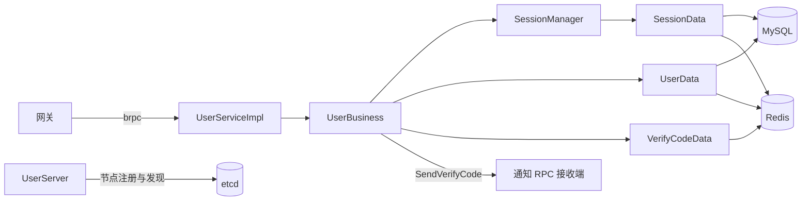

# 用户子服务

用户子服务通过 brpc 向[网关](./网关子服务.md)提供账号和登录会话功能。浏览器通过网关的 HTTP 接口访问这些功能。

## 1. 结构设计

| 组件                                                         | 职责                                |
| ------------------------------------------------------------ | ----------------------------------- |
| [UserServerBuilder](../svc_userService/userServerBuilder.cpp) | 读取构建配置，创建服务所需的组件    |
| [UserServer](../svc_userService/userServer.cpp)               | 管理 RPC 监听和服务生命周期         |
| [UserServiceImpl](../svc_userService/userServiceImpl.cpp)     | 取出 RPC 参数，调用业务层并返回结果 |
| [UserBusiness](../svc_userService/userBusiness.cpp)           | 处理注册、登录和验证码业务          |
| [SessionManager](../svc_userService/sessionManager.cpp)       | 管理会话及其缓存                    |
| `UserData`、`SessionData`、`VerifyCodeData`            | 按各自的数据类型访问 MySQL 或 Redis |

**主要代码和测试文件：**

```text
svc_userService/
├── main.cpp                    # 参数解析、启动和退出
├── userServer.hpp
├── userServer.cpp              # 管理 RPC 服务的启动和停止
├── userServerBuilder.hpp
├── userServerBuilder.cpp       # 组装服务，完成 etcd 注册与发现
├── userServiceImpl.hpp
├── userServiceImpl.cpp         # 实现 10 个用户 RPC 接口
├── userBusiness.hpp
├── userBusiness.cpp            # 注册、登录、验证码和用户资料
├── sessionManager.hpp
├── sessionManager.cpp          # 管理会话和缓存失效
├── userData.hpp
├── userData.cpp                # 用户数据读写和在线状态更新
├── sessionData.hpp
├── sessionData.cpp             # 会话数据读写和有效期查询
├── verifyCodeData.hpp
├── verifyCodeData.cpp          # 验证码存储、校验和单次消费
└── CMakeLists.txt

tests/svc_userService/
├── testSupport.hpp             # 测试数据库、Redis 连接和数据清理
├── userData_test.cpp           # 用户数据访问和用户业务测试
├── sessionData_test.cpp        # 会话数据访问测试
├── sessionManager_test.cpp     # 会话管理测试
├── verifyCodeData_test.cpp     # 验证码存储与消费测试
├── userServiceImpl_test.cpp    # 用户 RPC 接口测试
└── userServer_test.cpp         # 服务进程、etcd 注册和退出测试

tests/svc_gatewayService/
└── gatewayUser_test.cpp        # 九个用户 HTTP 接口及服务发现联合测试
```



## 2. 接口设计

协议定义在 [userService.proto](../proto/userService.proto)，包名为 `chat2Data`。所有请求都带 `request_id`。响应使用同一个请求 ID，`error_code = 0` 表示调用成功。业务失败时，响应通过 `error_code` 和 `error_msg` 给出原因。

下表列出公共字段之外的参数和结果。对应的 HTTP 格式见[接口设计第 1.2 节](./接口设计.md#12-用户子服务)。

| RPC 方法           | 请求字段                                     | 成功结果                               |
| ------------------ | -------------------------------------------- | -------------------------------------- |
| `ValidNickname`  | `nickname`                                 | 公共响应字段                           |
| `ValidEmail`     | `email`                                    | 公共响应字段                           |
| `UserRegister`   | `nickname`、`email`、`password`        | 公共响应字段                           |
| `PasswdLogin`    | `nickname`（昵称或注册邮箱）、`password` | 新的 `session_id`                    |
| `SessionLogin`   | `session_id`                               | 公共响应字段，沿用原会话               |
| `GetCode`        | `email`                                    | `code_id`                            |
| `VcodeLogin`     | `email`、`code_id`、`verify_code`      | 新的 `session_id`                    |
| `Logout`         | `session_id`                               | 公共响应字段                           |
| `GetUserInfo`    | `session_id`                               | `user_info`，包含用户 ID、昵称和邮箱 |
| `IsSessionValid` | `session_id`                               | `valid`，会话有效时附带 `user_id`  |

`IsSessionValid` 供网关等子服务鉴权。会话缺失或到期时，`error_code` 为 `0`，`valid` 为 `false`。查询故障通过错误码报告。用户业务和启动错误码定义见 [errorHandler.hpp](../common/errorHandler.hpp)。

## 3. 数据与业务流程

### 3.1 数据存储

[建表脚本](../data/sql/create_user_tables.sql)包含 `tbl_user` 和 `tbl_session`。用户表对用户 ID、昵称和邮箱设置唯一索引。会话表记录会话所属用户及到期时间，时间单位为 Unix 毫秒。

| Redis 键                | 用途         | 有效期                            |
| ----------------------- | ------------ | --------------------------------- |
| `user:{userId}`       | 用户资料缓存 | 1 小时                            |
| `session:{sessionId}` | 登录会话缓存 | 取会话剩余有效期与 3 天中的较小值 |
| `verifyCode:{codeId}` | 验证码记录   | 自创建起 5 分钟                   |

三个键都使用 Hash 的 `data` 字段保存 JSON。按用户 ID 查询资料和按会话 ID 校验会话时先读 Redis，缓存缺失时再查 MySQL。按昵称或邮箱查询账号时直接读 MySQL。验证码的校验和消费在 Redis 内完成。字段明细见[数据库设计](./数据库设计.md)。

### 3.2 注册与登录

注册时，MySQL 唯一索引保证昵称和邮箱的唯一性。服务使用 **16 字节随机盐**和 **PBKDF2-HMAC-SHA256** 生成密码哈希，迭代次数为 **600,000**。新用户状态为 `0`，表示离线。

密码登录先查昵称，查无对应账号时再查邮箱。密码或验证码校验成功后，用户服务生成独立的会话 ID，将会话写入 MySQL。会话自创建起有效 **3 天**。会话登录沿用原会话和到期时间。

校正在线状态时，**事务先锁定用户行，再检查该用户的有效会话**。有有效会话时写入 `1`，其余写入 `0`。登录和退出触发校正。会话自然到期后，下次校验该会话时触发校正。

### 3.3 退出登录

退出操作按当前请求中的会话 ID 处理。服务**先删除 Redis 中的会话缓存，再在 MySQL 事务中删除会话记录**。事务持有会话行锁。并发回填若先拿到锁，会在删除前完成。若删除先拿到锁，回填会等到事务结束。

删除记录后等待 500 毫秒，再次删除会话缓存，清理删除事务取得行锁前回填的旧缓存。服务在同一事务中校正用户状态，状态变化时在提交前清除用户资料缓存。第一次删会话缓存重试仍失败时，操作在开启删除事务前结束。第二次删会话缓存重试仍失败时，删除事务回滚。用户的其他有效会话可继续使用。

### 3.4 邮箱验证码

用户子服务用注册邮箱查询账号，再从通过 etcd 发现的通知节点中选取一个。生成的六位数字验证码与验证码 ID 一起保存到 Redis。用户子服务调用通知节点的 [SendVerifyCode](../proto/notifyService.proto)，等 SMTP 服务器确认接收邮件后，由 `GetCode` 返回验证码 ID。通知服务报告失败或 RPC 调用失败时，用户子服务删除本次验证码记录并返回 `USER_NOTIFICATION_FAILED`。

登录时使用验证码 ID 定位记录。Redis 校验邮箱和验证码后，一次性消费匹配的记录。用户子服务再按注册邮箱确认账号，然后创建登录会话。

## 4. 程序主流程

1. [main.cpp](../svc_userService/main.cpp) 读取 gflags 配置，并注册 `SIGINT` 和 `SIGTERM` 处理函数。
2. 构建器检查配置和 etcd 端点，创建 MySQL、Redis 客户端及业务对象。
3. RPC 服务开始监听。随后启动通知服务发现，并将用户服务节点注册到 etcd。
4. 主线程收到退出信号后销毁服务对象。服务停止租约续期，结束 RPC 监听并释放通知监听。

注册键形如 `/userService/节点标识`，键值为可访问的 RPC 地址。**BreezeKit 使用 3 秒租约并持续续期，节点退出后由 etcd 清理注册键。**

## 5. 配置、编译和运行

### 5.1 启动参数

| 参数                                                     | 默认值                                 | 说明                                              |
| -------------------------------------------------------- | -------------------------------------- | ------------------------------------------------- |
| `--log_level`                                          | `info`                               | 日志级别                                          |
| `--user_port`                                          | `9001`                               | brpc 监听端口                                     |
| `--user_service`                                       | `userService`                        | etcd 注册名称，与网关配置一致                     |
| `--user_address`                                       | 空值                                   | 使用 `dev-env-service:<user_port>` 作为注册地址 |
| `--etcd_address`                                       | `http://dev-etcd:2379`               | 通知服务发现使用的 etcd 地址                      |
| `--registry_address`                                   | 空值                                   | 沿用 `--etcd_address` 作为注册中心地址          |
| `--watch_service`                                      | `notifyService`                      | 通知服务注册名                                    |
| `--notify_rpc_timeout_ms`                             | `30000`                              | 等待通知 RPC 的毫秒数，需覆盖通知服务的邮件任务预算 |
| `--mysql_host`、`--mysql_port`、`--mysql_database` | `dev-mysql`、`3306`、`chat2data` | MySQL 地址、端口和库名                            |
| `--redis_host`、`--redis_port`、`--redis_db`       | `dev-redis`、`6379`、`0`         | Redis 地址、端口和数据库编号                      |

连接账号和密码见 [main.cpp](../svc_userService/main.cpp) 中的 gflags 定义。启动时按目标环境填写。

### 5.2 编译与启动

按[数据库建表操作](./数据库建表操作.md)准备数据库。在开发容器中执行以下命令：

```bash
cd /home/dev/workspace/chat2data-cpp/chat2data
cmake -S . -B build -DBUILD_TESTING=ON
cmake --build build --target user_service
./build/svc_userService/user_service
```

网关按相同注册名发现用户实例。通知服务的 `--notify_service` 应与用户服务的 `--watch_service` 一致，通知注册端点应与用户服务的发现端点一致。改用其他注册地址时，请填写调用方可访问的地址。

## 6. 测试

[用户服务测试](../tests/svc_userService/)覆盖数据访问和 RPC 处理。[userServer_test.cpp](../tests/svc_userService/userServer_test.cpp) 启动真实进程，检查 RPC 响应、etcd 注册和退出流程。[网关联合测试](../tests/svc_gatewayService/gatewayUser_test.cpp)从 HTTP 入口覆盖 9 条用户路由。

```bash
cmake --build build
ctest --test-dir build/svc_userService --output-on-failure
ctest --test-dir build/svc_gatewayService -R '^gateway_user_test$' --output-on-failure
```

联合测试使用**独立的 MySQL 测试库和临时 etcd 注册项**。测试账号需要创建和清理独立测试库的权限。
