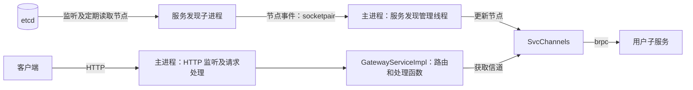

# 网关子服务

请求和响应格式见[接口设计](./接口设计.md)。下文说明目前的实现范围。

## 1. 结构设计

网关对外提供 HTTP 入口，通过 etcd 发现后端节点。用户 HTTP 接口已经接入[用户子服务](./用户子服务.md)。

| 部分                                   | 当前状态                                         |
| -------------------------------------- | ------------------------------------------------ |
| HTTP 监听和路由                        | 已实现，共注册 30 条路由                         |
| 健康检测                               | 已实现，返回网关状态和时间戳                     |
| 服务发现                               | 已实现，通过 etcd 获取节点变化并更新信道管理对象 |
| 9 条用户接口                           | 通过 brpc 调用用户子服务                         |
| 20 条文件、数据库和 AI 接口            | 保留路由占位                                     |
| 前端静态资源                          | 从 `wwwroot/dist` 提供首页和资源文件             |

主要代码和测试文件：

```text
svc_gatewayService/
├── main.cpp                  # 参数解析、启动和退出
├── gatewayServer.hpp
├── gatewayServer.cpp         # 网关构建、HTTP 监听、服务发现
├── gatewayServiceImpl.hpp
├── gatewayServiceImpl.cpp    # 路由绑定、健康检测、业务处理函数
└── CMakeLists.txt
tests/svc_gatewayService/
├── gateway_test.cpp          # 网关进程、HTTP 和服务发现测试
└── gatewayUser_test.cpp      # 用户 HTTP 接口及服务发现联合测试
```

核心对象的职责如下：

| 对象                     | 职责                                                             |
| ------------------------ | ---------------------------------------------------------------- |
| `GatewayServerBuilder` | 保存配置，创建各组件、设置信道监听并绑定路由                     |
| `GatewayServer`        | 持有 HTTP 服务、路由对象和服务发现对象，管理 HTTP 监听线程       |
| `GatewayServiceImpl`   | 注册各 HTTP 路由，并提供对应处理函数                             |
| `SvcChannels`          | 按服务名称维护可用的 RPC 信道，供用户接口选择节点            |
| `DiscoveryProcess`     | 在主进程中管理服务发现子进程，接收节点变化并更新 `SvcChannels` |

`GatewayServiceImpl` 和 `DiscoveryProcess` 通过 `shared_ptr` 持有同一个主进程内的 `SvcChannels`。HTTP 服务和服务发现对象由 `GatewayServer` 通过 `unique_ptr` 持有。子进程有独立的地址空间，通过本地域套接字向主进程发送节点事件。



## 2. 接口设计

路由定义位于 [gatewayServiceImpl.cpp](../svc_gatewayService/gatewayServiceImpl.cpp)。文件、数据库和 AI 的占位路由返回状态码 `200` 和空响应体。路径或方法匹配失败时返回 `404`。

### 2.1 用户接口

| 方法 | 路径                         | 处理函数                  | 用途         |
| ---- | ---------------------------- | ------------------------- | ------------ |
| POST | `/api/user/valid/nickname` | `ValidateNickname`      | 校验昵称     |
| POST | `/api/user/valid/email`    | `ValidateEmail`         | 校验邮箱     |
| POST | `/api/user/register`       | `RegisterUser`          | 用户注册     |
| POST | `/api/user/session/login`  | `SessionLogin`          | 会话登录     |
| POST | `/api/user/passwd/login`   | `PasswordLogin`         | 密码登录     |
| POST | `/api/user/code`           | `GetVerificationCode`   | 获取验证码   |
| POST | `/api/user/vcode/login`    | `VerificationCodeLogin` | 验证码登录   |
| POST | `/api/user/logout`         | `Logout`                | 用户退出     |
| GET  | `/api/user/info`           | `GetUserInfo`           | 获取用户信息 |

### 2.2 文件接口

| 方法   | 路径                        | 处理函数                     | 预留用途         |
| ------ | --------------------------- | ---------------------------- | ---------------- |
| POST   | `/api/file/upload/info`   | `UploadFileInfo`           | 上传文件信息     |
| GET    | `/api/file/info`          | `GetFileInfo`              | 获取文件信息     |
| POST   | `/api/file/upload`        | `UploadFile`               | 上传文件         |
| GET    | `/api/file/download`      | `DownloadFile`             | 下载文件         |
| DELETE | `/api/file/{fileId}`      | `DeleteFile`               | 删除文件         |
| POST   | `/api/file/preview`       | `PreviewExcel`             | 预览 Excel       |
| POST   | `/api/file/list`          | `GetFileList`              | 获取文件列表     |
| POST   | `/api/file/chat/map`      | `AssociateFileWithSession` | 关联文件与会话   |
| POST   | `/api/file/sqlite/upload` | `UploadSQLiteFile`         | 上传 SQLite 文件 |

其中删除路由在代码中使用正则表达式 `/api/file/[^/]+`，匹配 `/api/file/` 后的一个非空路径段。

### 2.3 数据库接口

| 方法 | 路径                          | 处理函数                | 预留用途       |
| ---- | ----------------------------- | ----------------------- | -------------- |
| POST | `/api/db/connect`           | `ConnectDatabase`     | 连接数据库     |
| GET  | `/api/db/tables`            | `ListDatabaseTables`  | 获取数据表列表 |
| POST | `/api/db/disconnect`        | `DisconnectDatabase`  | 断开数据库连接 |
| POST | `/api/db/table/data`        | `GetTableData`        | 获取表数据     |
| POST | `/api/db/connection/status` | `GetConnectionStatus` | 获取连接状态   |

### 2.4 AI 接口

| 方法 | 路径                          | 处理函数              | 预留用途     |
| ---- | ----------------------------- | --------------------- | ------------ |
| POST | `/api/ai/models`            | `GetModels`         | 获取模型列表 |
| POST | `/api/ai/session/create`    | `CreateChatSession` | 创建会话     |
| POST | `/api/ai/chatSessionLists`  | `GetChatSessions`   | 获取会话列表 |
| POST | `/api/ai/history`           | `GetChatHistory`    | 获取聊天历史 |
| POST | `/api/ai/delete`            | `DeleteChatSession` | 删除会话     |
| POST | `/api/ai/sendStreamMessage` | `SendStreamMessage` | 发送流式消息 |

### 2.5 健康检测

| 方法 | 路径        | 处理函数         | 用途               |
| ---- | ----------- | ---------------- | ------------------ |
| GET  | `/health` | 路由内的处理函数 | 检查网关 HTTP 服务 |

返回内容类型为 `application/json; charset=utf-8`，响应示例：

```json
{"status":"healthy","service":"GatewayService","timestamp":1730000000}
```

`timestamp` 为 Unix 时间戳，单位为秒。该接口只表明网关 HTTP 请求能够得到处理。

## 3. 业务处理和请求路由

`GatewayServerBuilder::Build()` 创建 `httplib::Server` 和 `GatewayServiceImpl`。构建器先尝试将 `wwwroot/dist` 挂载到 `/`，再调用 `BindRoutes()` 注册路由。挂载失败时记录警告，HTTP 接口照常启动。

HTTP 服务启动后，`cpp-httplib` 接收请求，按请求方法和路径匹配已注册的路由，再调用路由绑定的回调。业务路由的回调会调用对应的 `GatewayServiceImpl` 成员函数；健康检测路由直接在回调中构造 JSON 响应。请求处理由 HTTP 服务的工作线程执行。

`POST /api/user/register` 进入 `RegisterUser()`。网关校验必填字段后，按 `--user_service` 选择 RPC 信道，将注册请求转发给用户服务。查询资料和退出登录先调用 `IsSessionValid` 校验会话，再执行业务 RPC。HTTP 状态和错误字段见[接口设计第 1.2 节](./接口设计.md#12-用户子服务)。

## 4. 程序主流程

### 4.1 启动与退出

1. `main()` 解析命令行配置，设置日志级别，检查端口，并注册 `SIGINT`、`SIGTERM` 信号处理函数。
2. 构造 `GatewayServerBuilder` 并调用 `Build()`：创建 `SvcChannels`、设置待监听服务，创建服务发现对象和管理线程，再创建 HTTP 服务、设置路由并返回 `GatewayServer`。HTTP 的读、写超时均设置为 300 秒。
3. `GatewayServer::start()` 绑定监听地址和端口，在单独的线程中执行 `listen_after_bind()`，等待 HTTP 服务启动成功或失败。服务发现和 HTTP 启动并行，HTTP 启动不会等待 etcd 连接成功。
4. 主线程定期检查退出信号及 HTTP 运行状态。收到退出信号后调用 `stop()` 停止 HTTP 服务并等待监听线程结束；如果监听意外结束，程序按失败退出。
5. `GatewayServer` 销毁时释放服务发现对象。服务发现管理线程收到停止通知后终止并回收子进程，再由析构过程等待管理线程结束。单独调用 `stop()` 只停止 HTTP，服务发现对象仍存活到 `GatewayServer` 销毁。

### 4.2 服务发现

服务发现使用项目依赖的 `SvcWatcher`，由网关自己的代码管理子进程和节点事件：

1. `DiscoveryProcess` 在主进程创建管理线程，并用 `socketpair` 创建通信端点。
2. 管理线程通过 `posix_spawn` 执行 `/proc/self/exe`，也就是当前网关可执行文件。子进程带有内部参数 `--gateway-discovery-worker`，重新进入 `main()` 后运行 `RunDiscoveryWorker()`；该分支由网关启动，不需要手动调用。
3. 子进程创建 `SvcWatcher`，监听配置中的服务名称。`watch()` 在单独线程中调用，工作线程等待其启动完成；随后工作进程还会每隔约 2 秒读取 etcd 根目录快照，比较节点集合，补充节点变化。快照使用 `/服务名/节点标识` 格式的键和非空的键值作为地址。
4. 工作进程将新增或删除事件通过套接字发给主进程；管理线程接收后分别调用 `SvcChannels::addNode()` 或 `delNode()`。事件包含类型、服务名和地址。
5. 子进程退出后，管理线程清理已记录的旧节点并尝试重新启动；正常退出时通过 `eventfd` 通知管理线程停止。子进程也设置了父进程退出时接收终止信号。

这里使用了 Linux 的 `/proc/self/exe`、`eventfd` 等机制，当前实现面向 Linux。用户接口从服务发现维护的信道中选择节点。

## 5. 配置、编译和运行

### 5.1 启动参数

| 参数                  | 默认值                   | 说明                         |
| --------------------- | ------------------------ | ---------------------------- |
| `--log_level`       | `info`                 | 日志级别                     |
| `--gateway_address` | `0.0.0.0`              | HTTP 监听地址                |
| `--gateway_port`    | `9000`                 | HTTP 监听端口，范围 1～65535 |
| `--etcd_address`    | `http://dev-etcd:2379` | etcd 地址                    |
| `--user_service`    | `userService`          | 用户服务名称                 |
| `--file_service`    | `fileService`          | 文件服务名称                 |
| `--db_service`      | `dbService`            | 数据库服务名称               |
| `--ai_service`      | `aiService`            | AI 服务名称                  |

这些服务名称必须与实际注册到 etcd 的服务名称一致，才能被发现。

### 5.2 编译与启动

网关使用 C++17 和 CMake；网关子目录要求 CMake 3.20 或更高版本。依赖包括 `cpp-httplib`、`cpp-service-kit`、etcd-cpp-api、brpc、Protobuf、gflags 等；启用测试时还需要 Google Test。`BREEZEKIT_SOURCE_DIR` 默认指向项目旁的 `libSource/cpp-service-kit`，不同目录布局可通过 CMake 参数指定。

在项目的开发容器中，可以按以下方式编译并启动：

```bash
docker exec -it --user dev dev-env-service bash
cd /home/dev/workspace/chat2data-cpp/chat2data
cmake -S . -B build -DCMAKE_BUILD_TYPE=Debug -DBUILD_TESTING=ON
cmake --build build --target gateway_service
./build/svc_gatewayService/gateway_service
```

启动后，在可以访问网关监听地址的环境中检查健康接口：

```bash
curl http://127.0.0.1:9000/health
```

如需修改监听端口，可传入 `--gateway_port=9002`。前端构建完成后访问 `/`。用户接口联调时，先启动同一注册中心下的用户服务。

## 6. 测试

[gateway_test.cpp](../tests/svc_gatewayService/gateway_test.cpp) 使用 Google Test，覆盖网关健康检测、路由匹配、启动退出及服务发现。

[gatewayUser_test.cpp](../tests/svc_gatewayService/gatewayUser_test.cpp) 通过真实网关和用户服务验证九条用户 HTTP 接口。服务发现用例检查实例下线和重启后的转发恢复。验证码用例使用进程内的临时通知 RPC 接收端。

在上述已配置的构建目录中，可以直接运行测试程序：

```bash
cmake --build build --target gateway_test gateway_user_test
ctest --test-dir build/svc_gatewayService --output-on-failure
```

测试使用 `http://dev-etcd:2379`，需要在能够访问该地址的环境中运行。服务发现测试会在 etcd 中创建带租约的临时测试键，并在测试过程中清理；测试需要相应的读写权限。也可使用 `ctest --test-dir build --output-on-failure` 运行构建目录中注册的全部测试。
