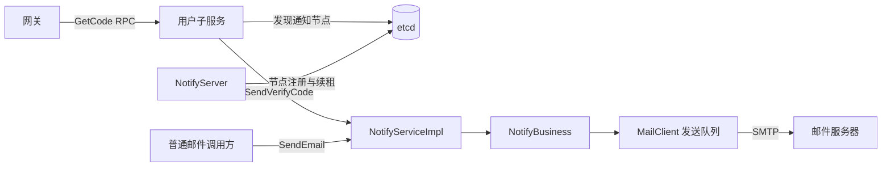
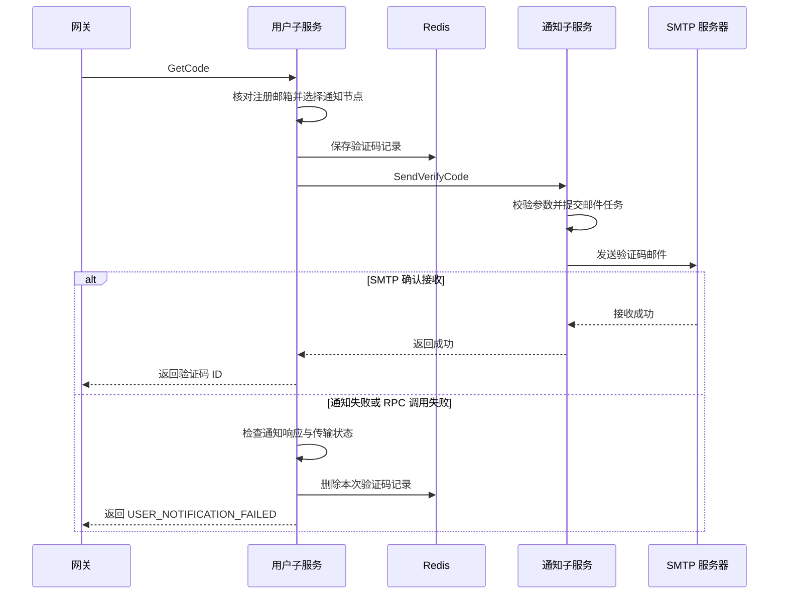

# 通知子服务

通知子服务通过 brpc 提供验证码邮件和普通 HTML 邮件投递。获取验证码时，[网关](./网关子服务.md)调用[用户子服务](./用户子服务.md)，用户子服务通过 etcd 发现通知节点并调用 `SendVerifyCode`。普通邮件接口支持多个附件，供内部调用方使用。

## 1. 结构设计

| 组件                                                           | 职责                                                        |
| -------------------------------------------------------------- | ----------------------------------------------------------- |
| [NotifyServerBuilder](../svc_notifyService/notifyServer.cpp)    | 校验启动配置，组装邮件客户端和 RPC 服务，启动监听后注册节点 |
| [NotifyServer](../svc_notifyService/notifyServer.cpp)           | 管理 etcd 续租、brpc 监听和业务对象的生命周期               |
| [NotifyServiceImpl](../svc_notifyService/notifyServiceImpl.cpp) | 解析公共请求字段，等待邮件发送结果并构造 RPC 响应           |
| [NotifyBusiness](../svc_notifyService/notifyBusiness.cpp)       | 校验邮件参数，构造验证码或普通邮件任务                      |
| `Breezecode::MailClient`                                     | 管理发送队列，通过 libcurl 构造 MIME 邮件并交给 SMTP 服务器 |

主要代码和测试文件如下：

```text
proto/
└── notifyService.proto
svc_notifyService/
├── main.cpp                     # 参数解析、启动和退出
├── notifyServer.hpp
├── notifyServer.cpp             # RPC 监听、etcd 注册和停机
├── notifyServiceImpl.hpp
├── notifyServiceImpl.cpp        # 验证码和普通邮件 RPC
├── notifyBusiness.hpp
├── notifyBusiness.cpp           # 参数校验与邮件任务构造
├── verifyCodeMail.html          # 验证码 HTML 模板
└── CMakeLists.txt
tests/svc_notifyService/
├── notifyServiceImpl_test.cpp    # 通知 RPC 和 SMTP 投递测试
└── localSmtpReceiver.hpp         # 本地 SMTP 接收端和 MIME 解码
tests/svc_gatewayService/
└── gatewayUserNotify_test.cpp    # 网关、用户和通知服务联合测试
```



## 2. 接口设计

协议定义在 [notifyService.proto](../proto/notifyService.proto)，包名为 `chat2Data`。请求携带 `request_id`。响应原样返回该 ID，并用 `error_code` 和 `error_msg` 报告处理结果。调用方同时检查 brpc 传输状态和业务错误码。

| RPC 方法           | 公共字段以外的请求字段                                         | 成功条件                              |
| ------------------ | -------------------------------------------------------------- | ------------------------------------- |
| `SendVerifyCode` | `email`、六位数字字符串 `verify_code`                      | SMTP 服务器确认接收验证码邮件         |
| `SendEmail`      | `to_email`、`subject`、`content`、可选的 `attachments` | SMTP 服务器确认接收 HTML 邮件及其附件 |

`error_code = 0` 时 `error_msg` 为空，此时邮件进入 SMTP 服务器的后续投递流程。附件由文件名 `filename`、原始字节 `data` 和可选的 `content_type` 组成，省略 MIME 类型时使用 `application/octet-stream`。

### 2.1 错误返回

| 错误码                            | 含义                                         |
| --------------------------------- | -------------------------------------------- |
| `NOTIFY_INVALID_INPUT`（500）   | 请求 ID 或邮件参数有误                       |
| `NOTIFY_SEND_FAILED`（501）     | 邮件客户端报告任务拒绝、过期或 SMTP 发送失败 |
| `NOTIFY_SEND_TIMEOUT`（502）    | RPC 等待邮件任务结果超过时间上限             |
| `NOTIFY_BUSINESS_FAILED`（503） | 提交邮件任务或获取结果时发生异常             |

启动配置、模板、etcd、监听和注册故障使用 `504` 至 `508`。错误定义见 [errorHandler.hpp](../common/errorHandler.hpp)。

## 3. 业务流程

### 3.1 验证码邮件

用户子服务核对注册邮箱、生成验证码并写入 Redis。通知子服务校验收件地址和六位数字字符串，再用 [verifyCodeMail.html](../svc_notifyService/verifyCodeMail.html) 中的 `{{code}}` 占位符渲染验证码邮件。验证码邮件的附件配置在服务构建时置空。



### 3.2 普通邮件和发送队列

`NotifyBusiness` 校验单个收件邮箱、非空主题及附件名称，并检查邮件头字段中的换行和 NUL。邮件正文保留 HTML，附件使用原始字节。通知与用户服务共用 [Utils::IsValidEmail](../common/utils.cpp) 校验邮箱格式。

验证码和普通邮件共用一个进程内队列。单个后台线程按入队顺序投递，队列限额统计排队及正在发送的任务。邮件任务预算覆盖排队和 SMTP 传输。RPC 等待邮件任务结果时通过 bthread 让出执行权，成功或失败后写入响应。

BreezeLog 记录服务注册、启动与退出，以及邮件 RPC 的方法名、请求 ID 和结果。SMTP 凭据、验证码、邮件正文和附件数据只用于投递。

## 4. 程序主流程

1. [main.cpp](../svc_notifyService/main.cpp) 解析 gflags，配置 BreezeLog，安装 `SIGINT` 和 `SIGTERM` 处理函数。
2. 构建器校验监听、邮件配置及模板可读性，并用带超时的请求检查 etcd。随后创建邮件客户端、业务对象和 RPC 服务。
3. brpc 监听成功后，以 `/notifyService/节点标识` 为键注册可访问的 RPC 地址。BreezeKit 使用 3 秒租约并持续续期。
4. 收到退出信号后，主线程销毁服务对象。先停止注册续期，再停止监听并等待在途 RPC，随后释放邮件队列和客户端。

## 5. 配置、编译和运行

### 5.1 启动参数

| 参数                                                      | 默认值或来源                                 | 说明                                                         |
| --------------------------------------------------------- | -------------------------------------------- | ------------------------------------------------------------ |
| `--log_level`                                           | `info`                                     | BreezeLog 日志级别                                           |
| `--notify_port`                                         | `9002`                                     | brpc 监听端口                                                |
| `--notify_service`                                      | `notifyService`                            | etcd 注册名，与用户服务的 `--watch_service` 一致           |
| `--notify_address`                                      | 空值时使用 `dev-env-service:<notify_port>` | 注册给调用方的 RPC 地址                                      |
| `--registry_address`                                    | `http://dev-etcd:2379`                     | etcd 注册端点                                                |
| `--smtp_url`                                            | `smtps://smtp.qq.com:465`                  | SMTP 连接地址                                                |
| `--smtp_username`、`--smtp_password`、`--smtp_from` | 部署配置                                     | 登录账号、客户端授权码和发件地址，发件地址为空时沿用登录账号 |
| `--smtp_login_options`                                  | `AUTH=LOGIN`                               | SMTP 认证选项                                                |
| `--mail_html_path`                                      | 服务模块的 `verifyCodeMail.html`           | 验证码模板路径                                               |
| `--mail_max_tasks`、`--mail_max_payload_bytes`        | `32`、`536870912`                        | 任务数和总负载字节数上限                                     |
| `--mail_task_timeout_ms`                                | `25000`                                    | 排队和发送的总预算，单位毫秒                                 |

默认用户服务到通知服务的 RPC 超时为 30 秒，网关获取验证码的 RPC 超时为 35 秒。调整邮件任务预算时，两段 RPC 超时也需覆盖各自的处理及返回时间。

### 5.2 编译与启动

在开发容器的 `chat2data` 项目目录构建。启动时使用目标 SMTP 服务的账号、授权码和发件地址配置。

```bash
cmake -S . -B build -DBUILD_TESTING=ON
cmake --build build --target notify_service
./build/svc_notifyService/notify_service
```

## 6. 测试

[notifyServiceImpl_test.cpp](../tests/svc_notifyService/notifyServiceImpl_test.cpp) 使用本地 SMTP 接收端验证验证码模板、HTML 邮件、二进制附件、无效参数和 SMTP 拒收。CTest 运行 `NotifyServiceTest.*`，部署方可用目标 SMTP 配置单独运行需要真实邮箱的 `NotifyServiceLiveTest.*`。

[gatewayUserNotify_test.cpp](../tests/svc_gatewayService/gatewayUserNotify_test.cpp) 启动真实的网关、用户和通知进程，覆盖邮件验证码登录、单次消费以及投递失败后的 Redis 清理。

```bash
cmake --build build --target notify_service_test gateway_user_notify_test
ctest --test-dir build -R '^(notify_service_test|gateway_user_notify_test)$' --output-on-failure
```
