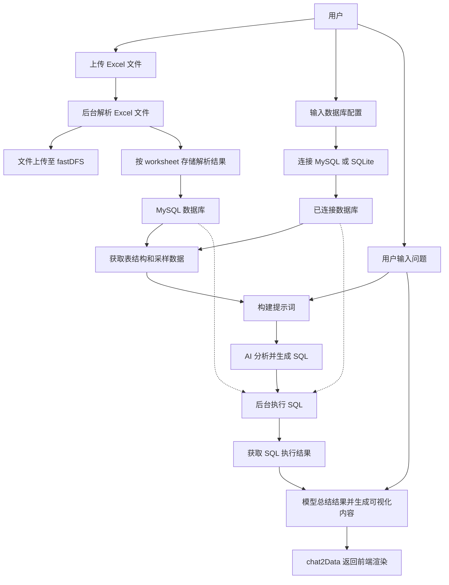
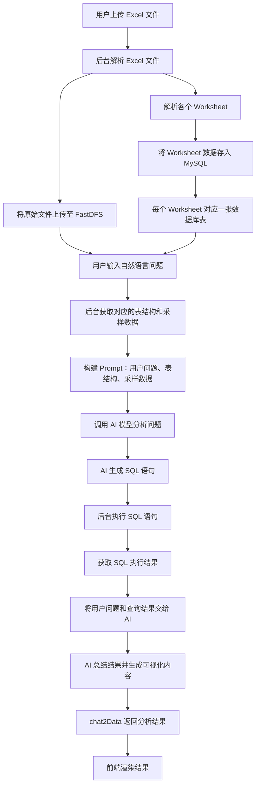
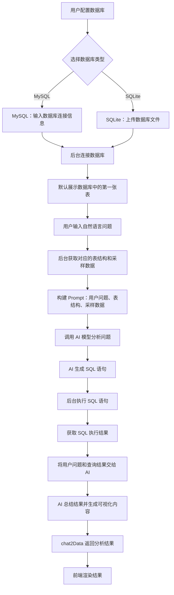

# 需求文档

# 1. 项目背景

## 1.1 业务背景

在数字化转型的浪潮中，企业和个人面临着海量的数据存储和处理需求。随着云计算、大数据、人工智能等技术的快速发展，数据已经成为企业最重要的资产之一。然而，传统的数据分析方式存在以下痛点：

- **技术门槛高**：非技术人员难以直接操作数据库和Excel数据，需要掌握SQL编程、数据建模等专业技能
- **效率低下**：数据查询和分析需要编写SQL或使用复杂的数据分析工具，从提出需求到获得结果往往需要数小时甚至数天
- **沟通成本大**：业务人员与技术人员之间存在沟通障碍，需求传递效率低，容易出现理解偏差
- **工具分散**：文件管理、数据查询、AI分析等功能分散在不同工具中，缺乏统一平台，用户需要频繁切换
- **学习成本高**：传统数据分析工具（如Excel高级功能、BI工具、数据库管理工具）学习曲线陡峭

当前，企业面临的数据挑战主要体现在以下几个方面：

**数据获取困难：**

- 业务人员需要依赖IT部门提取数据，流程繁琐
- 数据库查询需要编写SQL，非技术人员无法独立完成
- Excel文件分散存储，难以快速查找和整合

**数据分析复杂：**

- 传统数据分析工具操作复杂，需要专业培训
- 多数据源分析需要手动整合，耗时耗力
- 数据可视化需要专业工具，门槛较高

**协作效率低：**

- 数据分析结果难以快速分享和协作
- 缺乏统一的数据分析平台，团队协作困难
- 数据版本管理混乱，难以追溯

## 1.2 市场机会

随着大语言模型（LLM）技术的快速发展，自然语言交互成为可能。通过AI技术，可以让用户以对话的方式直接与数据进行交互，大大降低数据使用门槛。目前市场上存在以下机会：

**技术趋势：**

- 大语言模型能力不断提升，理解自然语言查询的准确率越来越高
- AI技术在数据分析领域的应用日益成熟
- 自然语言处理技术可以理解复杂的业务需求

**市场需求：**

- 企业数字化转型加速，对数据分析工具的需求激增
- 非技术人员的数据分析需求日益增长
- 远程办公和在线协作需求推动云端数据分析工具的发展

**市场空白：**

- 目前市场上缺乏一个能够同时支持Excel文件和数据库查询的智能对话平台
- 现有数据分析工具要么过于专业（如Tableau、Power BI），要么功能单一（如Excel）
- 缺乏以自然语言交互为核心的数据分析平台

**竞争优势：**

- 通过AI技术降低数据分析门槛，扩大用户群体
- 支持多种数据源，提供一站式解决方案
- 流式AI对话体验，提升用户体验
- 微服务架构，易于扩展和维护

## 1.3 项目定位

chat2Data是一个智能数据对话平台，通过自然语言交互方式，让用户能够轻松查询、分析和管理Excel文件及数据库数据。平台集成了文件管理、数据解析、AI对话、数据库操作等核心功能，为用户提供一站式的数据处理解决方案。

**产品定位：**

- 目标市场：中小企业、个人用户、数据分析团队
- 核心价值：降低数据分析门槛，提升数据处理效率
- 差异化优势：自然语言交互、多数据源支持、一站式解决方案

**产品愿景：**

- 成为最易用的智能数据分析平台
- 让每个人都能轻松使用数据
- 推动数据民主化，释放数据价值

# 2. 产品目标

## 2.1 总体目标

打造一个易用、高效、安全的智能数据对话平台，让用户通过自然语言即可完成数据查询、分析和管理操作，提升数据处理效率，降低技术门槛。

## 2.2 具体目标

### 2.2.1 用户体验

- **零学习成本**：用户无需学习SQL或编程知识，通过自然语言即可完成数据操作
- **快速响应**：AI对话响应时间控制在3秒以内
- **操作便捷**：核心功能操作步骤不超过3步
- **界面友好**：提供直观的文件预览和数据展示界面

### 2.2.2 功能

- 支持用户登录注册以及用户信息管理等
- 支持通过自然语言操作Excel文件
- 支持通过自然语言操作数据库，目前支持MySQL和SQLite数据库操作
- 支持操作结果的可视化显示。比如：柱状图、饼状图、表格等
- 提供流式AI对话体验

### 2.2.3 业务目标

- 降低数据使用门槛，让非技术人员也能轻松操作MySQL，让非技术人员也能操作Excel
- 提升数据处理效率，减少人工操作时间
- 提供统一的数据处理平台，整合分散的工具

# 3. 核心用户

## 3.1 数据分析师

- **特征**：具备一定的数据分析能力，熟悉Excel操作，但不熟悉SQL编程
- **需求**：快速查询和分析数据，生成报表
- **使用场景**：日常数据查询、趋势分析、异常检测
- **痛点**：需要频繁切换工具，SQL编写困难

## 3.2 业务人员

- **特征**：业务专家，对数据有需求但技术能力有限
- **需求**：通过自然语言获取业务数据，辅助决策
- **使用场景**：销售数据查询、客户信息查询、业绩分析
- **痛点**：依赖技术人员，等待时间长

## 3.3 开发人员

- **特征**：具备技术背景，需要快速查看和测试数据
- **需求**：快速连接数据库，执行SQL查询，调试数据
- **使用场景**：数据库调试、数据验证、接口测试
- **痛点**：工具分散，操作繁琐

## 3.4 管理者

- **特征**：需要快速了解业务数据，做出决策
- **需求**：通过简单的对话获取关键指标和报表
- **使用场景**：经营数据查询、KPI查看、决策支持
- **痛点**：数据获取困难，依赖报表

# 4. 需求范围

- 用户登录：支持昵称&密码登录、邮箱&密码登录、验证码登录、会话登录
- 验证码获取：通过邮箱获取验证码，验证码是6为随机数字，验证码有效期5分钟
- excel文件仅支持.xlsx格式，文件大小限制在10M以内
- SQLite数据库文件支持.db格式
- 数据库支持MySQL和sQLite
- 模型适配云端模型以及本地部署模型
- 流式显示聊天内容，能够可视化显示分析数据

# 5. 需求功能点

## 5.1 项目原理

chat2Data能够让用户零门槛以自然语言方式来操作Excel 或 数据库，快速完成数据分析。数据库目前暂**支持MySQL 和 SQLite**。操作流程说明如下：

### 自然语言操作Excel

### 自然语言操作数据库

## 5.3 功能详细需求

### 1. 登录流程

用户访问 Chat2Data 系统时，首先尝试会话登录。会话登录失败后跳转至登录页面。

登录页面支持两种登录方式：

- 密码登录：用户输入昵称或注册邮箱、密码，点击登录按钮。
- 邮箱验证码登录：用户输入注册邮箱，点击获取验证码，填写验证码后点击登录按钮。

登录成功后跳转至系统主页面，登录失败时提示具体失败原因。

### 2. 用户注册

未注册用户可点击“点击注册”按钮，进入注册页面。

注册时需要填写用户昵称、邮箱和密码，具体要求如下：

- 唯一性：昵称和邮箱必须唯一。
- 密码长度：至少 8 位。
- 密码复杂度：数字、小写字母、大写字母、特殊符号中，至少包含两种类型。
- 密码确认：两次输入的密码必须一致。

所有条件满足后完成注册。用户点击“点击登录”返回登录页面，选择相应方式登录系统。

## 智能 Excel 页面

### 1. 页面介绍

用户成功登录后进入系统主界面，默认显示智能 Excel 助手。

该功能支持用户上传 Excel 文件，通过自然语言提出数据分析问题，并查看 AI 返回的分析结果和可视化内容。

### 2. 页面功能

- **文件预览区域**：展示 Excel 文件经过后台解析后的数据。
- **结果分析区域**：展示 AI 对用户问题的分析总结和可视化结果，例如饼状图。
- **新建会话按钮**：创建新的聊天会话，同时清空当前结果分析区域和消息显示区域。
- **文件上传按钮**：点击后弹出文件选择对话框，用户选择 Excel 文件并上传至服务器。
- **模型列表**：展示当前系统支持的 AI 模型，供用户选择。
- **文本输入区域**：用户输入需要查询或分析的自然语言问题。
- **发送消息按钮**：点击发送按钮或按回车键，将问题发送至服务器。

### 3. Excel 文件上传规则

- **文件格式**：仅支持 `.xlsx`。
- **文件大小**：限制在 10 MB 以内。
- **上传按钮**：默认处于禁用状态，创建新会话后才能使用。
- **文件解析**：上传后由服务端完成解析，并将解析结果返回前端展示。

### 4. 操作流程

1. 用户进入主界面，系统获取支持的 AI 模型列表。
2. 用户点击“新建会话”，创建新的数据分析会话。
3. 文件上传按钮变为可用状态。
4. 用户选择 Excel 文件并上传。
5. 服务端解析 Excel 文件，将数据返回前端渲染。
6. 用户针对当前 Excel 文件输入自然语言问题。
7. 后台调用 AI 模型完成数据分析。
8. 前端显示对话消息、分析总结和可视化结果。

### 5. 数据分析结果展示

根据需求文档中的页面示例，AI 分析结果可以包含以下内容：

- 分析任务：展示 AI 对用户问题的任务拆解及各步骤的处理情况。
- 关键发现：提取分析过程中的重要数据和结论。
- 分析总结：对查询结果进行文字总结，帮助用户理解数据。
- 数据可视化：根据分析结果生成图表，例如饼状图。

用户可以在“文件预览”和“结果分析”两个区域之间切换，分别查看原始数据与分析结果。

## 智能 DB 页面

### 1. 页面介绍

用户点击“智能 DB 助手”导航栏，进入智能 DB 页面。

系统支持连接 MySQL 和 SQLite 数据库。首次进入且尚未连接数据库时，展示数据库连接界面。

### 2. 数据库连接

MySQL 数据库连接

用户需要填写以下信息：

- 主机地址：MySQL 服务器地址。
- 端口号：默认为 `3306`。
- 数据库名称：需要连接的数据库。
- 用户名：MySQL 数据库用户名。
- 密码：对应的数据库密码。
- 字符集：默认为 `utf8mb4`。

用户完成配置后，点击“连接”按钮，系统连接到指定 MySQL 数据库。

SQLite 数据库连接

1. 用户点击“浏览”按钮，打开文件选择对话框。
2. 选择需要连接的 SQLite 数据库文件，要求文件后缀为 `.db`。
3. 点击“上传”按钮，将数据库文件上传至服务器。
4. 点击“连接”按钮，建立数据库连接。

### 3. 数据库预览

数据库连接成功后，系统跳转至智能 DB 页面。

- **表预览区域**：默认展示数据库中第一张表的数据。
- **表列表下拉框**：用户可以切换需要查看的数据库表。
- **数据库类型标识**：连接 SQLite 时显示 `SQLite`，连接 MySQL 时显示 `MySQL`。

### 4. 智能分析功能

智能 DB 助手与智能 Excel 助手采用相同的交互方式，包含以下功能：

- 模型列表：选择当前支持的 AI 模型。
- 新建会话：创建新的数据分析会话。
- 消息显示区域：展示用户问题及 AI 回复。
- 问题输入区域：输入自然语言问题。
- 发送按钮：将问题发送至服务器。
- 结果分析区域：展示分析总结及可视化结果。

### 5. 数据库连接管理

用户已连接 MySQL 或 SQLite 数据库后，再次点击智能 DB 助手导航栏，系统会显示已经建立连接的数据库信息。

提供以下操作：

- 使用本次连接：点击后进入智能 DB 助手页面，继续使用已建立的数据库连接。
- 断开连接：点击后断开当前数据库连接。

### 6. 操作流程

1. 用户进入智能 DB 页面。
2. 选择 MySQL 或 SQLite 数据库。
3. 填写数据库连接信息或上传数据库文件。
4. 点击连接按钮，建立数据库连接。
5. 系统展示数据库中的第一张表。
6. 用户通过下拉框切换需要分析的数据表。
7. 用户选择 AI 模型并输入自然语言问题。
8. 后台获取对应数据表的结构和采样数据。
9. AI 根据问题及数据库信息生成 SQL。
10. 后台执行 SQL，并将查询结果交给 AI 进行总结。
11. 前端展示分析结果及可视化内容。

## 我的文件页面

### 1. 页面介绍

用户点击“我的文件”导航栏，进入文件管理页面。

系统在该页面展示当前用户之前上传的所有文件，并提供统一的文件管理功能。

### 2. 文件管理功能

**文件预览**

根据文件类型执行不同的预览操作：

- Excel 文件：跳转至智能 Excel 页面，展示文件数据。
- SQLite 文件：跳转至智能 DB 页面，连接对应 SQLite 数据库并展示数据。

**文件下载**

用户点击下载按钮，系统将对应文件从服务器下载至本地。

**文件删除**

用户点击删除按钮，系统执行以下操作：

1. 删除服务器上存储的对应文件。
2. 删除该文件关联的聊天会话。

### 3. 操作流程

1. 用户进入“我的文件”页面。
2. 系统获取并展示该用户上传的文件列表。
3. 用户选择需要操作的文件。
4. 根据需要执行预览、下载或删除操作。

## 历史会话页面

### 1. 页面介绍

用户点击“历史会话”导航栏，进入历史会话管理页面。

系统获取当前用户的历史会话列表，展示以往的聊天会话信息。

### 2. 历史会话查看

用户点击某个历史会话后，系统会：

1. 切换至该会话对应的页面。
2. 展示该会话中的具体聊天消息。
3. 展示会话关联的文件或数据库表信息。

通过历史会话，用户可以重新查看之前的数据分析过程及结果。

### 3. 历史会话删除

用户点击某个会话对应的删除按钮，系统删除该历史会话。

### 4. 操作流程

1. 用户进入历史会话页面。
2. 系统获取并展示历史会话列表。
3. 用户选择某个历史会话。
4. 系统加载对应的消息内容和关联数据信息。
5. 用户可以查看历史记录，或删除指定会话。

## 个人中心页面

### 1. 页面介绍

用户点击“个人中心”导航栏，进入个人中心页面。

该页面主要用于展示当前用户的个人信息，以及用户上传的文件列表。

### 2. 个人信息展示

页面展示当前登录用户的个人信息。

根据需求文档中的页面示例，个人中心包含用户信息展示区域和退出登录入口。

### 3. 文件管理

个人中心同时展示用户上传的文件列表。

每个文件对应以下操作：

- 预览：查看文件内容。
- 下载：将文件保存至本地。
- 删除：删除文件及关联的聊天会话。

以上操作的具体行为与“我的文件”页面保持一致。

### 4. 退出登录

用户点击“退出登录”按钮后：

1. 系统退出当前登录状态。
2. 页面跳转至登录页面。
3. 用户可以重新选择登录方式进入系统。
