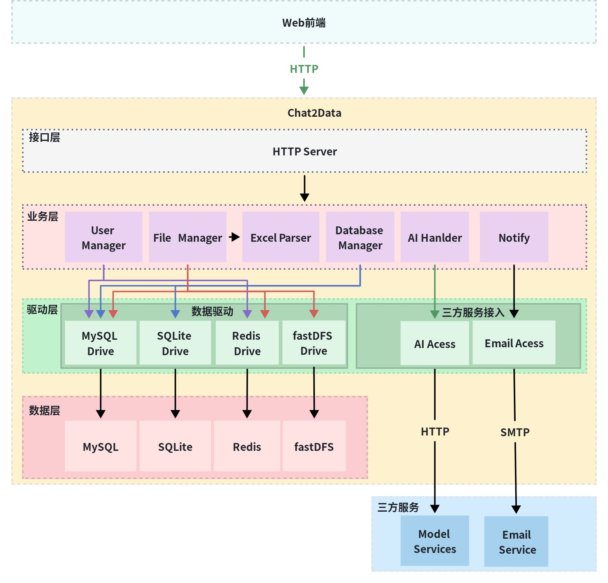
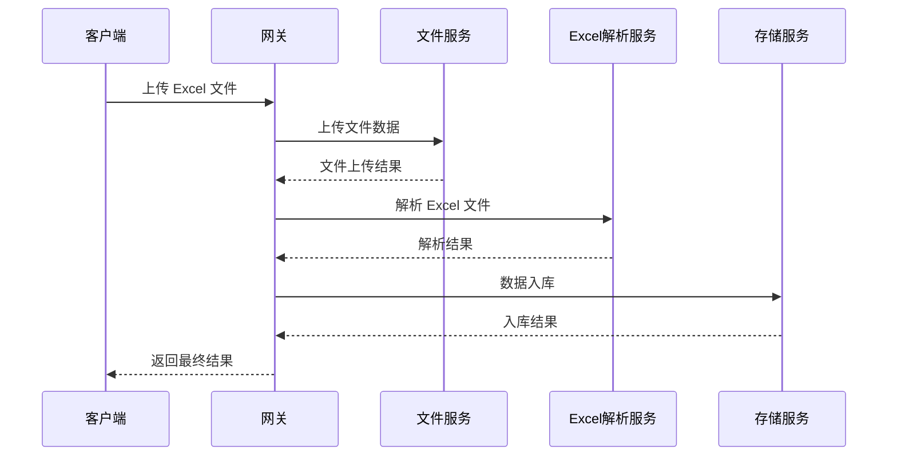
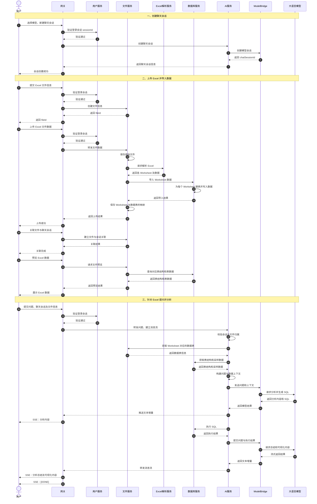
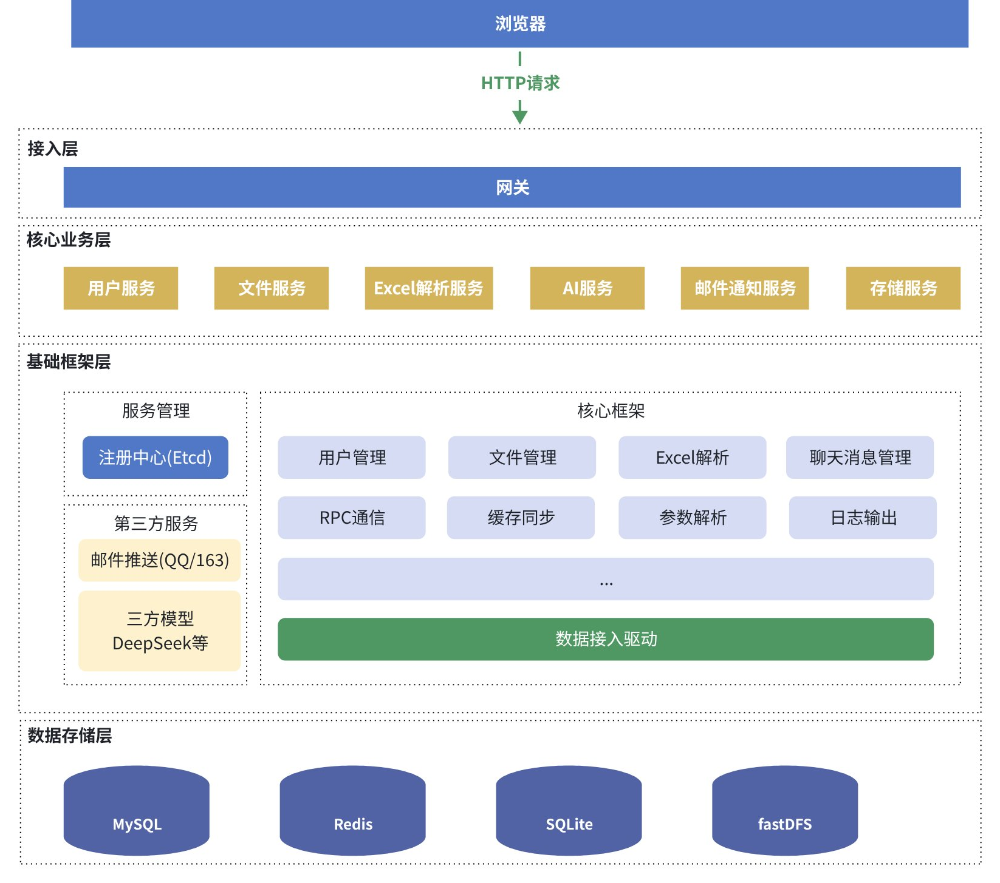
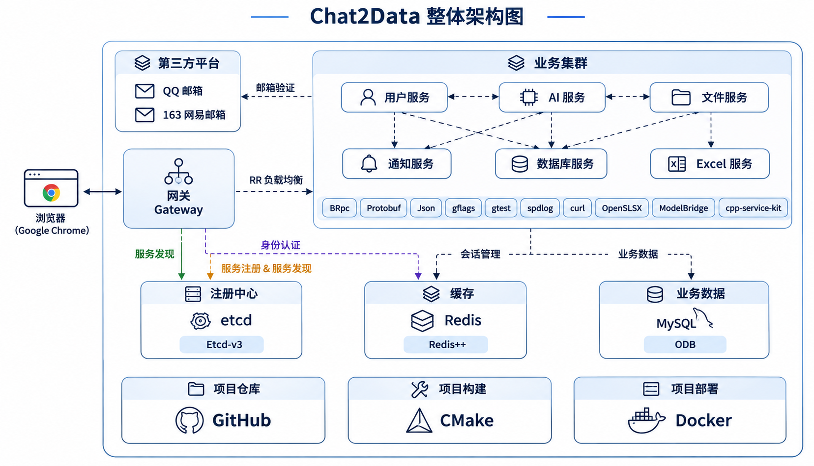

# 项目设计

## 1. 需求分析

对 Chat2Data 项目进行了的业务分析，总共梳理出 **29 个功能点加 1 个健康检测，共 30 个接口**。

### 1.1 接口清单

**用户相关（1～9）**

1. 检测用户昵称是否唯一
2. 检测邮箱是否唯一
3. 用户注册
4. 昵称密码登录
5. 邮箱登录
6. 会话登录
7. 获取验证码
8. 退出登录
9. 获取个人信息

**文件相关（10～18）**

10. 上传文件信息
11. 获取文件信息
12. 上传文件数据
13. 下载文件
14. 删除文件
15. 预览 Excel 表格
16. 获取文件列表信息
17. 关联文件和聊天会话
18. 上传 SQLite 文件

**模型聊天相关（19～24）**

19. 获取支持模型列表
20. 新建会话
21. 给模型发送消息
22. 获取会话列表
23. 获取历史会话
24. 删除会话

**数据存储相关（25～29）**

25. 建立数据库连接
26. 关闭数据库连接
27. 获取数据库表列表
28. 获取表数据
29. 获取连接状态

**系统检测（30）**

30. 健康检测

### 1.2 模块划分

接口 1～9 与用户相关，10～18 与文件相关，19～24 与模型聊天相关，25～29 与数据存储相关。因此，在设计时可以按职责划分为用户模块、文件模块、AI 模块和数据存储模块。

由于 Excel 上传后需要解析才能存入数据库；用户通过验证码登录时需要给邮箱发送验证码，模型总结结果也可能需要发送到用户邮箱。为了降低模块之间的耦合性，再拆分出 **Excel 解析模块** 和 **邮件通知模块**。

| 模块           | 主要职责                                     |
| -------------- | -------------------------------------------- |
| 用户模块       | 用户注册、登录、退出登录、获取用户个人信息等 |
| 文件模块       | 文件上传、下载、删除、预览等                 |
| Excel 解析模块 | Excel 文件解析                               |
| 数据存储模块   | 项目数据持久化存储及数据库操作               |
| AI 模块        | 与大模型交互、聊天会话管理等                 |
| 邮件通知模块   | 向用户邮箱发送邮件                           |

## 2. 架构设计

每个模块功能清晰之后，在实现前需要先设计好程序的架构，以便后续明确开发任务。

### 2.1 单体架构

为了让职责更清晰、耦合性更低，可以将系统划分为接口层、业务层、驱动层、数据层及第三方服务。

| 层次       | 职责                                                                                                                    |
| ---------- | ----------------------------------------------------------------------------------------------------------------------- |
| 接口层     | 接收和响应请求，**实现 30 个 HTTP 响应接口**                                                                      |
| 业务层     | 实现业务规则及逻辑处理。例如，用户注册时创建新用户、填充信息、持久化到数据库，然后将结果返回接口层进行网络通信          |
| 驱动层     | 封装底层组件访问，包括 **MySQL、SQLite、Redis、fastDFS** 等数据驱动，以及**模型和邮件**等第三方服务接入封装 |
| 存储层     | 存储**用户信息、文件信息、聊天消息**等业务数据                                                                    |
| 第三方服务 | 提供外部模型服务和邮件服务等能力                                                                                        |

**单体架构特点：** 所有功能模块打包在一个进程中。为了实现模块独立开发、独立编译、独立部署，进一步考虑微服务架构。

### 2.2 微服务介绍

微服务将一个大的业务拆分为多个子业务，分别在一台或多台机器节点上提供相应的服务。由网关服务统一接收客户端请求，然后把请求分发给相应的子服务节点处理，获得响应后，再转发给客户端。

微服务架构设计主要包括以下方面：

1. **服务拆分：** 将应用拆分为多个小型服务，每个服务负责一部分业务功能，具有独立的生命周期和部署能力。
2. **独立部署：** 每个微服务可以独立于其他服务部署、更新和扩展。
3. **语言和数据的多样性：** 不同服务可以根据需要使用不同的编程语言和数据库。
4. **轻量级通信：** 服务之间通过定义良好的 API 通信，通常使用 HTTP/REST、gRPC 等协议。
5. **去中心化治理：** 各服务可以拥有自己的开发团队、技术栈和开发流程。
6. **弹性和可扩展性：** 可根据负载动态扩展或收缩服务。
7. **容错性：** 通过断路器、重试机制等手段提高系统容错性。
8. **去中心化数据管理：** 各服务管理自己的数据库，数据在服务间保持私有，以保证服务独立性。
9. **自动化部署：** 使用 CI/CD 自动化构建、测试和部署。
10. **监控和日志：** 监控各服务并记录日志，用于跟踪问题和性能瓶颈。
11. **服务发现：** 动态查找可能发生变化的服务实例。
12. **安全：** 考虑认证、授权和数据传输安全。

### 2.3 子服务划分

#### 2.3.1 服务拆分与职责

Chat2Data 可拆分为 **6 个能够独立部署的微服务**：

| 微服务         | 主要职责                                              |
| -------------- | ----------------------------------------------------- |
| 用户服务       | 用户生命周期管理，包括注册、登录、信息查询等          |
| 文件服务       | 文件存储、检索和元数据管理，提供上传、下载等接口      |
| Excel 解析服务 | 解析 Excel 文件，获取 Worksheet，解析 Worksheet 数据  |
| AI 服务        | 与大模型交互，创建聊天会话、获取模型列表、发送消息等  |
| 通知服务       | 发送邮件、短信等通知，如验证码、模型聊天结果总结      |
| 存储服务       | 提供统一数据访问，管理数据库连接、表结构和 SQL 执行等 |

不同子服务可以部署在一台或多台机器上，等待并处理客户端请求。

#### 2.3.2 存在问题

如果客户端直接调用各微服务，将面临以下问题：

1. **客户端复杂性高：** 客户端需要维护所有服务的部署地址；例如服务分布在 100 台机器上时，需要维护大量服务端点，增加配置与版本管理成本。
2. **横切关注点复杂：** 各服务分别实现鉴权、限流、日志等公共功能，造成代码冗余与维护成本增加。
3. **协议适配困难：** 如果需要 WebSocket 等实时协议，例如服务端向客户端实时推送数据，则各相关服务均需实现相应的协议处理逻辑。
4. **业务流程碎片化：** 以“上传 Excel 并入库”为例，客户端必须串联三次调用：
   - 客户端 → 文件服务：上传文件。
   - 客户端 → Excel 解析服务：解析 Excel 文件。
   - 客户端 → 存储服务：将 Excel 数据入库。

这使客户端实现复杂，也暴露了内部服务间的依赖关系。

#### 2.3.3 引入网关服务

在已有的 6 个微服务基础上，再设计一个**网关服务**。客户端不再直接与各子服务交互，而是将所有请求统一发送给网关。网关完成鉴权后，把请求转发给能够处理该请求的子服务。至于服务内部如何处理，客户端与网关都无需关心其具体业务实现。**以“上传 Excel 文件”为例，客户端只需向网关发起一次调用，由网关协调文件服务、Excel 解析服务与存储服务，最后返回结果。**

**网关职责**

| 职责         | 说明                                              |
| ------------ | ------------------------------------------------- |
| 单一访问点   | 客户端只需与网关通信，后端服务对客户端透明        |
| 统一安全控制 | 集中处理鉴权、认证等安全逻辑                      |
| 协议转换     | 对外提供 HTTP/WebSocket 等协议，对内统一 RPC 交互 |
| 流量管理     | 实现负载均衡、熔断降级、限流等                    |
| 智能路由     | 通过服务发现，把请求路由到对应服务处理            |

服务端最终设计为 **7 个服务：1 个网关服务 + 6 个业务微服务**。各服务能够独立开发、部署和扩展，提高系统容错性与可扩展性。

### 2.3.4 详细流程图

### 2.4 项目框架图

#### 2.4.1 系统架构图

- **浏览器：** 通过 HTTP 请求访问网关。
- **接入层：** 网关负责统一接入。
- **核心业务层：** 用户服务、文件服务、Excel 解析服务、AI 服务、邮件通知服务、存储服务。
- **基础框架层：** 服务管理（注册中心 Etcd）、核心框架（用户管理、文件管理、Excel 解析、聊天消息管理、RPC 通信、缓存同步、参数解析、日志输出等）、第三方服务（邮件推送、模型接入等）及数据接入驱动。
- **数据存储层：** MySQL、Redis、SQLite、FastDFS。

#### 2.4.2 技术架构图

**技术架构说明**

1. 用户通过浏览器向服务端发送请求，服务端处理后将结果返回给浏览器渲染。
2. 服务端采用微服务架构处理请求：
   - 各子服务启动时，将自身能够提供的服务注册到注册中心。网关启动后通过服务发现，确定哪些主机能够提供哪些服务。
   - 客户端请求由网关接收。网关先执行权限检测，鉴权成功后将请求路由给能够处理该请求的子服务。
   - 由具体子服务处理请求，再将结果返回网关，由网关返回浏览器渲染。
3. 服务端共划分为 7 个子服务：
   - **网关子服务：** 对客户端（浏览器）请求进行权限检测，并实现客户端与业务子服务之间的通信。
   - **用户子服务：** 注册、登录、用户信息获取等。
   - **文件子服务：** 上传、下载、删除、文件列表获取、文件预览、文件存储管理等。
   - **Excel 子服务：** Excel 文件解析。
   - **AI 子服务：** 模型交互、聊天会话与聊天消息管理。
   - **邮件通知子服务：** 验证码和普通邮件发送等。
   - **数据库子服务：** 用户信息、聊天信息、Excel 数据等存储管理。
4. 后端常用组件使用脚手架完成，模型交互使用封装的 ModelBridge 完成，Excel 解析使用 OpenXLSX 库完成。

技术架构图中还包含第三方平台（如邮件服务、模型服务）、**Etcd 注册中心、Redis 缓存、MySQL/ODB 业务数据层**，以及 Gitee、CMake 和 Docker 等项目仓库、构建与部署工具。

## 3. 技术选型

### 3.1 中间件及第三方库

| 序号 |                                   中间件 / 第三方库                                   | 用途或说明                                                                                                                                                                                                                                 |
| :--: | :-----------------------------------------------------------------------------------: | :----------------------------------------------------------------------------------------------------------------------------------------------------------------------------------------------------------------------------------------- |
|  1  |     [ModelBridge](https://github.com/Dairenwen/ModelBridge?utm_source=chatgpt.com)     | 基于 C++17 开发的多模型统一接入 SDK，通过统一的 LLMProvider 接口封装不同大模型的访问逻辑，支持 DeepSeek、OpenAI、Gemini 等云端模型及 Ollama 本地模型，提供模型配置、工具调用、多轮对话、会话管理、流式响应和 SQLite 历史记录持久化等功能。 |
|  2  | [cpp-service-kit](https://github.com/Dairenwen/cpp-service-kit?utm_source=chatgpt.com) | 基于 C++17 的模块化服务端开发工具库（BreezeKit），对 brpc、Etcd、RabbitMQ、FastDFS、Redis、MySQL/ODB、Elasticsearch、FFmpeg 等组件进行封装，同时提供日志、JSON 处理、邮件通知及通用工具模块，支持通过 CMake 按需集成。                     |
|  3  |                                       OpenXLSX                                       | 零依赖、跨平台、纯 C++17 的 Excel 2007+（`*.xlsx`）文件读写库。                                                                                                                                                                          |
|  4  |                                         Etcd                                         | 实现注册中心。                                                                                                                                                                                                                             |
|  5  |                                         MySQL                                         | 数据持久化存储与管理。                                                                                                                                                                                                                     |
|  6  |                                         Redis                                         | 系统缓存管理。                                                                                                                                                                                                                             |
|  7  |                                          ODB                                          | 开源 C++ 对象关系映射（ORM）框架。                                                                                                                                                                                                         |
|  8  |                                         brpc                                         | 工业级 RPC 框架，常用于搜索、存储、机器学习、广告、推荐等高性能系统。                                                                                                                                                                      |
|  9  |                                        FastDFS                                        | 轻量级分布式文件系统，用于文件存储、同步、上传和下载。                                                                                                                                                                                     |
|  10  |                                        JsonCpp                                        | 高性能 JSON 库，用于序列化与反序列化。                                                                                                                                                                                                     |
|  11  |                                       protobuf                                       | 跨语言、跨平台、紧凑的二进制序列化协议。                                                                                                                                                                                                   |
|  12  |                                        gflags                                        | 命令行参数的声明、定义和解析。                                                                                                                                                                                                             |
|  13  |                                         gtest                                         | 跨平台 C++ 单元测试框架。                                                                                                                                                                                                                  |
|  14  |                                        spdlog                                        | 高性能、快速、零配置的 C++ 日志库。                                                                                                                                                                                                        |
|  15  |                                        libcurl                                        | 高性能、多协议网络通信客户端库。                                                                                                                                                                                                           |
|  16  |                                        redis++                                        | Redis 中间件对应的客户端 SDK。                                                                                                                                                                                                             |
|  17  |                                    QQ/163 邮件推送                                    | 用于获取验证码和发送可视化结果邮件通知。                                                                                                                                                                                                   |

### 3.2 使用工具

| 类别     | 工具                                  |
| -------- | ------------------------------------- |
| 编辑器   | vim、Trae、VS Code                    |
| 辅助工具 | Codex、Claude code、Copliot、DeepSeek |
| 编译器   | gcc / g++                             |
| 调试器   | gdb                                   |
| 插件     | clangd、CMake Tools、Office Viewer    |
| 项目构建 | CMake、make                           |
| 项目部署 | Docker、Docker Compose                |
